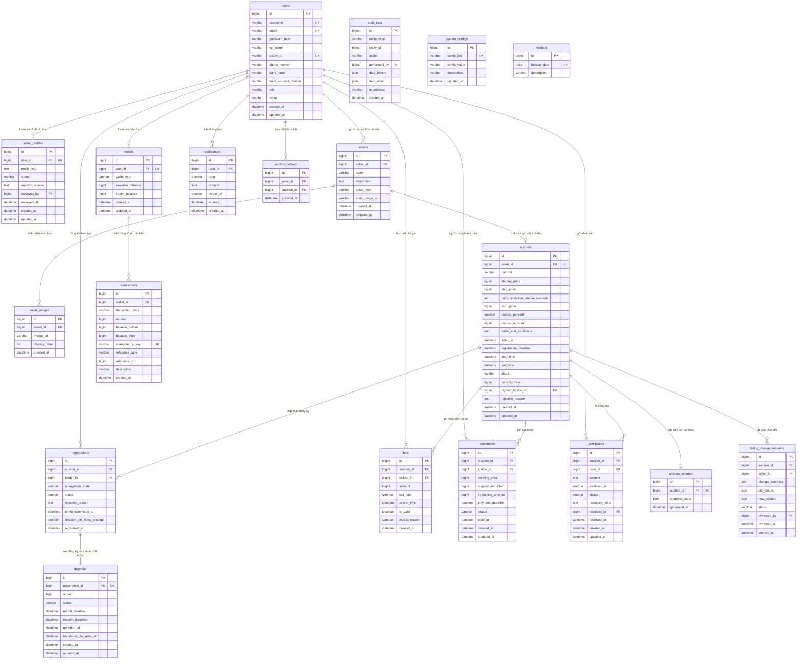

# 📐 TÀI LIỆU THIẾT KẾ CƠ SỞ DỮ LIỆU (ERD)

> **Dự án:** Hệ Thống Đấu Giá Trực Tuyến (Online Auction System)  
> **Căn cứ:** docs/SRS.md (Mục 5, Mục 7, Mục 8) và docs/PLAN.md (Ngày 1)

---

## 1. QUY ƯỚC THIẾT KẾ (DATABASE CONVENTIONS)

1. **Đặt tên bảng & cột:**
   - Tên bảng: `snake_case` số nhiều (`users`, `auctions`, `wallets`,...).
   - Tránh từ khóa bảo lưu SQL (dùng `users` thay vì `user`).
   - Khóa chính luôn là `id BIGINT AUTO_INCREMENT PRIMARY KEY`.
   - Khóa ngoại có dạng `<tên_thực_thể_số_ít>_id` (ví dụ: `auction_id`, `bidder_id`).
2. **Kiểu dữ liệu tiền tệ:**
   - Sử dụng `BIGINT` đơn vị Việt Nam Đồng (VND), không dùng số thực để tránh lỗi sai số dấu phẩy động.
   - Có ràng buộc `CHECK (amount >= 0)` và số dư ví không bao giờ âm.
3. **Kiểu dữ liệu thời gian:**
   - Sử dụng `DATETIME(3)` (độ chính xác mili-giây) theo một múi giờ chuẩn duy nhất: `Asia/Ho_Chi_Minh`.
4. **Trạng thái (Enum):**
   - Lưu dạng `VARCHAR` chứa tên mã Enum bằng tiếng Anh (ví dụ: `PENDING_APPROVAL`, `IN_PROGRESS`, `COMPLETED`).
5. **Tính bất biến & Toàn vẹn:**
   - Các bảng ghi nhận dòng tiền và lịch sử đấu giá (`transactions`, `bids`, `audit_logs`) là bảng **Chỉ ghi thêm (Append-only)**, không cập nhật hoặc xóa.
   - Mỗi người dùng chỉ có tối đa một ví (`UNIQUE(user_id)`).
   - Mỗi người dùng chỉ đăng ký một lần cho mỗi phiên (`UNIQUE(auction_id, bidder_id)`).
   - Mã ẩn danh duy nhất trong mỗi phiên (`UNIQUE(auction_id, anonymous_code)`).

---

## 2. SƠ ĐỒ THỰC THỂ LIÊN KẾT (MERMAID ER DIAGRAM)

---

## 3. CHI TIẾT CÁC BẢNG CỐT LÕI (14 THỰC THỂ SRS MỤC 7)

### 3.1. `users` (Tài khoản người dùng)
| Tên cột | Kiểu dữ liệu | Ràng buộc | Diễn giải |
| :--- | :--- | :--- | :--- |
| `id` | BIGINT | PK, AUTO_INCREMENT | Mã định danh người dùng |
| `username` | VARCHAR(50) | NOT NULL, UNIQUE | Tên đăng nhập |
| `email` | VARCHAR(100) | NOT NULL, UNIQUE | Địa chỉ email |
| `password_hash` | VARCHAR(255) | NOT NULL | Mật khẩu băm (BCrypt) |
| `full_name` | VARCHAR(100) | NOT NULL | Họ và tên thật |
| `citizen_id` | VARCHAR(20) | UNIQUE, NULLABLE | Số CCCD/Định danh cá nhân |
| `phone_number` | VARCHAR(20) | NULLABLE | Số điện thoại liên hệ |
| `bank_name` | VARCHAR(100) | NULLABLE | Tên ngân hàng thụ hưởng |
| `bank_account_number` | VARCHAR(50) | NULLABLE | Số tài khoản ngân hàng |
| `role` | VARCHAR(20) | NOT NULL, DEFAULT 'USER' | Vai trò hệ thống: `USER`, `ADMIN` |
| `status` | VARCHAR(20) | NOT NULL, DEFAULT 'ACTIVE' | Trạng thái: `ACTIVE`, `LOCKED` |
| `created_at` | DATETIME(3) | NOT NULL | Thời điểm tạo tài khoản |
| `updated_at` | DATETIME(3) | NOT NULL | Thời điểm cập nhật cuối |

### 3.2. `seller_profiles` (Hồ sơ người bán)
| Tên cột | Kiểu dữ liệu | Ràng buộc | Diễn giải |
| :--- | :--- | :--- | :--- |
| `id` | BIGINT | PK, AUTO_INCREMENT | Mã hồ sơ người bán |
| `user_id` | BIGINT | NOT NULL, UNIQUE, FK(users) | Khóa ngoại người dùng (1-1) |
| `profile_info` | TEXT | NULLABLE | Thông tin giới thiệu / hồ sơ năng lực |
| `status` | VARCHAR(30) | NOT NULL, DEFAULT 'PENDING' | `PENDING`, `APPROVED`, `REJECTED` |
| `rejected_reason` | TEXT | NULLABLE | Lý do Admin từ chối hồ sơ |
| `reviewed_by` | BIGINT | NULLABLE, FK(users) | Admin thẩm định và duyệt |
| `reviewed_at` | DATETIME(3) | NULLABLE | Thời điểm xét duyệt |
| `created_at` | DATETIME(3) | NOT NULL | Thời điểm gửi hồ sơ |
| `updated_at` | DATETIME(3) | NOT NULL | Thời điểm cập nhật |

### 3.3. `assets` (Tài sản đấu giá)
| Tên cột | Kiểu dữ liệu | Ràng buộc | Diễn giải |
| :--- | :--- | :--- | :--- |
| `id` | BIGINT | PK, AUTO_INCREMENT | Mã tài sản |
| `seller_id` | BIGINT | NOT NULL, FK(users) | Người sở hữu tài sản (Seller) |
| `name` | VARCHAR(255) | NOT NULL | Tên tài sản |
| `description` | TEXT | NULLABLE | Mô tả chi tiết, hiện trạng, xuất xứ |
| `asset_type` | VARCHAR(30) | NOT NULL | `MOVABLE` (Động sản), `IMMOVABLE` (Bất động sản) |
| `main_image_url` | VARCHAR(500) | NULLABLE | Ảnh đại diện chính của tài sản |
| `created_at` | DATETIME(3) | NOT NULL | Thời điểm đăng tài sản |
| `updated_at` | DATETIME(3) | NOT NULL | Thời điểm cập nhật |

### 3.4. `auctions` (Phiên đấu giá)
| Tên cột | Kiểu dữ liệu | Ràng buộc | Diễn giải |
| :--- | :--- | :--- | :--- |
| `id` | BIGINT | PK, AUTO_INCREMENT | Mã phiên đấu giá |
| `asset_id` | BIGINT | NOT NULL, UNIQUE, FK(assets) | Tài sản gắn với phiên (1-1) |
| `method` | VARCHAR(30) | NOT NULL | `ASCENDING` (Tăng dần), `DESCENDING` (Giảm dần) |
| `starting_price` | BIGINT | NOT NULL, CHECK >= 0 | Giá khởi điểm (VND) |
| `step_price` | BIGINT | NULLABLE, CHECK > 0 | Bước giá (tăng dần) hoặc bước giảm (giảm dần) |
| `price_reduction_interval_seconds` | INT | NULLABLE | Khoảng thời gian giữa các lần giảm (giảm dần) |
| `floor_price` | BIGINT | NULLABLE | Giá sàn tối thiểu (giảm dần, < starting_price) |
| `deposit_percent` | DECIMAL(5,2) | NOT NULL, CHECK 5-20 | Tỷ lệ đặt trước (5.00% – 20.00%) |
| `deposit_amount` | BIGINT | NOT NULL, CHECK > 0 | Số tiền đặt trước quy ra VND |
| `terms_and_conditions` | TEXT | NULLABLE | Quy chế phiên đấu giá |
| `listing_at` | DATETIME(3) | NULLABLE | Thời điểm chính thức niêm yết công khai |
| `registration_deadline` | DATETIME(3) | NULLABLE | Hạn nộp hồ sơ & đặt trước (trước mở phiên 2 ngày làm việc) |
| `start_time` | DATETIME(3) | NOT NULL | Thời điểm bắt đầu mở phiên |
| `end_time` | DATETIME(3) | NOT NULL | Thời điểm kết thúc phiên |
| `status` | VARCHAR(30) | NOT NULL | `PENDING_APPROVAL`, `REJECTED`, `LISTED`, `WAITING_FOR_OPENING`, `IN_PROGRESS`, `WAITING_FOR_PAYMENT`, `COMPLETED`, `FAILED`, `CANCELED` |
| `current_price` | BIGINT | NULLABLE | Giá hiện hành cao nhất (hoặc giá đã giảm) |
| `highest_bidder_id`| BIGINT | NULLABLE, FK(users) | Người đang dẫn đầu (hoặc người trúng) |
| `rejection_reason` | TEXT | NULLABLE | Lý do Admin từ chối duyệt phiên |
| `created_at` | DATETIME(3) | NOT NULL | Thời điểm tạo phiên |
| `updated_at` | DATETIME(3) | NOT NULL | Thời điểm cập nhật |

### 3.5. `registrations` (Đăng ký tham gia đấu giá)
| Tên cột | Kiểu dữ liệu | Ràng buộc | Diễn giải |
| :--- | :--- | :--- | :--- |
| `id` | BIGINT | PK, AUTO_INCREMENT | Mã đăng ký |
| `auction_id` | BIGINT | NOT NULL, FK(auctions) | Phiên đấu giá |
| `bidder_id` | BIGINT | NOT NULL, FK(users) | Đấu giá viên đăng ký |
| `anonymous_code` | VARCHAR(20) | NOT NULL | Mã ẩn danh duy nhất trong phiên (dãy 6 số ngẫu nhiên) |
| `status` | VARCHAR(30) | NOT NULL | `PENDING_APPROVAL`, `APPROVED`, `REJECTED`, `REJECTED_BY_CHANGE` |
| `rejection_reason` | TEXT | NULLABLE | Lý do loại hồ sơ |
| `terms_committed_at`| DATETIME(3) | NOT NULL | Thời điểm cam kết không thuộc diện cấm |
| `decision_on_listing_change` | VARCHAR(20) | DEFAULT 'CONTINUE' | `CONTINUE`, `DECLINE` (khi niêm yết thay đổi) |
| `registered_at` | DATETIME(3) | NOT NULL | Thời điểm gửi đăng ký |
| *Ràng buộc:* | `UNIQUE(auction_id, bidder_id)` | Mỗi người chỉ đăng ký 1 lần/phiên |
| *Ràng buộc:* | `UNIQUE(auction_id, anonymous_code)` | Mã ẩn danh duy nhất trong mỗi phiên |

### 3.6. `deposits` (Tiền đặt trước)
| Tên cột | Kiểu dữ liệu | Ràng buộc | Diễn giải |
| :--- | :--- | :--- | :--- |
| `id` | BIGINT | PK, AUTO_INCREMENT | Mã khoản đặt trước |
| `registration_id` | BIGINT | NOT NULL, UNIQUE, FK(registrations) | Gắn liền với 1 lượt đăng ký |
| `amount` | BIGINT | NOT NULL, CHECK > 0 | Số tiền đặt trước (VND) |
| `status` | VARCHAR(30) | NOT NULL | `HELD` (Phong tỏa), `REFUNDED` (Đã hoàn), `CONVERTED_TO_SELLER_DEPOSIT` (Chuyển thành cọc), `FORFEITED` (Bị giữ), `TRANSFERRED_TO_SELLER` (Đã chuyển cho Seller) |
| `refund_deadline` | DATETIME(3) | NULLABLE | Hạn hoàn cọc (3 ngày làm việc sau phiên) |
| `transfer_deadline` | DATETIME(3) | NULLABLE | Hạn chuyển tiền cho Seller |
| `refunded_at` | DATETIME(3) | NULLABLE | Thời điểm hoàn tiền thành công |
| `transferred_to_seller_at` | DATETIME(3) | NULLABLE | Thời điểm chuyển tiền cho Seller |
| `created_at` | DATETIME(3) | NOT NULL | Thời điểm phong tỏa |
| `updated_at` | DATETIME(3) | NOT NULL | Thời điểm cập nhật |

### 3.7. `bids` (Lượt trả giá / Chấp nhận giá – Bất biến)
| Tên cột | Kiểu dữ liệu | Ràng buộc | Diễn giải |
| :--- | :--- | :--- | :--- |
| `id` | BIGINT | PK, AUTO_INCREMENT | Mã lượt trả giá |
| `auction_id` | BIGINT | NOT NULL, FK(auctions) | Phiên đấu giá |
| `bidder_id` | BIGINT | NOT NULL, FK(users) | Người trả giá / chấp nhận giá |
| `amount` | BIGINT | NOT NULL, CHECK > 0 | Mức giá đưa ra (VND) |
| `bid_type` | VARCHAR(20) | NOT NULL | `INCREMENT` (Trả giá lên), `ACCEPT` (Chấp nhận giá xuống) |
| `server_time` | DATETIME(3) | NOT NULL | Giờ server ghi nhận (chuẩn xét thứ tự) |
| `is_valid` | BOOLEAN | NOT NULL, DEFAULT TRUE | Hợp lệ hay bị từ chối |
| `invalid_reason` | VARCHAR(255) | NULLABLE | Lý do từ chối (bước giá thấp, đến sau,...) |
| `created_at` | DATETIME(3) | NOT NULL | Thời điểm lưu bản ghi |

### 3.8. `settlements` (Thanh toán của người trúng)
| Tên cột | Kiểu dữ liệu | Ràng buộc | Diễn giải |
| :--- | :--- | :--- | :--- |
| `id` | BIGINT | PK, AUTO_INCREMENT | Mã bản thanh toán trúng đấu giá |
| `auction_id` | BIGINT | NOT NULL, FK(auctions) | Phiên đấu giá |
| `bidder_id` | BIGINT | NOT NULL, FK(users) | Người trúng đấu giá |
| `winning_price` | BIGINT | NOT NULL | Mức giá trúng chính thức |
| `deposit_deducted` | BIGINT | NOT NULL | Số tiền đặt trước khấu trừ thành cọc |
| `remaining_amount` | BIGINT | NOT NULL | Phần tiền còn phải trả (`winning_price - deposit_deducted`) |
| `payment_deadline` | DATETIME(3) | NOT NULL | Hạn thanh toán (mặc định 15 phút) |
| `status` | VARCHAR(30) | NOT NULL | `WAITING_FOR_PAYMENT`, `PAID`, `CANCELED`, `OVERDUE` |
| `paid_at` | DATETIME(3) | NULLABLE | Thời điểm thanh toán đủ |
| `created_at` | DATETIME(3) | NOT NULL | Thời điểm công bố người trúng |
| `updated_at` | DATETIME(3) | NOT NULL | Thời điểm cập nhật |

### 3.9. `wallets` (Ví tiền)
| Tên cột | Kiểu dữ liệu | Ràng buộc | Diễn giải |
| :--- | :--- | :--- | :--- |
| `id` | BIGINT | PK, AUTO_INCREMENT | Mã ví |
| `user_id` | BIGINT | NULLABLE, UNIQUE, FK(users) | Khóa ngoại User (NULL nếu là ví hệ thống) |
| `wallet_type` | VARCHAR(20) | NOT NULL | `USER` (Ví người dùng), `SYSTEM_ESCROW` (Ví ký quỹ hệ thống), `SYSTEM_REVENUE` (Ví doanh thu phí) |
| `available_balance` | BIGINT | NOT NULL, DEFAULT 0, CHECK >= 0 | Số dư khả dụng |
| `frozen_balance` | BIGINT | NOT NULL, DEFAULT 0, CHECK >= 0 | Số dư đang phong tỏa |
| `created_at` | DATETIME(3) | NOT NULL | Thời điểm tạo ví |
| `updated_at` | DATETIME(3) | NOT NULL | Thời điểm cập nhật |

### 3.10. `transactions` (Lịch sử giao dịch tiền – Bất biến)
| Tên cột | Kiểu dữ liệu | Ràng buộc | Diễn giải |
| :--- | :--- | :--- | :--- |
| `id` | BIGINT | PK, AUTO_INCREMENT | Mã giao dịch tiền |
| `wallet_id` | BIGINT | NOT NULL, FK(wallets) | Ví thực hiện giao dịch |
| `transaction_type` | VARCHAR(30) | NOT NULL | `TOPUP`, `WITHDRAW`, `FREEZE`, `UNFREEZE`, `CONVERT_DEPOSIT`, `PAYMENT`, `SERVICE_FEE`, `PAYOUT_TO_SELLER` |
| `amount` | BIGINT | NOT NULL | Số tiền giao dịch |
| `balance_before` | BIGINT | NOT NULL | Số dư khả dụng trước giao dịch |
| `balance_after` | BIGINT | NOT NULL | Số dư khả dụng sau giao dịch |
| `idempotency_key` | VARCHAR(100) | NOT NULL, UNIQUE | Khóa chống lặp giao dịch (Idempotent) |
| `reference_type` | VARCHAR(50) | NULLABLE | Loại liên kết (`DEPOSIT`, `SETTLEMENT`,...) |
| `reference_id` | BIGINT | NULLABLE | ID của bản ghi liên kết |
| `description` | VARCHAR(255) | NULLABLE | Mô tả chi tiết giao dịch |
| `created_at` | DATETIME(3) | NOT NULL | Thời điểm giao dịch |

### 3.11. `notifications` (Thông báo trong ứng dụng)
| Tên cột | Kiểu dữ liệu | Ràng buộc | Diễn giải |
| :--- | :--- | :--- | :--- |
| `id` | BIGINT | PK, AUTO_INCREMENT | Mã thông báo |
| `user_id` | BIGINT | NOT NULL, FK(users) | Người nhận thông báo |
| `type` | VARCHAR(50) | NOT NULL | Mã loại thông báo (`WINNER`, `PAYMENT_REMINDER`,...) |
| `content` | TEXT | NOT NULL | Nội dung chi tiết thông báo |
| `target_url` | VARCHAR(255) | NULLABLE | Đường dẫn điều hướng khi nhấp |
| `is_read` | BOOLEAN | NOT NULL, DEFAULT FALSE | Đã đọc hay chưa |
| `created_at` | DATETIME(3) | NOT NULL | Thời điểm phát thông báo |

### 3.12. `audit_logs` (Nhật ký kiểm toán – Bất biến)
| Tên cột | Kiểu dữ liệu | Ràng buộc | Diễn giải |
| :--- | :--- | :--- | :--- |
| `id` | BIGINT | PK, AUTO_INCREMENT | Mã nhật ký |
| `entity_type` | VARCHAR(50) | NOT NULL | Tên thực thể thao tác (`AUCTION`, `BID`, `WALLET`,...) |
| `entity_id` | BIGINT | NULLABLE | Khóa của thực thể |
| `action` | VARCHAR(50) | NOT NULL | Hành động (`CREATE`, `UPDATE_STATUS`, `BID_SUBMIT`,...) |
| `performed_by` | BIGINT | NULLABLE, FK(users) | Người thực hiện (hoặc NULL nếu hệ thống tự chạy) |
| `data_before` | JSON | NULLABLE | Bản chụp dữ liệu trước thay đổi |
| `data_after` | JSON | NULLABLE | Bản chụp dữ liệu sau thay đổi |
| `ip_address` | VARCHAR(45) | NULLABLE | Địa chỉ IP người thực hiện |
| `created_at` | DATETIME(3) | NOT NULL | Thời điểm ghi log |

### 3.13. `complaints` (Khiếu nại)
| Tên cột | Kiểu dữ liệu | Ràng buộc | Diễn giải |
| :--- | :--- | :--- | :--- |
| `id` | BIGINT | PK, AUTO_INCREMENT | Mã khiếu nại |
| `auction_id` | BIGINT | NOT NULL, FK(auctions) | Phiên đấu giá phát sinh khiếu nại |
| `user_id` | BIGINT | NOT NULL, FK(users) | Người khiếu nại (Bidder hợp lệ hoặc Seller) |
| `content` | TEXT | NOT NULL | Chi tiết lý do khiếu nại |
| `evidence_url` | VARCHAR(500) | NULLABLE | Đường dẫn tệp/ảnh bằng chứng |
| `status` | VARCHAR(30) | NOT NULL, DEFAULT 'NEW' | `NEW`, `PROCESSING`, `RESOLVED`, `REJECTED` |
| `resolution_note` | TEXT | NULLABLE | Kết luận xử lý của Admin |
| `resolved_by` | BIGINT | NULLABLE, FK(users) | Admin thụ lý giải quyết |
| `resolved_at` | DATETIME(3) | NULLABLE | Thời điểm giải quyết xong |
| `created_at` | DATETIME(3) | NOT NULL | Thời điểm gửi khiếu nại |
| `updated_at` | DATETIME(3) | NOT NULL | Thời điểm cập nhật |

### 3.14. `system_configs` (Cấu hình hệ thống)
| Tên cột | Kiểu dữ liệu | Ràng buộc | Diễn giải |
| :--- | :--- | :--- | :--- |
| `id` | BIGINT | PK, AUTO_INCREMENT | Mã cấu hình |
| `config_key` | VARCHAR(100) | NOT NULL, UNIQUE | Khóa cấu hình (`SERVICE_FEE_PERCENT`, `DEFAULT_PAYMENT_TIMEOUT_MINUTES`,...) |
| `config_value` | VARCHAR(255) | NOT NULL | Giá trị thiết lập |
| `description` | VARCHAR(255) | NULLABLE | Mô tả mục đích tham số |
| `updated_at` | DATETIME(3) | NOT NULL | Thời điểm cập nhật |

---

## 4. DANH SÁCH BẢNG NGOÀI SRS (ĐÃ BỔ SUNG & CẦN DUYỆT)

Để đáp ứng trọn vẹn nghiệp vụ thực tế và các yêu cầu trong PLAN, hệ thống bổ sung thêm 4 bảng hỗ trợ:

1. **`holidays` (Ngày nghỉ lễ):**
   - Lưu trữ các ngày nghỉ lễ theo lịch nhà nước.
   - Phục vụ module `system` (BusinessCalendar) tính toán chính xác số ngày làm việc (7 ngày làm việc động sản, 2 ngày nộp tiền đặt trước, 3 ngày hoàn tiền).
2. **`asset_images` (Thư viện hình ảnh tài sản):**
   - Cho phép một tài sản có nhiều hình ảnh thẩm định chi tiết với thứ tự hiển thị `display_order`.
3. **`auction_follows` (Theo dõi phiên đấu giá – FR-US-04):**
   - Lưu trữ danh sách các phiên đấu giá yêu thích mà User đang quan tâm theo dõi.
4. **`auction_minutes` (Biên bản điện tử – BR-32):**
   - Tự động sinh khi phiên Hoàn tất hoặc Không thành. Lưu trữ bản chụp dữ liệu (JSON) kết quả toàn bộ phiên đấu giá có chữ ký điện tử/thời gian server.
5. **`listing_change_requests` (Yêu cầu thay đổi niêm yết – UC-07):**
   - Lưu trữ đề xuất thay đổi thông số niêm yết của Seller (giá, phương thức, thời gian) kèm bản chụp `old_values` và `new_values` để Admin duyệt và Bidder phản hồi.
