# TÀI LIỆU THIẾT KẾ CƠ SỞ DỮ LIỆU (ERD) — HỆ THỐNG ĐẤU GIÁ TỰ ĐỘNG

> **Dự án:** Hệ Thống Đấu Giá Trực Tuyến (Online Auction System)  
> **Căn cứ:** `docs/PLAN.md` (Ngày 1) và `docs/SRS.md`  
> **Định hướng:** Tập trung duy nhất vào cơ chế đấu giá thương mại trực tuyến (Listing, Proxy Bidding, Reserve Price, Buy It Now, Relist, Order sau khi thắng).

---

## 1. NGUYÊN TẮC THIẾT KẾ CỐT LÕI (DATABASE CONVENTIONS)

1. **Quy ước đặt tên (Naming Conventions):**
   * Tên bảng dùng `snake_case` số nhiều (`users`, `categories`, `items`, `auctions`, `orders`,...). Tránh từ khóa SQL (dùng `users` thay vì `user`).
   * Khóa chính chuẩn hóa: `id BIGINT AUTO_INCREMENT PRIMARY KEY`.
   * Khóa ngoại theo định dạng: `<tên_thực_thể_số_ít>_id` (ví dụ: `seller_id`, `category_id`, `auction_id`, `buyer_id`).
2. **Tiền tệ chính xác tuyệt đối (Financial Precision):**
   * Sử dụng kiểu `BIGINT` đơn vị đồng (VNĐ). Tuyệt đối không dùng số thực (`FLOAT`/`DOUBLE`) để tránh sai số dấu phẩy động.
   * Ràng buộc: `CHECK (amount >= 0)` trên các cột giá và số dư ví `available_balance >= 0`.
3. **Độ chính xác thời gian mili-giây (Timestamp Precision):**
   * Sử dụng `DATETIME(3)` theo múi giờ chuẩn duy nhất `Asia/Ho_Chi_Minh`. Giúp phân định thứ tự đặt giá công bằng ở các mili-giây cuối phiên.
4. **Trạng thái & Phân loại (Enums):**
   * Lưu dạng `VARCHAR` chứa mã Enum tiếng Anh (ví dụ: `ACTIVE`, `ENDED_SOLD`, `ENDED_UNSOLD`, `AWAITING_PAYMENT`, `PAID`).
5. **Tính bất biến (Append-only Auditability):**
   * Các bảng ghi nhận dòng tiền và lịch sử đấu giá (`transactions`, `bids`, `audit_logs`) là bảng **Chỉ ghi thêm (Append-only)**, không bao giờ `UPDATE` hay `DELETE`.
6. **Bảo mật giá trần tự động (Proxy Bidding Privacy):**
   * Cột `max_amount` trong bảng `proxy_bids` là giá trần bí mật tối đa của bidder, chỉ lưu và xử lý ở phía server, không trả ra API công khai cho người khác.

---

## 2. SƠ ĐỒ THỰC THỂ LIÊN KẾT (MERMAID ER DIAGRAM)

```mermaid
erDiagram
    users ||--o{ items : "đăng bán"
    users ||--o{ proxy_bids : "cài đặt giá trần"
    users ||--o{ bids : "lịch sử bước giá"
    users ||--o{ orders : "mua / bán"
    users ||--o| wallets : "sở hữu ví"
    users ||--o{ notifications : "nhận thông báo"
    users ||--o{ reviews : "đánh giá uy tín"

    categories ||--o{ categories : "danh mục cha - con"
    categories ||--o{ items : "phân loại"
    items ||--o{ item_images : "album ảnh"
    items ||--o{ auctions : "được đấu giá (1-N hỗ trợ Relist)"

    auctions ||--o{ proxy_bids : "nhận mức giá trần"
    auctions ||--o{ bids : "ghi nhận bước giá"
    auctions ||--o| orders : "chốt đơn hàng (1-1)"
    auctions ||--o{ complaints : "bị khiếu nại"

    orders ||--o{ reviews : "đánh giá đơn hàng"
    wallets ||--o{ transactions : "biến động số dư"

    categories {
        bigint id PK
        bigint parent_id FK "NULL nếu là danh mục gốc"
        varchar name "Tên danh mục"
        varchar slug "UK"
        int display_order
    }

    items {
        bigint id PK
        bigint seller_id FK "Tham chiếu users(id)"
        bigint category_id FK "Tham chiếu categories(id)"
        varchar title "Tên món hàng"
        text description "Mô tả chi tiết"
        varchar item_condition "NEW, LIKE_NEW, USED, FOR_PARTS"
        varchar main_image_url
        datetime created_at
        datetime updated_at
    }

    item_images {
        bigint id PK
        bigint item_id FK
        varchar image_url
        int display_order
        datetime created_at
    }

    auctions {
        bigint id PK
        bigint item_id FK "Bỏ UNIQUE để 1 Item có thể Relist nhiều lần"
        bigint starting_price "Giá khởi điểm"
        bigint step_price "Bước giá tối thiểu"
        bigint reserve_price "Giá sàn ẩn (NULL nếu không đặt)"
        bigint buy_it_now_price "Giá mua đứt ngay (NULL nếu không có)"
        boolean is_reserve_met "Đã chạm giá sàn chưa"
        bigint current_price "Giá công khai hiện tại"
        bigint highest_bidder_id FK "Người đang dẫn đầu"
        int bid_count "Số lượt bid"
        datetime start_time "Giờ bắt đầu"
        datetime end_time "Giờ kết thúc (Hard-close)"
        varchar status "SCHEDULED, ACTIVE, ENDED_SOLD, ENDED_UNSOLD, CANCELED"
        datetime created_at
        datetime updated_at
    }

    proxy_bids {
        bigint id PK
        bigint auction_id FK "UK (auction_id, bidder_id)"
        bigint bidder_id FK "UK (auction_id, bidder_id)"
        bigint max_amount "Giá trần tối đa bí mật"
        datetime created_at
        datetime updated_at
    }

    bids {
        bigint id PK
        bigint auction_id FK
        bigint bidder_id FK
        bigint bid_amount "Mức giá công khai tại thời điểm này"
        boolean is_auto_bid "TRUE: hệ thống Proxy tự nhảy, FALSE: đặt thủ công"
        datetime bid_time "Thời điểm ghi nhận mili-giây"
    }

    orders {
        bigint id PK
        bigint auction_id FK "UK - Mỗi phiên chỉ sinh 1 đơn hàng"
        bigint buyer_id FK
        bigint seller_id FK
        varchar purchase_type "AUCTION_WIN, BUY_IT_NOW"
        bigint final_price "Giá chốt món hàng"
        bigint shipping_fee "Phí vận chuyển"
        bigint total_amount "final_price + shipping_fee"
        text shipping_address "Địa chỉ nhận hàng"
        varchar status "AWAITING_PAYMENT, PAID, COMPLETED, CANCELLED_UNPAID"
        datetime payment_deadline "Hạn chót thanh toán (mặc định 72h)"
        datetime created_at
        datetime updated_at
    }

    wallets {
        bigint id PK
        bigint user_id FK "UK (NULL với ví hệ thống)"
        varchar wallet_type "USER, SYSTEM_REVENUE"
        bigint available_balance "Số dư khả dụng (CHECK >= 0)"
        datetime created_at
        datetime updated_at
    }

    transactions {
        bigint id PK
        bigint wallet_id FK
        varchar transaction_type "TOPUP, WITHDRAW, PAYMENT, PAYOUT, SERVICE_FEE"
        bigint amount "Số tiền biến động"
        bigint balance_before
        bigint balance_after
        varchar reference_type "ORDER, TOPUP, WITHDRAW"
        bigint reference_id
        varchar idempotency_key "UK - Chống lặp giao dịch"
        datetime created_at
    }

    reviews {
        bigint id PK
        bigint order_id FK "UK (order_id, reviewer_id)"
        bigint reviewer_id FK
        bigint reviewee_id FK
        int rating "1 - 5 sao"
        text comment
        datetime created_at
    }

    notifications {
        bigint id PK
        bigint user_id FK
        varchar notification_type "OUTBID, AUCTION_ENDING, AUCTION_WON, ITEM_SOLD"
        varchar title
        text content
        varchar action_url
        boolean is_read
        datetime created_at
    }

    complaints {
        bigint id PK
        bigint order_id FK
        bigint complainant_id FK
        varchar complaint_type "ITEM_NOT_AS_DESCRIBED, ITEM_NOT_RECEIVED"
        text reason
        text resolution_note
        varchar status "PENDING, RESOLVED_REFUND, RESOLVED_PAYOUT, REJECTED"
        datetime created_at
        datetime resolved_at
    }

    system_configs {
        bigint id PK
        varchar config_key "UK"
        varchar config_value
        text description
        datetime updated_at
    }
```

---

## 3. GIẢI THÍCH CHI TIẾT 14 BẢNG THEO 5 PHÂN HỆ

### 3.1. Phân hệ Danh mục & Hàng hóa (`categories`, `items`, `item_images`)
* **`categories`:** Hỗ trợ cấu trúc cây danh mục sản phẩm (ví dụ: Điện tử $\rightarrow$ Laptop $\rightarrow$ MacBook). Cột `parent_id` trỏ ngược về chính `categories(id)`.
* **`items`:** Lưu món hàng mà người bán muốn đưa lên sàn. Phân loại tình trạng món hàng `item_condition` (`NEW`: Mới 100%, `LIKE_NEW`: Như mới 99%, `USED`: Đã qua sử dụng, `FOR_PARTS`: Lấy linh kiện).
* **`item_images`:** Quản lý album ảnh của món hàng để hiển thị slider trên giao diện.

### 3.2. Phân hệ Đấu giá cốt lõi (`auctions`, `proxy_bids`, `bids`)
* **`auctions`:** 
  * Lưu thông số phiên đấu giá: `starting_price`, `step_price`, `reserve_price` (giá sàn bảo lưu bí mật), `buy_it_now_price` (giá mua đứt ngay).
  * **Đặc tính hỗ trợ Relist:** Bỏ ràng buộc `UNIQUE(item_id)` để 1 món hàng có thể tạo phiên đấu giá mới nếu phiên cũ kết thúc không thành công (`ENDED_UNSOLD`).
  * Denormalization tối ưu hiệu năng: Cột `current_price` và `highest_bidder_id` được cập nhật liên tục để phòng đấu giá truy vấn $O(1)$ mà không cần chạy `SELECT MAX()` trên hàng ngàn bước giá.
* **`proxy_bids`:** Trái tim của cơ chế đấu giá tự động. Lưu giá trần tối đa (`max_amount`) mà người dùng sẵn sàng chi trả. Ràng buộc `UNIQUE(auction_id, bidder_id)`.
* **`bids`:** Bảng bất biến ghi lại lịch sử từng bước giá nhảy công khai. Cờ `is_auto_bid` phân biệt bước giá tự động sinh ra bởi Proxy Engine với bước giá do người dùng nhập.

### 3.3. Phân hệ Đơn hàng & Đánh giá (`orders`, `reviews`)
* **`orders`:** Khi có người thắng phiên hoặc bấm Mua ngay, hệ thống tạo bản ghi `orders` với `status = 'AWAITING_PAYMENT'`. Người thắng có 72 giờ (`payment_deadline`) để thanh toán.
* **`reviews`:** Hệ thống đánh giá uy tín 2 chiều giữa Người mua và Người bán sau khi hoàn tất đơn hàng, tạo nên thang điểm uy tín cho tài khoản.

### 3.4. Phân hệ Ví & Dòng tiền (`wallets`, `transactions`)
* **`wallets`:** Quản lý số dư khả dụng `available_balance`. Bỏ `frozen_balance` do không còn cơ chế giam cọc. Hệ thống gồm ví người dùng và ví doanh thu sàn `SYSTEM_REVENUE`.
* **`transactions`:** Sổ cái ghi nhận mọi biến động tiền: nạp (`TOPUP`), rút (`WITHDRAW`), trả tiền đơn hàng (`PAYMENT`), giải ngân cho người bán (`PAYOUT`), thu phí hoa hồng sàn (`SERVICE_FEE`). Cột `idempotency_key` chống trừ tiền 2 lần.

### 3.5. Phân hệ Vận hành, Giám sát & Cấu hình (`notifications`, `audit_logs`, `complaints`, `system_configs`)
* **`notifications`:** Bắn thông báo tức thời khi bị vượt giá (**Outbid Alert**), phiên sắp kết thúc trong 15 phút, báo thắng cuộc.
* **`complaints`:** Quản lý khiếu nại món hàng không đúng mô tả hoặc không nhận được hàng.
* **`audit_logs`:** Nhật ký kiểm toán bất biến phục vụ tra cứu bảo mật.
* **`system_configs`:** Lưu bảng bước giá chuẩn, % phí sàn và thời hạn thanh toán đơn hàng.

---

## 4. BẢNG ĐỐI CHIẾU THAY ĐỔI SO VỚI MÔ HÌNH CŨ

| Thao tác | Tên bảng | Lý do điều chỉnh |
| :--- | :--- | :--- |
| ❌ **Xóa bỏ** | `registrations`, `deposits` | Bỏ rào cản đăng ký trước và nộp tiền cọc (cho phép Instant Bidding). |
| ❌ **Xóa bỏ** | `holidays` | Đồng hồ đếm ngược 24/7, không phụ thuộc ngày làm việc hay lễ tết. |
| ❌ **Xóa bỏ** | `auction_minutes` | Bỏ biên bản đấu giá hành chính rườm rà. |
| ❌ **Xóa bỏ** | `listing_change_requests` | Seller được phép tự chỉnh sửa thông tin mô tả khi chưa có ai bid. |
| ❌ **Xóa bỏ** | `seller_profiles` | Tối giản; mọi User đã kích hoạt đều có quyền đăng bán món hàng. |
| 🔄 **Đổi tên & Sửa** | `assets` $\rightarrow$ `items` | Đổi thành hàng hóa thương mại. Thêm `category_id`, `item_condition`. |
| 🔄 **Sửa đổi** | `auctions` | Bỏ `deposit_*`, `registration_deadline`, bỏ `UNIQUE(item_id)`. Thêm `reserve_price`, `buy_it_now_price`, `is_reserve_met`, `bid_count`. |
| ➕ **Thêm mới** | `categories` | Cây danh mục hàng hóa đa cấp. |
| ➕ **Thêm mới** | `proxy_bids` | Lưu mức giá trần tối đa bí mật của từng bidder. |
| 🔄 **Nâng cấp** | `settlements` $\rightarrow$ `orders` | Chuyển thành Đơn hàng thương mại: lưu địa chỉ giao nhận, phí ship, hạn thanh toán 72h. |
