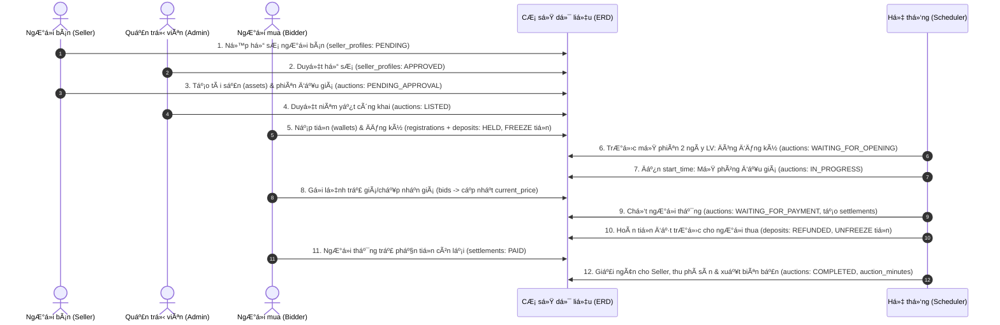
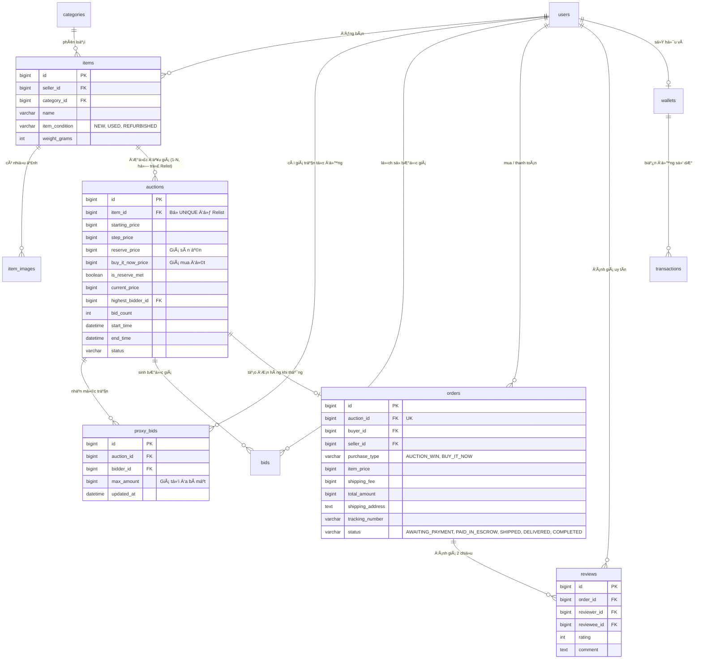

# 📘 TÀI LIỆU GIẢI THÍCH NGHIỆP VỤ ERD & SO SÁNH MÔ HÃŒNH Sàn đấu giá trực tuyến

> **Dự án:** Hệ Thống Đấu Giá Trực Tuyến (Online Auction System - `project_1`)  
> **Môn học:** Phát Triển Phần Mềm Hướng Đối Tượng (PTPMHĐT)  
> **Tài liệu liên quan:** [ERD.md](./ERD.md) | [STATE_MACHINES.md](./STATE_MACHINES.md) | [SRS.md](./SRS.md)

---

## MỤC LỤC
1. [Nguyên tắc Thiết kế Cốt lõi (Database Conventions)](#1-nguyên-tắc-thiết-kế-cốt-lõi-database-conventions)
2. [Giải thích Chi tiết 19 Bảng theo 5 Phân hệ Nghiệp vụ](#2-giải-thích-chi-tiết-19-bảng-theo-5-phân-hệ-nghiệp-vụ)
3. [Luồng Nghiệp vụ & Biến đổi Dữ liệu 6 Giai đoạn (`project_1`)](#3-luồng-nghiệp-vụ--biến-đổi-dữ-liệu-6-giai-đoạn-project_1)
4. [Phân tích Mở rá»™ng: Chuyển đổi ERD sang Mô hình Đấu giá Sàn đấu giá trực tuyến](#4-phân-tích-mở-rá»™ng-chuyển-đổi-erd-sang-mô-hình-đấu-giá-Sàn đấu giá trực tuyến)
5. [Ghi chú Trọng tâm khi Báo cáo / Vấn đáp Đồ án (Notes)](#5-ghi-chú-trọng-tâm-khi-báo-cáo--vấn-đáp-đồ-án-notes)

---

## 1. NGUYÊN TẮC THIẾT KẾ CỐT LÕI (DATABASE CONVENTIONS)

Trước khi đi vào từng bảng, ERD của `project_1` tuân thủ **5 nguyên tắc kỹ thuật bất biến** nhằm đảm bảo tính toàn vẹn tài chính và pháp lý:

| STT | Nguyên tắc | Thiết kế trong ERD | Lý do nghiệp vụ |
| :-: | :--- | :--- | :--- |
| **1** | **Tiền tệ chính xác tuyệt đối** | Dùng kiểu `BIGINT` (đơn vị: VNĐ), có ràng buộc `CHECK (amount >= 0)`. | Tránh hoàn toàn sai số làm tròn dấu phẩy động (`FLOAT`/`DOUBLE`) khi tính tiền cọc (5%–20%), phí dịch vụ và hoàn tiền. |
| **2** | **Thời gian chuẩn xác đến mili-giây** | Dùng `DATETIME(3)` theo múi giờ chuẩn `Asia/Ho_Chi_Minh`. | Phân xử công bằng thứ tự đặt giá (`server_time`) khi nhiều người cùng trả giá ở những giây cuối cùng. |
| **3** | **Bất biến lịch sử (Append-only)** | Các bảng `bids`, `transactions`, `audit_logs` chỉ cho phép `INSERT`, cấm `UPDATE`/`DELETE`. | Đảm bảo tính minh bạch, chống sửa đổi lịch sử trả giá hoặc làm lệch sổ cái dòng tiền. |
| **4** | **Chống lặp giao dịch (Idempotency)** | Cột `idempotency_key VARCHAR(100) UNIQUE` tại bảng `transactions`. | Ngăn chặn lỗi trừ tiền hoặc hoàn tiền 2 lần khi mạng chập chờn hoặc hệ thống retry request. |
| **5** | **Bảo mật danh tính phòng đấu giá** | Cột `anonymous_code` (`UNIQUE(auction_id, anonymous_code)`) tại bảng `registrations`. | Che giấu danh tính thật của người mua trong suốt thời gian diễn ra phiên, chống thông đồng dìm giá hoặc đe dọa. |

---

## 2. GIẢI THÍCH CHI TIẾT 19 BẢNG THEO 5 PHÂN HỆ NGHIỆP VỤ

Hệ thống gồm **19 bảng** (14 bảng cốt lõi từ SRS và 5 bảng mở rộng hỗ trợ nghiệp vụ), được chia thành 5 phân hệ:

### 2.1. Phân hệ Người dùng & Định danh (`users`, `seller_profiles`)
* **`users` (Tài khoản người dùng):**
  * Lưu thông tin định danh cá nhân (`username`, `email`, `citizen_id` đều là `UNIQUE`) và tài khoản ngân hàng (`bank_name`, `bank_account_number`) để phục vụ rút tiền/nhận tiền.
  * Mọi người dùng thông thường đều có `role = 'USER'` (mặc định có quyền làm Người mua - Bidder). Quản trị viên có `role = 'ADMIN'`.
* **`seller_profiles` (Hồ sơ người bán):**
  * Quan hệ **1 - 0..1** với `users` (`UNIQUE(user_id)`).
  * **Nghiệp vụ:** Một `USER` muốn đăng tài sản đấu giá phải nộp hồ sơ năng lực/pháp lý vào bảng này. Chỉ khi Admin xét duyệt (`status = 'APPROVED'`), người dùng đó mới được phép tạo tài sản ở bảng `assets`.

### 2.2. Phân hệ Tài sản & Phiên đấu giá (`assets`, `asset_images`, `auctions`, `listing_change_requests`, `auction_follows`, `auction_minutes`)
* **`assets` & `asset_images` (Tài sản & Thư viện ảnh):**
  * Lưu thông tin tài sản thuộc sở hữu của người bán (`seller_id`).
  * Phân loại `asset_type`: Động sản (`MOVABLE`) hoặc Bất động sản (`IMMOVABLE`). Việc phân loại này quyết định thời gian niêm yết tối thiểu theo luật định.
* **`auctions` (Phiên đấu giá):**
  * Quan hệ **1 - 1** với `assets` (`UNIQUE(asset_id)`).
  * Hỗ trợ 2 phương thức đấu giá (`method`):
    1. **Trả giá lên (`ASCENDING`):** Sử dụng `starting_price` (giá khởi điểm) và `step_price` (bước giá tối thiểu mỗi lần trả thêm).
    2. **Đặt giá xuống (`DESCENDING`):** Giá giảm tự động từ `starting_price` theo từng mức `step_price` sau mỗi khoảng thời gian `price_reduction_interval_seconds`, nhưng không thấp hơn giá sàn `floor_price`.
  * Lưu trữ trực tiếp `current_price` và `highest_bidder_id` ngay trên bảng để tối ưu tốc độ đọc thời gian thực trong phòng đấu giá mà không cần `MAX(amount)` trên bảng `bids`.
* **Các bảng mở rộng vòng đời phiên:**
  * **`listing_change_requests`:** Lưu yêu cầu xin thay đổi thông số phiên đấu giá khi đã niêm yết (kèm ảnh chụp JSON `old_values`, `new_values`) để Admin duyệt.
  * **`auction_follows`:** Lưu danh sách phiên đấu giá mà người dùng bấm theo dõi để nhận thông báo nhắc lịch.
  * **`auction_minutes`:** Biên bản đấu giá điện tử (quan hệ 1-1 với `auctions`), tự động chụp toàn bộ kết quả phiên dưới dạng JSON (`snapshot_data`) khi phiên kết thúc (`COMPLETED` hoặc `FAILED`).

### 2.3. Phân hệ Tham gia, Đặt trước, Trả giá & Quyết toán (`registrations`, `deposits`, `bids`, `settlements`)
* **`registrations` (Hồ sơ đăng ký tham gia phiên):**
  * Ràng buộc `UNIQUE(auction_id, bidder_id)`: Mỗi người chỉ được đăng ký tối đa 1 lần cho 1 phiên.
  * Cấp mã ẩn danh 6 chữ số `anonymous_code` duy nhất trong phiên.
  * Cột `decision_on_listing_change` (`CONTINUE` / `DECLINE`): Ghi nhận quyết định đi tiếp hay rút lui nhận lại cọc của người mua nếu phiên đấu giá có sự thay đổi thông tin niêm yết.
* **`deposits` (Tiền đặt trước):**
  * Quan hệ **1 - 1** với `registrations` (`UNIQUE(registration_id)`).
  * Quản lý khoản tiền đặt trước (từ 5% đến 20% giá khởi điểm): từ lúc đang phong tỏa (`HELD`), hoàn trả cho người thua (`REFUNDED`), chuyển thành tiền cọc của người thắng (`CONVERTED_TO_SELLER_DEPOSIT`), hoặc tịch thu nếu vi phạm/bỏ cọc (`FORFEITED`) để chuyển cho người bán (`TRANSFERRED_TO_SELLER`).
* **`bids` (Lịch sử trả giá bất biến):**
  * Lưu **tất cả** các lượt gửi giá của người mua theo `server_time`, bao gồm cả lượt hợp lệ (`is_valid = TRUE`) và không hợp lệ (`is_valid = FALSE` kèm lý do `invalid_reason` như thấp hơn bước giá, gửi chậm hơn người khác...).
* **`settlements` (Thanh toán kết quả trúng đấu giá):**
  * Sinh ra ngay khi xác định được người thắng. Tính toán nghĩa vụ tài chính còn lại:
    $$\text{remaining\_amount} = \text{winning\_price} - \text{deposit\_deducted}$$
  * Theo dõi hạn thanh toán (`payment_deadline`) và trạng thái hoàn tất (`WAITING_FOR_PAYMENT` → `PAID` / `CANCELED` / `OVERDUE`).

### 2.4. Phân hệ Tài chính & Ví điện tử (`wallets`, `transactions`)
* **`wallets` (Ví tiền):**
  * Gồm ví cá nhân của người dùng (`wallet_type = 'USER'`, `UNIQUE(user_id)`) và 2 ví hệ thống (`user_id = NULL`): **Ví ký quỹ (`SYSTEM_ESCROW`)** và **Ví doanh thu phí sàn (`SYSTEM_REVENUE`)**.
  * Tách biệt rõ 2 ngăn tiền:
    * `available_balance`: Số dư khả dụng (có thể rút hoặc dùng để đăng ký phiên mới).
    * `frozen_balance`: Số dư đang bị đóng băng (đang làm tiền đặt trước cho các phiên chưa kết thúc).
* **`transactions` (Sổ cái giao dịch tiền bất biến):**
  * Ghi vết mọi biến động số dư (`balance_before`, `balance_after`) theo 8 loại giao dịch: `TOPUP` (nạp), `WITHDRAW` (rút), `FREEZE` (đóng băng cọc), `UNFREEZE` (giải tỏa cọc), `CONVERT_DEPOSIT` (khấu trừ cọc), `PAYMENT` (thanh toán tiền trúng), `SERVICE_FEE` (thu phí sàn), `PAYOUT_TO_SELLER` (giải ngân cho người bán).
  * Liên kết đa hình (`reference_type` + `reference_id`) trỏ về bản ghi `deposits` hoặc `settlements` tương ứng.

### 2.5. Phân hệ Vận hành, Kiểm toán & Cấu hình (`notifications`, `audit_logs`, `complaints`, `system_configs`, `holidays`)
* **`notifications`:** Lưu thông báo gửi tới người dùng (khi được duyệt hồ sơ, bị vượt giá, trúng đấu giá, hoàn cọc...).
* **`complaints`:** Quản lý đơn khiếu nại của Bidder hoặc Seller đối với một phiên đấu giá kèm đường dẫn bằng chứng (`evidence_url`) và kết luận xử lý của Admin (`resolution_note`).
* **`audit_logs`:** Nhật ký kiểm toán toàn hệ thống, tự động chụp JSON `data_before` và `data_after` kèm địa chỉ IP mỗi khi có thay đổi trạng thái quan trọng.
* **`system_configs` & `holidays`:** Lưu tham số vận hành động (tỷ lệ phí dịch vụ, thời gian chờ thanh toán) và danh sách ngày lễ nhà nước để tính chính xác **ngày làm việc** (Business Days).

---

## 3. LUỒNG NGHIỆP VỤ & BIẾN ĐỔI DỮ LIỆU 6 GIAI ĐOẠN (`project_1`)

### Giai đoạn 1: Chuẩn bị & Niêm yết (`PENDING_APPROVAL` → `LISTED`)
1. Người dùng được duyệt `seller_profiles` (`APPROVED`) tạo bản ghi trong `assets` và `asset_images`.
2. Seller tạo phiên trong `auctions` (`status = 'PENDING_APPROVAL'`), chọn phương thức `ASCENDING` hoặc `DESCENDING`, thiết lập giá khởi điểm và tỷ lệ tiền đặt trước (5%–20%).
3. Admin kiểm tra tính hợp lệ (đối chiếu bảng `holidays` để đảm bảo thời gian niêm yết đủ số ngày làm việc theo quy định) và duyệt phiên sang `status = 'LISTED'`, ghi nhận `listing_at` và `registration_deadline` (trước `start_time` 2 ngày làm việc).

### Giai đoạn 2: Đăng ký & Phong tỏa Tiền đặt trước (`LISTED` → `WAITING_FOR_OPENING`)
1. Bidder nạp tiền vào `wallets` (`transactions`: `TOPUP`).
2. Trước mốc `registration_deadline`, Bidder gửi yêu cầu đăng ký. Hệ thống thực thi trong **1 Database Transaction**:
   * Tạo bản ghi `registrations` kèm mã ẩn danh `anonymous_code`.
   * Tạo bản ghi `deposits` (`status = 'HELD'`, `amount = deposit_amount`).
   * Tại bảng `wallets` của Bidder:
     $$\text{available\_balance} = \text{available\_balance} - \text{deposit\_amount}$$
     $$\text{frozen\_balance} = \text{frozen\_balance} + \text{deposit\_amount}$$
   * Ghi bản ghi `transactions` (`transaction_type = 'FREEZE'`).
3. Đúng mốc `registration_deadline`, Scheduler tự động chuyển `auctions.status` sang `WAITING_FOR_OPENING` (khóa cổng đăng ký mới).

### Giai đoạn 3: Mở phiên & Đấu giá thời gian thực (`WAITING_FOR_OPENING` → `IN_PROGRESS`)
1. Đúng giờ `start_time`, nếu không có người đăng ký hợp lệ, phiên chuyển thẳng sang `FAILED` và hoàn tiền cọc. Ngược lại, phiên chuyển sang `IN_PROGRESS`.
2. **Với Đấu giá Tăng dần (`ASCENDING`):**
   * Khi Bidder đặt giá, hệ thống khóa dòng `auctions` hiện tại, kiểm tra `amount >= current_price + step_price`.
   * Nếu hợp lệ: Lưu `bids` (`is_valid = TRUE`), cập nhật `auctions.current_price = amount` và `auctions.highest_bidder_id = bidder_id`.
   * Nếu không hợp lệ: Lưu `bids` (`is_valid = FALSE`, kèm `invalid_reason`).
3. **Với Đấu giá Giảm dần (`DESCENDING`):**
   * Định kỳ mỗi `price_reduction_interval_seconds`, Scheduler giảm `current_price` một mức `step_price` (tối thiểu bằng `floor_price`).
   * Người đầu tiên gửi lệnh `bid_type = 'ACCEPT'` hợp lệ sẽ trở thành `highest_bidder_id` và kết thúc việc trả giá ngay lập tức.

### Giai đoạn 4: Kết thúc trả giá & Hoàn cọc người thua (`IN_PROGRESS` → `WAITING_FOR_PAYMENT`)
1. Khi xác định được người thắng (`highest_bidder_id`):
   * `auctions.status` chuyển sang `WAITING_FOR_PAYMENT`.
   * Khoản đặt trước của người thắng trong `deposits` chuyển từ `HELD` sang `CONVERTED_TO_SELLER_DEPOSIT`.
   * Tạo bản ghi `settlements` với `remaining_amount = winning_price - deposit_deducted` và hạn chót `payment_deadline`.
2. Đối với tất cả người tham gia **không trúng** (và không vi phạm quy chế):
   * `deposits.status` chuyển sang `REFUNDED`.
   * Trong `wallets`: giảm `frozen_balance`, cộng trả lại vào `available_balance` (`transactions`: `UNFREEZE`).

### Giai đoạn 5: Thanh toán, Giải ngân & Xử lý ngoại lệ (`WAITING_FOR_PAYMENT` → `COMPLETED` / `FAILED`)
* **Trường hợp 1 – Người thắng thanh toán đúng hạn (`PAID`):**
  1. Trừ `remaining_amount` từ `available_balance` của người thắng (`PAYMENT`) và tất toán khoản `frozen_balance` tiền cọc (`CONVERT_DEPOSIT`).
  2. Cộng phí dịch vụ vào ví `SYSTEM_REVENUE` (`SERVICE_FEE`) và cộng tiền bán tài sản (sau khi trừ phí) vào `available_balance` của ví Seller (`PAYOUT_TO_SELLER`).
  3. Cập nhật `deposits.status = 'TRANSFERRED_TO_SELLER'`, `settlements.status = 'PAID'`, `auctions.status = 'COMPLETED'`.
  4. Tự động sinh biên bản điện tử vào bảng `auction_minutes`.
* **Trường hợp 2 – Người thắng bỏ cọc hoặc quá hạn (`CANCELED` / `OVERDUE`):**
  1. Phạt mất cọc: `deposits.status` của người vi phạm chuyển sang `FORFEITED`, tiền cọc được chuyển cho Seller (`TRANSFERRED_TO_SELLER`).
  2. Nếu là đấu giá **Tăng dần**: Xét trao quyền mua cho người trả giá cao liền kề. Nếu không còn ai đồng ý → `auctions.status = 'FAILED'`.
  3. Nếu là đấu giá **Giảm dần**: Đưa phiên quay lại trạng thái `IN_PROGRESS` để tiếp tục giảm giá từ mức giá vừa bị hủy.

---

## 4. PHÂN TÍCH MỞ RỘNG: CHUYỂN ĐỔI ERD SANG MÔ HÃŒNH ĐẤU GIÁ Sàn đấu giá trực tuyến

> [!IMPORTANT]
> **Kết luận đánh giá:** ERD gốc của `project_1` chỉ phù hợp khoảng **40% – 50%** nếu áp dụng cho sàn thÆ°Æ¡ng mại Ä‘iện tá»­ đấu giá kiểu **Sàn đấu giá trực tuyến**.
> * **`project_1`:** Mô hình **Đấu giá tài sản pháp lý/nhà nước** (tiền kiểm chặt chẽ, bắt buộc đăng ký trước 2 ngày làm việc, nộp tiền đặt trước 5%–20%, lập biên bản pháp lý).
> * **Sàn đấu giá trực tuyến:** Mô hình **ThÆ°Æ¡ng mại Ä‘iện tá»­ kết hợp Đấu giá tá»± do (C2C/B2C Marketplace & Proxy Bidding)** (không đăng ký trÆ°á»›c, không đặt cọc, trả giá tá»± Ä‘á»™ng, mua đứt ngay, giao nhận vận chuyển và đánh giá uy tín 2 chiều).

### 4.1. 6 Điểm không phù hợp của ERD gốc khi áp vào Sàn đấu giá trực tuyến
1. **Bắt buá»™c đăng ký trÆ°á»›c & Đặt cọc (`registrations` & `deposits`):** Trên Sàn đấu giá trực tuyến, người mua thấy món hàng là bấm trả giá ngay lập tức (kể cả ở giây cuối cùng), không phải ná»™p hồ sÆ¡ trÆ°á»›c 2 ngày hay đóng băng 5%–20% tiền cọc.
2. **Thiếu cÆ¡ chế Đấu giá tá»± Ä‘á»™ng (`Proxy Bidding` / `Max Bid`):** Người mua trên Sàn đấu giá trực tuyến nhập mức giá tối Ä‘a sẵn sàng trả (giữ bí mật), hệ thống tá»± Ä‘á»™ng trả giá há»™ từng bÆ°á»›c nhỏ nhất để thắng đối thủ. Bảng `bids` hiện tại chỉ lÆ°u giá trá»±c tiếp.
3. **Thiếu giá Mua ngay (`buy_it_now_price`) và Giá sàn ẩn (`reserve_price`):** Trên Sàn đấu giá trực tuyến, người mua có thể mua đứt món hàng ngay lập tức vá»›i giá `Buy It Now`, và người bán có thể đặt mức giá kỳ vọng tối thiểu ẩn (`Reserve Price`) mà nếu chÆ°a chạm tá»›i thì không bắt buá»™c phải bán.
4. **Ràng buá»™c cứng 1 Tài sản – 1 Phiên (`UNIQUE(asset_id)` trên bảng `auctions`):** Trên Sàn đấu giá trực tuyến, má»™t món hàng đấu giá thất bại có thể được đăng đấu giá lại (**Relist**) nhiều lần (quan hệ `1 - N`).
5. **Quy trình duyệt tay & Lịch nghỉ lá»… (`holidays`, `auction_minutes`, `listing_change_requests`):** Sàn đấu giá trực tuyến hoạt Ä‘á»™ng tá»± Ä‘á»™ng 24/7/365 toàn cầu theo số ngày thá»±c (3, 5, 7, 10 ngày), không trừ ngày lá»… nhà nÆ°á»›c và không cần Admin duyệt từng bài đăng.
6. **Thiếu phân hệ Giao vận, Đơn hàng & Đánh giá uy tín (`orders`, `reviews`):** Sau khi thắng trên Sàn đấu giá trực tuyến, tiền phải được giữ trong ví ký quỹ (`SYSTEM_ESCROW`) chờ đóng gói, vận chuyển (`tracking_number`), giao hàng thành công (`DELIVERED`) rồi má»›i giải ngân cho Seller, kèm hệ thống chấm Ä‘iểm uy tín 2 chiều (Feedback Score) để chống bùng hàng.

### 4.2. Cách thức chỉnh sá»­a ERD sang mô hình Sàn đấu giá trực tuyến

| Thao tác | Bảng tác động | Chi tiết chỉnh sửa |
| :--- | :--- | :--- |
| **1. Loại bỏ** | `holidays`, `auction_minutes`, `listing_change_requests`, `registrations`, `deposits` | Loại bỏ quy trình đăng ký trước, đặt cọc bắt buộc và lịch nghỉ lễ để cho phép người dùng vào trả giá tức thì (Instant Bidding). |
| **2. Chỉnh sửa** | `assets` $\rightarrow$ `items` | Bỏ `asset_type`; thêm `category_id` (danh mục), `item_condition` (`NEW`, `USED`, `REFURBISHED`), `weight_grams` (tính phí ship). |
| **3. Chỉnh sửa** | `auctions` | Bỏ `UNIQUE(asset_id)` (hỗ trợ Relist), bỏ `deposit_*`, `registration_deadline`. Thêm `buy_it_now_price`, `reserve_price`, `is_reserve_met`, `bid_count`. |
| **4. Thêm mới & Nâng cấp** | `proxy_bids` & `bids` | Thêm bảng `proxy_bids` lưu mức trần bí mật (`max_amount`) của từng Bidder; thêm cột `is_auto_bid` vào bảng `bids` để ghi nhận các bước nhảy giá tự động. |
| **5. Nâng cấp** | `settlements` $\rightarrow$ `orders` | Mở rộng thành bảng Đơn hàng TMĐT: thêm `purchase_type` (`AUCTION_WIN`, `BUY_IT_NOW`), `shipping_fee`, `shipping_address`, `tracking_number`, và trạng thái giao vận (`AWAITING_PAYMENT` $\rightarrow$ `PAID_IN_ESCROW` $\rightarrow$ `SHIPPED` $\rightarrow$ `DELIVERED` $\rightarrow$ `COMPLETED`). |
| **6. Thêm mới** | `categories`, `reviews` | Thêm `categories` (danh mục đa cấp) và `reviews` (đánh giá uy tín 2 chiều Buyer $\leftrightarrow$ Seller sau khi hoàn tất đơn hàng). |

### 4.3. SÆ¡ đồ ERD sau khi chuyển sang mô hình Sàn đấu giá trực tuyến

### 4.4. So sánh Điểm mạnh & Điểm yếu giữa 2 Mô hình (Trade-offs)

| Tiêu chí | Mô hình ERD gốc (`project_1` - Đấu giá Pháp lý) | Mô hình ERD cải tiến (Kiểu Sàn đấu giá trực tuyến - Đấu giá TMĐT) |
| :--- | :--- | :--- |
| **Rào cản tham gia** | **Cao:** Phải đăng ký trước 2 ngày làm việc và nộp tiền đặt trước 5%–20%. | **Rất thấp (Điểm mạnh lớn nhất):** Thấy hàng là bấm trả giá ngay trong 1 giây, tỷ lệ chuyển đổi (Conversion Rate) cực cao. |
| **Rủi ro bùng hàng (Non-paying Bidder)** | **Rất thấp (Điểm mạnh lớn nhất):** Người thắng bỏ cuộc sẽ bị tịch thu ngay khoản tiền đặt trước (`FORFEITED`) đền bù cho Seller. | **Cao (Điểm yếu lớn nhất):** Không giữ tiền cọc trước nên người thắng dễ bỏ chạy. Phải khắc phục bằng khóa tài khoản (`unpaid_strikes`), giới hạn hạn mức bid hoặc yêu cầu liên kết thẻ trước. |
| **Tiện ích cho người mua & người bán** | Đấu giá thủ công trực tiếp trong khung giờ cố định. | **Rất linh hoạt:** Có `Proxy Bidding` tự động trả giá hộ, `Buy It Now` mua đứt ngay, `Reserve Price` bảo vệ người bán khỏi bán lỗ. |
| **Khả năng mở rộng (Scalability)** | Giới hạn bởi khâu Admin duyệt từng hồ sơ đăng ký và duyệt từng phiên đấu giá. | **Tự động hóa 100%:** Mở rộng lên hàng triệu phiên đấu giá đồng thời mà không cần Admin duyệt tay. |
| **Tải xử lý đồng thời (Concurrency)** | Ổn định do số lượng Bidder trong 1 phòng đã được chốt cố định trước 2 ngày làm việc. | **Rất khắc nghiệt ở giây cuối (Auction Sniping):** Hàng trăm người có thể nhảy vào đặt lệnh ở 5 giây cuối cùng kết hợp tính toán `proxy_bids`, đòi hỏi khóa bi quan (`FOR UPDATE`) hoặc hàng đợi Redis. |
| **Tính tuân thủ pháp luật VN** | **Đạt chuẩn:** Phù hợp đấu giá tài sản công, đất đai, biển số xe, tài sản thi hành án theo Luật Đấu giá tài sản. | **Không áp dụng được cho tài sản công pháp lý:** Chỉ phù hợp làm sàn thương mại điện tử dân sự (C2C/B2C). |

---

## 5. GHI CHÚ TRỌNG TÂM KHI BÁO CÁO / VẤN ĐÁP ĐỒ ÁN (NOTES)

> [!TIP]
> Dưới đây là 5 câu hỏi phản biện thường gặp nhất khi bảo vệ ERD của `project_1` và gợi ý trả lời ngắn gọn:

1. **Câu hỏi 1: Tại sao trong bảng `auctions` đã có quan hệ với bảng `bids`, mà lại lưu thêm `current_price` và `highest_bidder_id` gây dư thừa dữ liệu (Denormalization)?**
   * **Trả lời:** Đây là kỹ thuật **Denormalization có chủ đích để tối ưu hiệu năng đọc thời gian thực**. Trong phòng đấu giá có hàng trăm client truy vấn liên tục mỗi giây, việc đọc trực tiếp `current_price` và `highest_bidder_id` trên 1 dòng của bảng `auctions` (O(1)) nhanh hơn rất nhiều so với việc phải chạy truy vấn `SELECT MAX(amount) FROM bids WHERE auction_id = ? AND is_valid = TRUE` trên bảng lịch sử lớn. Đồng thời, khóa dòng (`SELECT ... FOR UPDATE`) trên `auctions` cũng giúp kiểm soát Concurrency tại một điểm duy nhất.

2. **Câu hỏi 2: Tại sao những lượt trả giá bị lỗi/không hợp lệ vẫn lưu vào bảng `bids` (`is_valid = FALSE`) mà không chặn và bỏ đi ở tầng Service?**
   * **Trả lời:** Trong nghiệp vụ đấu giá trực tuyến, người mua rất hay khiếu nại: *"Tôi đã bấm trả giá cao hơn trước khi hết giờ, tại sao không được ghi nhận?"*. Việc lưu lại cả các lượt trả giá bị từ chối kèm `server_time` (độ chính xác mili-giây) và `invalid_reason` vào bảng bất biến `bids` giúp hệ thống có **bằng chứng pháp lý không thể chối cãi** khi giải quyết khiếu nại (`complaints`).

3. **Câu hỏi 3: Làm sao đảm bảo tiền trong ví (`wallets`) không bao giờ bị âm hoặc bị trừ 2 lần khi người dùng bấm đúp chuột (Double-click)?**
   * **Trả lời:** Hệ thống kết hợp 3 lớp bảo vệ:
     1. Ở tầng Database: Ràng buộc `CHECK (available_balance >= 0)` và `CHECK (frozen_balance >= 0)`.
     2. Ở tầng Giao dịch (`transactions`): Cột `idempotency_key` có ràng buộc `UNIQUE` chặn mọi request trùng lặp.
     3. Ở tầng Thực thi Backend: Sử dụng Transaction cô lập kèm khóa dòng ví khi chuyển tiền giữa `available_balance` và `frozen_balance`.

4. **Câu hỏi 4: Tại sao không gộp bảng `registrations` và `deposits` làm một vì chúng có quan hệ 1-1?**
   * **Trả lời:** Tách riêng để đảm bảo **Nguyên lý Đơn trách nhiệm (Single Responsibility Principle - SRP)** và tách biệt 2 vòng đời trạng thái độc lập ([STATE_MACHINES.md](./STATE_MACHINES.md)):
     * `registrations` quản lý **tư cách pháp lý và điểm danh phòng đấu giá** (`PENDING_REVIEW` → `VALID` → `ATTENDED` / `DISQUALIFIED`).
     * `deposits` quản lý **nghĩa vụ tài chính và dòng tiền ký quỹ** (`SUBMITTED`/`HELD` → `REFUNDED` / `CONVERTED_TO_DEPOSIT` / `FORFEITED` → `TRANSFERRED_TO_SELLER`).

5. **Câu hỏi 5: Tại sao bảng `transactions` dùng `reference_type` và `reference_id` thay vì tạo khóa ngoại cứng (`FK`) tới `deposits` và `settlements`?**
   * **Trả lời:** Vì một giao dịch ví có thể phát sinh từ nhiều nguồn nghiệp vụ khác nhau: nạp/rút tiền trực tiếp (`TOPUP`/`WITHDRAW`), phong tỏa tiền đặt trước (`DEPOSIT`), hoặc thanh toán kết quả trúng đấu giá (`SETTLEMENT`). Thiết kế **Polymorphic Association (`reference_type` + `reference_id`)** giúp bảng sổ cái `transactions` gọn gàng, không bị chứa nhiều cột khóa ngoại `NULL` và dễ dàng mở rộng thêm các loại giao dịch mới trong tương lai.

