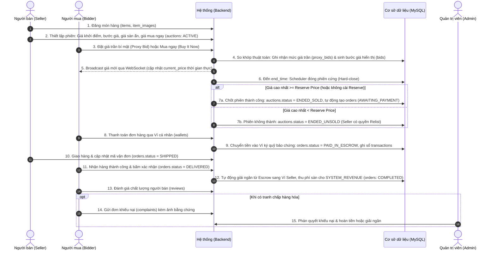

# 📘 TÀI LIỆU GIẢI THÍCH NGHIỆP VỤ CƠ SỞ DỮ LIỆU (ERD) & CƠ CHẾ ĐẤU GIÁ TỰ ĐỘNG

> **Dự án:** Hệ Thống Đấu Giá Trực Tuyến Tự Động (Online Auction System - `PROJECT_1`)  
> **Môn học:** Phát Triển Phần Mềm Hướng Đối Tượng (OOAD / PTPMHĐT)  
> **Tài liệu liên quan:** [ERD.md](./ERD.md) | [SRS.md](./SRS.md) | [STATE_MACHINES.md](./STATE_MACHINES.md) | [BUSINESS_RULES.md](./BUSINESS_RULES.md)

---

## MỤC LỤC
1. [Nguyên Tắc Thiết Kế Cốt Lõi (Database Conventions)](#1-nguyên-tắc-thiết-kế-cốt-lõi-database-conventions)
2. [Chi Tiết 15 Bảng Dữ Liệu Theo 5 Phân Hệ Nghiệp Vụ](#2-chi-tiết-15-bảng-dữ-liệu-theo-5-phân-hệ-nghiệp-vụ)
3. [Luồng Nghiệp Vụ & Biến Đổi Dữ Liệu 6 Giai Đoạn](#3-luồng-nghiệp-vụ--biến-đổi-dữ-liệu-6-giai-đoạn)
4. [Lý Do Tối Ưu Hóa & Loại Bỏ Các Bảng Hành Chính Cũ](#4-lý-do-tối-ưu-hóa--loại-bỏ-các-bảng-hành-chính-cũ)
5. [Bộ Câu Hỏi & Ghi Chú Trọng Tâm Khi Báo Cáo / Vấn Đáp Đồ Án](#5-bộ-câu-hỏi--ghi-chú-trọng-tâm-khi-báo-cáo--vấn-đáp-đồ-án)

---

## 1. NGUYÊN TẮC THIẾT KẾ CỐT LÕI (DATABASE CONVENTIONS)

Cơ sở dữ liệu của hệ thống tuân thủ **6 nguyên tắc kỹ thuật chuẩn mực** nhằm đảm bảo tính toàn vẹn tài chính, độ tin cậy thời gian thực và khả năng kiểm toán:

| STT | Nguyên Tắc | Thiết Kế Kỹ Thuật Trong DB | Lý Do Nghiệp Vụ |
| :-: | :--- | :--- | :--- |
| **1** | **Tiền tệ chính xác tuyệt đối** | Kiểu dữ liệu `BIGINT` (đơn vị: VNĐ), kèm ràng buộc `CHECK (amount >= 0)` và `available_balance >= 0`. | Tránh triệt để sai số làm tròn số thực (`FLOAT`/`DOUBLE`) trong các giao dịch cộng trừ tiền ví, tính phí sàn và khấu trừ thanh toán đơn hàng. |
| **2** | **Thời gian chuẩn xác đến mili-giây** | Dùng `DATETIME(3)` theo múi giờ chuẩn `Asia/Ho_Chi_Minh`. | Phân xử thứ tự đặt giá công bằng (`created_at`) khi nhiều người mua cùng gửi lệnh trả giá hoặc cập nhật giá trần ở những giây cuối phiên. |
| **3** | **Bất biến lịch sử (Append-only)** | Các bảng `bids`, `transactions`, `audit_logs` là bảng **Chỉ ghi thêm (Append-only)**, cấm lệnh `UPDATE` hoặc `DELETE`. | Bảo đảm tính toàn vẹn kiểm toán (Audit Trail), chống gian lận thay đổi lịch sử trả giá hoặc làm sai lệch sổ cái tài chính. |
| **4** | **Chống lặp giao dịch (Idempotency)** | Cột `idempotency_key VARCHAR(100) UNIQUE` tại bảng `transactions`. | Ngăn ngừa sự cố trừ tiền hoặc giải ngân 2 lần khi đường truyền mạng chập chờn hoặc người dùng click đúp/gửi lại request. |
| **5** | **Bảo mật giá trần bí mật (Proxy Bid Privacy)** | Cột `max_amount` trong bảng `proxy_bids` chỉ được xử lý ở phía server, không bao giờ lộ ra API public. | Bảo đảm người tham gia không thể dò biết mức giá tối đa của đối thủ, bảo đảm tính công bằng tuyệt đối của cơ chế Proxy Bidding. |
| **6** | **Hỗ trợ đăng lại (Relist Flexibility)** | Tách biệt thực thể Món hàng (`items`) và Phiên đấu giá (`auctions`) theo quan hệ **1 - N**. | Cho phép người bán tổ chức lại phiên đấu giá mới cho cùng một món hàng nếu phiên trước đó không có ai trả giá hoặc giá chưa đạt giá sàn bảo lưu. |

---

## 2. CHI TIẾT 15 BẢNG DỮ LIỆU THEO 5 PHÂN HỆ NGHIỆP VỤ

Cơ sở dữ liệu hoàn chỉnh của hệ thống bao gồm **15 bảng** (khởi tạo qua Flyway `V1__init.sql` và `V2__audit_logs.sql`), được phân định rõ ràng theo 5 phân hệ nghiệp vụ:

### 2.1. Phân hệ Tài khoản & Danh mục (`users`, `categories`)
* **`users` (Người dùng hệ thống):**
  * Quản lý thông tin định danh cá nhân (`username`, `email` duy nhất), mật khẩu băm (`password_hash`), thông tin giao hàng (`shipping_address`), thông tin ngân hàng phục vụ rút tiền (`bank_name`, `bank_account_number`).
  * Phân quyền linh hoạt: Mọi tài khoản thông thường đều mang vai trò `ROLE_USER` và có đầy đủ quyền làm Người mua (Buyer) hoặc Người bán (Seller); Quản trị viên mang vai trò `ROLE_ADMIN`.
  * Cột `unpaid_strikes_count`: Đếm số lần bùng hàng không thanh toán; khi đạt ngưỡng phạt sẽ tự động khóa quyền mua hàng.
* **`categories` (Danh mục sản phẩm đa cấp):**
  * Hỗ trợ cấu trúc danh mục cha - con thông qua khóa ngoại đệ quy `parent_id` trỏ về chính bảng `categories`.
  * Quản lý đường dẫn thân thiện (`slug` duy nhất) và thứ tự hiển thị (`display_order`).

### 2.2. Phân hệ Hàng hóa & Phiên đấu giá (`items`, `item_images`, `auctions`)
* **`items` (Món hàng đăng bán):**
  * Thuộc sở hữu của người bán (`seller_id` trỏ tới `users.id`) và thuộc danh mục `category_id`.
  * Lưu trữ thông tin tình trạng món hàng (`item_condition`: `NEW`, `LIKE_NEW`, `USED`), tiêu đề, mô tả và ảnh đại diện.
* **`item_images` (Album ảnh chi tiết món hàng):**
  * Quan hệ **1 - N** với `items`, hỗ trợ người bán đăng nhiều góc chụp thực tế kèm thứ tự sắp xếp (`display_order`).
* **`auctions` (Phiên đấu giá trực tuyến):**
  * Liên kết với món hàng (`item_id`). Một món hàng có thể có nhiều phiên qua các lần Relist, nhưng tại một thời điểm chỉ có tối đa 1 phiên ở trạng thái hoạt động (`ACTIVE`).
  * Thiết lập các thông số tài chính và thời gian:
    * `start_price`: Giá khởi điểm mở phiên.
    * `step_price`: Bước giá tối thiểu bắt buộc giữa các lần nâng giá.
    * `reserve_price`: **Giá sàn bảo lưu ẩn** (chỉ người bán biết). Cột `reserve_met` (BOOLEAN) đánh dấu phiên đã chạm ngưỡng này hay chưa.
    * `buy_now_price`: **Giá mua ngay** (cho phép người mua mua đứt và kết thúc phiên lập tức).
    * `current_price`: Mức giá dẫn đầu hiện tại (được cập nhật tức thì phục vụ hiển thị nhanh).
    * `highest_bidder_id`: ID người đang dẫn đầu phiên.
    * `start_time`, `end_time`: Mốc thời gian mở và đóng phiên theo cơ chế đóng cứng (Hard-close).
    * `status`: Trạng thái phiên (`DRAFT`, `ACTIVE`, `ENDED_SOLD`, `ENDED_UNSOLD`, `CANCELED`).

### 2.3. Phân hệ Trả giá tự động (`proxy_bids`, `bids`)
* **`proxy_bids` (Cài đặt mức giá trần tự động):**
  * Ghi nhận mức giá tối đa bí mật (`max_amount`) mà người mua sẵn sàng chi trả cho một phiên (`auction_id`, `bidder_id`).
  * Hệ thống sử dụng thuật toán Proxy Bidding để tự động nâng giá cho người mua từng bước một (`step_price`) mỗi khi có đối thủ trả giá cạnh tranh.
* **`bids` (Lịch sử các bước giá được ghi nhận):**
  * Bảng bất biến ghi nhận mọi bước giá phát sinh trong phiên kèm thời điểm chính xác (`created_at` mili-giây).
  * Cột `is_proxy`: Đánh dấu bước giá này do người dùng tự gõ tay trực tiếp hay do máy tự động nhảy bước giá thay người mua.

### 2.4. Phân hệ Đơn hàng & Tài chính bảo chứng (`orders`, `wallets`, `transactions`)
* **`orders` (Đơn hàng sau đấu giá):**
  * Được tự động tạo khi phiên kết thúc có người trúng (`ENDED_SOLD`) hoặc khi có người bấm Mua ngay (`BUY_IT_NOW`).
  * Lưu trữ giá chốt (`final_price`), phí vận chuyển (`shipping_fee`), tổng tiền thanh toán (`total_amount`), địa chỉ giao hàng và mã vận đơn (`tracking_number`).
  * Theo dõi vòng đời thanh toán và vận chuyển: `AWAITING_PAYMENT` → `PAID_IN_ESCROW` → `SHIPPED` → `DELIVERED` → `COMPLETED` (hoặc `CANCELLED_UNPAID` nếu bùng hàng).
* **`wallets` (Ví tiền nội bộ bảo chứng):**
  * Gồm ví cá nhân của từng người dùng (`user_id`) và các ví nghiệp vụ hệ thống (`SYSTEM_REVENUE`: ví thu phí sàn, `SYSTEM_ESCROW`: ví trung gian giữ tiền bảo chứng).
  * Hai ngăn số dư:
    * `available_balance`: Số dư khả dụng (dùng để thanh toán hoặc rút về tài khoản ngân hàng).
    * `frozen_balance`: Số dư đang tạm giữ bảo chứng (cho đến khi người mua nhận hàng thành công).
* **`transactions` (Sổ cái biến động số dư bất biến):**
  * Ghi lại chi tiết từng biến động số dư (`balance_before`, `balance_after`) kèm loại giao dịch (`TOP_UP`, `WITHDRAW`, `PAYMENT`, `ESCROW_HOLD`, `ESCROW_RELEASE`, `REFUND`, `SYSTEM_FEE`).
  * Tích hợp `idempotency_key` đảm bảo không bao giờ xử lý lặp giao dịch tài chính.

### 2.5. Phân hệ Tương tác & Vận hành (`reviews`, `notifications`, `complaints`, `system_configs`, `audit_logs`)
* **`reviews` (Đánh giá uy tín):** Đánh giá số sao (1-5) và nhận xét của người mua dành cho người bán sau khi hoàn tất đơn hàng.
* **`notifications` (Hệ thống thông báo):** Gửi thông báo tức thì cho người dùng khi bị vượt giá, khi trúng đấu giá, khi có đơn hàng mới hoặc khi đơn hàng được cập nhật trạng thái.
* **`complaints` (Tiếp nhận khiếu nại):** Cho phép người mua hoặc người bán khiếu nại về món hàng, thanh toán hoặc giao vận kèm bằng chứng hình ảnh; Admin tiếp nhận và đưa ra phán quyết xử lý.
* **`system_configs` (Cấu hình hệ thống):** Lưu trữ các tham số vận hành linh hoạt (tỷ lệ phí sàn %, thời gian gia hạn thanh toán đơn hàng...).
* **`audit_logs` (Nhật ký kiểm toán toàn diện):** Tự động ghi vết các thao tác nhạy cảm, trạng thái trước/sau (`data_before`, `data_after`) cùng IP và User ID thực hiện.

---

## 3. LUỒNG NGHIỆP VỤ & BIẾN ĐỔI DỮ LIỆU 6 GIAI ĐOẠN

### Chi Tiết Diễn Biến Dữ Liệu Qua Từng Giai Đoạn:
1. **Giai đoạn 1 (Đăng bán & Mở phiên):**
   * Người bán tạo bản ghi trong bảng `items` kèm album ảnh trong `item_images`.
   * Khởi tạo phiên đấu giá trong `auctions` với trạng thái `ACTIVE`. Người bán có thể kích hoạt tính năng **Giá sàn ẩn** (`reserve_price`) và **Giá mua ngay** (`buy_now_price`).
2. **Giai đoạn 2 (Trả giá tức thì & Proxy Bidding):**
   * Người mua có thể trả giá trực tiếp (Instant Bid) hoặc đặt giá trần bí mật (Proxy Bid).
   * Thuật toán Proxy Bidding tự động so sánh hai mức giá trần cao nhất:
     $$\text{current\_price} = \min(\text{MaxBid}_1, \text{MaxBid}_2 + \text{step\_price})$$
   * Bảng `proxy_bids` lưu trữ giá trần tối đa; bảng `bids` ghi nhận các bước giá công khai hiển thị trên giao diện người dùng.
3. **Giai đoạn 3 (Đóng phiên tự động & Kiểm tra giá sàn):**
   * Khi đến mốc `end_time`, `AuctionScheduler` tự động quét và đóng phiên.
   * Nếu có người bấm **Mua ngay (Buy It Now)** trong lúc phiên đang chạy, phiên lập tức kết thúc sớm mà không cần chờ hết giờ.
   * Hệ thống kiểm tra điều kiện: Nếu `current_price >= reserve_price`, phiên chuyển sang `ENDED_SOLD` và tự động sinh bản ghi trong bảng `orders`. Nếu không đạt, phiên chuyển thành `ENDED_UNSOLD` và cho phép Relist.
4. **Giai đoạn 4 (Thanh toán bảo chứng Escrow):**
   * Người thắng cuộc có thời hạn quy định (48h - 72h) để thanh toán đơn hàng.
   * Tiền thanh toán không chuyển ngay cho Người bán mà được chuyển vào ví trung gian bảo chứng (`SYSTEM_ESCROW`), trạng thái đơn hàng chuyển sang `PAID_IN_ESCROW`.
5. **Giai đoạn 5 (Giao hàng & Hoàn tất giải ngân):**
   * Người bán chuyển hàng và cập nhật mã bưu vận (`tracking_number`).
   * Khi Người mua xác nhận đã nhận hàng đúng mô tả, hệ thống tự động giải ngân tiền hàng vào ví Người bán và trích thu phí hoa hồng sàn vào ví `SYSTEM_REVENUE`. Đơn hàng chuyển sang `COMPLETED`.
6. **Giai đoạn 6 (Hậu mãi, Đánh giá & Xử lý bùng hàng):**
   * Hai bên đánh giá uy tín lẫn nhau trong bảng `reviews`.
   * Nếu Người thắng không thanh toán trong thời hạn quy định, hệ thống tự động hủy đơn (`CANCELLED_UNPAID`), phạt 1 gậy vi phạm (`unpaid_strikes_count += 1`), và hỗ trợ người bán đăng lại sản phẩm (`Relist`).

---

## 4. LÝ DO TỐI ƯU HÓA & LOẠI BỎ CÁC BẢNG HÀNH CHÍNH CŨ

Trong phiên bản thiết kế ban đầu, hệ thống từng dự kiến áp dụng mô hình đấu giá tài sản hành chính/nhà nước với **19 bảng**. Tuy nhiên, mô hình này đã được loại bỏ và tối ưu hóa thành mô hình sàn thương mại điện tử đấu giá hiện đại với **15 bảng** vì các lý do sau:

| Bảng Đã Loại Bỏ | Lý Do Nghiệp Vụ Loại Bỏ | Giải Pháp Thay Thế Trong Mô Hình Hiện Tại |
| :--- | :--- | :--- |
| `registrations` | Bắt buộc người mua phải nộp hồ sơ xét duyệt trước 2 ngày tạo rào cản lớn, làm mất tính sôi động của sàn đấu giá trực tuyến. | Áp dụng cơ chế **Instant Bidding**: Người dùng đã kích hoạt tài khoản có thể tham gia trả giá ngay lập tức chỉ với một thao tác. |
| `deposits` | Thu tiền đặt cọc trước (5%–20%) gây đóng băng vốn của người mua và làm tăng gánh nặng thủ tục đối soát hoàn cọc. | Áp dụng cơ chế **Ví bảo chứng Escrow** sau khi thắng đấu giá kết hợp chế tài xử phạt bùng hàng (**Unpaid Item Strike**). |
| `seller_profiles` | Bắt buộc nộp hồ sơ pháp lý công chứng rườm rà làm hạn chế người dùng đăng bán hàng hóa. | Tích hợp quyền đăng bán cho toàn bộ tài khoản `ROLE_USER`, bảo đảm an toàn qua cơ chế đánh giá uy tín và giữ tiền bảo chứng. |
| `listing_change_requests` | Thủ tục gửi đơn xin thay đổi thông tin niêm yết chờ Admin duyệt gây chậm trễ vận hành. | Người bán được quyền tự chỉnh sửa mô tả món hàng khi phiên chưa có lượt trả giá nào. |
| `auction_minutes` | Thủ tục lập biên bản đấu giá bằng văn bản chỉ phù hợp với đấu giá công sản nhà nước. | Thay thế bằng bản chụp kết quả số hóa tự động trong bảng `orders` và nhật ký `audit_logs`. |
| `holidays` | Quy định dừng đếm ngược vào ngày thứ Bảy, Chủ Nhật và ngày lễ nhà nước không phù hợp với sàn TMĐT hoạt động 24/7 toàn cầu. | Hệ thống sử dụng đồng hồ đếm ngược liên tục 24/7/365 chính xác đến từng mili-giây. |

---

## 5. BỘ CÂU HỎI & GHI CHÚ TRỌNG TÂM KHI BÁO CÁO / VẤN ĐÁP ĐỒ ÁN

### Câu 1: Tại sao hệ thống sử dụng thuật toán Proxy Bidding thay vì chỉ lưu một mức giá đơn thuần?
* **Trả lời:** Proxy Bidding là tiêu chuẩn của các sàn đấu giá hàng đầu thế giới (eBay, Yahoo Auctions). Cơ chế này giúp người mua không phải tốn thời gian canh chừng màn hình liên tục. Người mua chỉ cần đặt mức giá tối đa mà họ sẵn sàng trả (Max Bid), hệ thống sẽ đóng vai trò là đại diện tự động nâng giá từng bước giá tối thiểu để người mua luôn dẫn đầu nhưng với mức chi phí thấp nhất có thể.

### Câu 2: Giá sàn bảo lưu (Reserve Price) hoạt động như thế nào và mang lại lợi ích gì cho người bán?
* **Trả lời:** Khi đăng bán, người bán thường muốn đặt giá khởi điểm thấp (ví dụ: 100.000 đ) để thu hút đông đảo người tham gia trả giá. Tuy nhiên, nếu không có giá sàn bảo lưu, món hàng giá trị cao có nguy cơ bị bán rẻ nếu phiên có ít người tham gia. Với `reserve_price` được ẩn bí mật, phiên chỉ công nhận kết quả bán nếu giá thắng đạt hoặc vượt ngưỡng này. Nếu kết thúc phiên mà giá cao nhất chưa chạm giá sàn, người bán không bị bắt buộc phải giao hàng và có thể đăng lại (Relist).

### Câu 3: Làm thế nào hệ thống giải quyết vấn đề sai số tài chính và chống lặp giao dịch?
* **Trả lời:**
  1. **Không dùng số thực:** Sử dụng kiểu dữ liệu `BIGINT` (đơn vị: VNĐ) cho toàn bộ các cột tiền tệ, loại trừ hoàn toàn lỗi sai số dấu phẩy động (floating-point rounding error).
  2. **Ràng buộc kiểm tra:** `CHECK (available_balance >= 0)` ngăn chặn triệt để tình trạng số dư bị âm.
  3. **Chống lặp giao dịch:** Sử dụng cột `idempotency_key` duy nhất tại bảng `transactions`. Khi client gửi request lặp do mạng lag, server từ chối thực hiện giao dịch trùng lặp.
  4. **Kiểm toán bất biến:** Toàn bộ bảng biến động số dư `transactions` và lịch sử trả giá `bids` là dạng chỉ ghi thêm (Append-only), không bao giờ sửa hoặc xóa.

### Câu 4: Cơ chế ví bảo chứng (Escrow) bảo vệ quyền lợi hai bên như thế nào?
* **Trả lời:** Sau khi thắng đấu giá, tiền thanh toán của người mua được chuyển vào ví trung gian bảo chứng (`SYSTEM_ESCROW`) của sàn. Người bán yên tâm đóng gói giao hàng vì biết người mua đã nộp đủ tiền. Người mua yên tâm kiểm tra hàng hóa vì tiền chưa về tay người bán. Chỉ khi người mua bấm xác nhận đã nhận hàng đúng mô tả (hoặc quá thời hạn khiếu nại quy định), tiền mới được hệ thống tự động giải ngân cho người bán kèm theo việc trích thu phí hoa hồng sàn.
