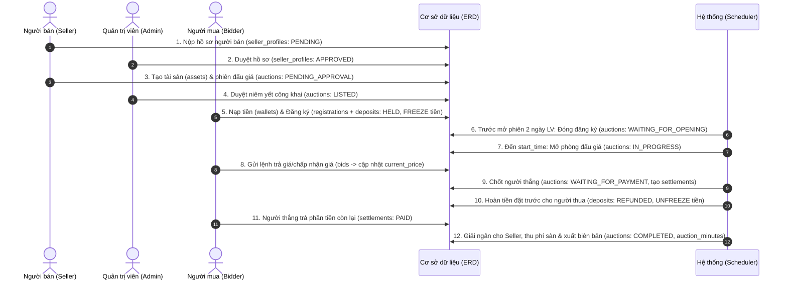
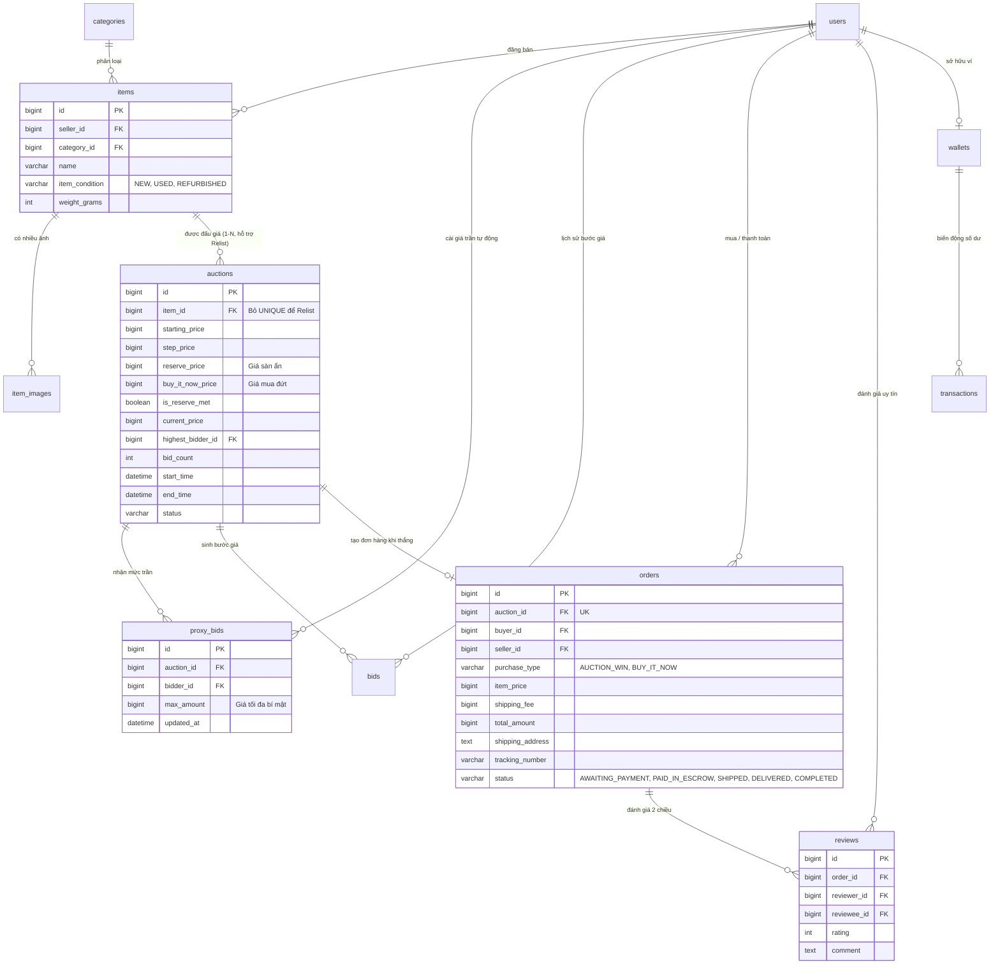

# 📘 TÀI LIỆU GIẢI THÍCH NGHIỆP VỤ ERD & SO SÁNH MÔ HÌNH EBAY

> **Dự án:** Hệ Thống Đấu Giá Trực Tuyến (Online Auction System - `project_1`)  
> **Môn học:** Phát Triển Phần Mềm Hướng Đối Tượng (PTPMHĐT)  
> **Tài liệu liên quan:** [ERD.md](./ERD.md) | [STATE_MACHINES.md](./STATE_MACHINES.md) | [SRS.md](./SRS.md)

---

## MỤC LỤC
1. [Nguyên tắc Thiết kế Cốt lõi (Database Conventions)](#1-nguyên-tắc-thiết-kế-cốt-lõi-database-conventions)
2. [Giải thích Chi tiết 19 Bảng theo 5 Phân hệ Nghiệp vụ](#2-giải-thích-chi-tiết-19-bảng-theo-5-phân-hệ-nghiệp-vụ)
3. [Luồng Nghiệp vụ & Biến đổi Dữ liệu 6 Giai đoạn (`project_1`)](#3-luồng-nghiệp-vụ--biến-đổi-dữ-liệu-6-giai-đoạn-project_1)
4. [Phân tích Mở rộng: Chuyển đổi ERD sang Mô hình Đấu giá eBay](#4-phân-tích-mở-rộng-chuyển-đổi-erd-sang-mô-hình-đấu-giá-ebay)
5. [Ghi chú Trọng tâm khi Báo cáo / Vấn đáp Đồ án (Notes)](#5-ghi-chú-trọng-tâm-khi-báo-cáo--vấn-đáp-đồ-án-notes)

---

## 1. NGUYÊN TẮC THIẾT KẾ CỐT LÕI (DATABASE CONVENTIONS)

Trước khi đi vào từng bảng, ERD của `project_1` tuân thủ **5 nguyên tắc kỹ thuật bất biến** nhằm đảm bảo tính toàn vẹn tài chính và pháp lý:

| STT | Nguyên tắc | Thiết kế trong ERD | Lý do nghiệp vụ |
| :-: | :--- | :--- | :--- |
| **1** | **Tiền tệ chính xác tuyệt đối** | Dùng kiểu `BIGINT` (đơn vị: VNĐ), có ràng buộc `CHECK (amount >= 0)`. | Tránh hoàn toàn sai số làm tròn dấu phẩy động (`FLOAT`/`DOUBLE`) khi tính tiền cọc (5%–20%), phí dịch vụ và hoàn tiền. |
| **2** | **Thời gian chuẩn xác đến mili-giây** | Dùng `DATETIME(3)` theo múi giờ chuẩn `Asia/Ho_Chi_Minh`. | Phân xử công bằng thứ tự đặt giá (`server_time`) khi nhiều người cùng trả giá ở những giây cuối cùng. |
| **3** | **Bất biến lịch sử (Append-only)** | Các bảng `bids`, `transactions`, `audit_logs` chỉ cho phép `INSERT`, cấm `UPDATE`/`DELETE`. | Đảm bảo tính minh bạch, chống sửa đổi lịch sử trả giá hoặc làm lệch sổ cái dòng tiền. |
| **4** | **Chống lặp giao dịch (Idempotency)** | Cột `idempotency_key VARCHAR(100) UNIQUE` tại bảng `transactions`. | Ngăn chặn lỗi trừ tiền hoặc hoàn tiền 2 lần khi mạng chập chờn hoặc hệ thống retry request. |
| **5** | **Bảo mật danh tính phòng đấu giá** | Cột `anonymous_code` (`UNIQUE(auction_id, anonymous_code)`) tại bảng `registrations`. | Che giấu danh tính thật của người mua trong suốt thời gian diễn ra phiên, chống thông đồng dìm giá hoặc đe dọa. |

---

## 2. GIẢI THÍCH CHI TIẾT 19 BẢNG THEO 5 PHÂN HỆ NGHIỆP VỤ

Hệ thống gồm **19 bảng** (14 bảng cốt lõi từ SRS và 5 bảng mở rộng hỗ trợ nghiệp vụ), được chia thành 5 phân hệ:

### 2.1. Phân hệ Người dùng & Định danh (`users`, `seller_profiles`)
* **`users` (Tài khoản người dùng):**
  * Lưu thông tin định danh cá nhân (`username`, `email`, `citizen_id` đều là `UNIQUE`) và tài khoản ngân hàng (`bank_name`, `bank_account_number`) để phục vụ rút tiền/nhận tiền.
  * Mọi người dùng thông thường đều có `role = 'USER'` (mặc định có quyền làm Người mua - Bidder). Quản trị viên có `role = 'ADMIN'`.
* **`seller_profiles` (Hồ sơ người bán):**
  * Quan hệ **1 - 0..1** với `users` (`UNIQUE(user_id)`).
  * **Nghiệp vụ:** Một `USER` muốn đăng tài sản đấu giá phải nộp hồ sơ năng lực/pháp lý vào bảng này. Chỉ khi Admin xét duyệt (`status = 'APPROVED'`), người dùng đó mới được phép tạo tài sản ở bảng `assets`.

### 2.2. Phân hệ Tài sản & Phiên đấu giá (`assets`, `asset_images`, `auctions`, `listing_change_requests`, `auction_follows`, `auction_minutes`)
* **`assets` & `asset_images` (Tài sản & Thư viện ảnh):**
  * Lưu thông tin tài sản thuộc sở hữu của người bán (`seller_id`).
  * Phân loại `asset_type`: Động sản (`MOVABLE`) hoặc Bất động sản (`IMMOVABLE`). Việc phân loại này quyết định thời gian niêm yết tối thiểu theo luật định.
* **`auctions` (Phiên đấu giá):**
  * Quan hệ **1 - 1** với `assets` (`UNIQUE(asset_id)`).
  * Hỗ trợ 2 phương thức đấu giá (`method`):
    1. **Trả giá lên (`ASCENDING`):** Sử dụng `starting_price` (giá khởi điểm) và `step_price` (bước giá tối thiểu mỗi lần trả thêm).
    2. **Đặt giá xuống (`DESCENDING`):** Giá giảm tự động từ `starting_price` theo từng mức `step_price` sau mỗi khoảng thời gian `price_reduction_interval_seconds`, nhưng không thấp hơn giá sàn `floor_price`.
  * Lưu trữ trực tiếp `current_price` và `highest_bidder_id` ngay trên bảng để tối ưu tốc độ đọc thời gian thực trong phòng đấu giá mà không cần `MAX(amount)` trên bảng `bids`.
* **Các bảng mở rộng vòng đời phiên:**
  * **`listing_change_requests`:** Lưu yêu cầu xin thay đổi thông số phiên đấu giá khi đã niêm yết (kèm ảnh chụp JSON `old_values`, `new_values`) để Admin duyệt.
  * **`auction_follows`:** Lưu danh sách phiên đấu giá mà người dùng bấm theo dõi để nhận thông báo nhắc lịch.
  * **`auction_minutes`:** Biên bản đấu giá điện tử (quan hệ 1-1 với `auctions`), tự động chụp toàn bộ kết quả phiên dưới dạng JSON (`snapshot_data`) khi phiên kết thúc (`COMPLETED` hoặc `FAILED`).

### 2.3. Phân hệ Tham gia, Đặt trước, Trả giá & Quyết toán (`registrations`, `deposits`, `bids`, `settlements`)
* **`registrations` (Hồ sơ đăng ký tham gia phiên):**
  * Ràng buộc `UNIQUE(auction_id, bidder_id)`: Mỗi người chỉ được đăng ký tối đa 1 lần cho 1 phiên.
  * Cấp mã ẩn danh 6 chữ số `anonymous_code` duy nhất trong phiên.
  * Cột `decision_on_listing_change` (`CONTINUE` / `DECLINE`): Ghi nhận quyết định đi tiếp hay rút lui nhận lại cọc của người mua nếu phiên đấu giá có sự thay đổi thông tin niêm yết.
* **`deposits` (Tiền đặt trước):**
  * Quan hệ **1 - 1** với `registrations` (`UNIQUE(registration_id)`).
  * Quản lý khoản tiền đặt trước (từ 5% đến 20% giá khởi điểm): từ lúc đang phong tỏa (`HELD`), hoàn trả cho người thua (`REFUNDED`), chuyển thành tiền cọc của người thắng (`CONVERTED_TO_SELLER_DEPOSIT`), hoặc tịch thu nếu vi phạm/bỏ cọc (`FORFEITED`) để chuyển cho người bán (`TRANSFERRED_TO_SELLER`).
* **`bids` (Lịch sử trả giá bất biến):**
  * Lưu **tất cả** các lượt gửi giá của người mua theo `server_time`, bao gồm cả lượt hợp lệ (`is_valid = TRUE`) và không hợp lệ (`is_valid = FALSE` kèm lý do `invalid_reason` như thấp hơn bước giá, gửi chậm hơn người khác...).
* **`settlements` (Thanh toán kết quả trúng đấu giá):**
  * Sinh ra ngay khi xác định được người thắng. Tính toán nghĩa vụ tài chính còn lại:
    $$\text{remaining\_amount} = \text{winning\_price} - \text{deposit\_deducted}$$
  * Theo dõi hạn thanh toán (`payment_deadline`) và trạng thái hoàn tất (`WAITING_FOR_PAYMENT` → `PAID` / `CANCELED` / `OVERDUE`).

### 2.4. Phân hệ Tài chính & Ví điện tử (`wallets`, `transactions`)
* **`wallets` (Ví tiền):**
  * Gồm ví cá nhân của người dùng (`wallet_type = 'USER'`, `UNIQUE(user_id)`) và 2 ví hệ thống (`user_id = NULL`): **Ví ký quỹ (`SYSTEM_ESCROW`)** và **Ví doanh thu phí sàn (`SYSTEM_REVENUE`)**.
  * Tách biệt rõ 2 ngăn tiền:
    * `available_balance`: Số dư khả dụng (có thể rút hoặc dùng để đăng ký phiên mới).
    * `frozen_balance`: Số dư đang bị đóng băng (đang làm tiền đặt trước cho các phiên chưa kết thúc).
* **`transactions` (Sổ cái giao dịch tiền bất biến):**
  * Ghi vết mọi biến động số dư (`balance_before`, `balance_after`) theo 8 loại giao dịch: `TOPUP` (nạp), `WITHDRAW` (rút), `FREEZE` (đóng băng cọc), `UNFREEZE` (giải tỏa cọc), `CONVERT_DEPOSIT` (khấu trừ cọc), `PAYMENT` (thanh toán tiền trúng), `SERVICE_FEE` (thu phí sàn), `PAYOUT_TO_SELLER` (giải ngân cho người bán).
  * Liên kết đa hình (`reference_type` + `reference_id`) trỏ về bản ghi `deposits` hoặc `settlements` tương ứng.

### 2.5. Phân hệ Vận hành, Kiểm toán & Cấu hình (`notifications`, `audit_logs`, `complaints`, `system_configs`, `holidays`)
* **`notifications`:** Lưu thông báo gửi tới người dùng (khi được duyệt hồ sơ, bị vượt giá, trúng đấu giá, hoàn cọc...).
* **`complaints`:** Quản lý đơn khiếu nại của Bidder hoặc Seller đối với một phiên đấu giá kèm đường dẫn bằng chứng (`evidence_url`) và kết luận xử lý của Admin (`resolution_note`).
* **`audit_logs`:** Nhật ký kiểm toán toàn hệ thống, tự động chụp JSON `data_before` và `data_after` kèm địa chỉ IP mỗi khi có thay đổi trạng thái quan trọng.
* **`system_configs` & `holidays`:** Lưu tham số vận hành động (tỷ lệ phí dịch vụ, thời gian chờ thanh toán) và danh sách ngày lễ nhà nước để tính chính xác **ngày làm việc** (Business Days).

---

## 3. LUỒNG NGHIỆP VỤ & BIẾN ĐỔI DỮ LIỆU 6 GIAI ĐOẠN (`project_1`)

### Giai đoạn 1: Chuẩn bị & Niêm yết (`PENDING_APPROVAL` → `LISTED`)
1. Người dùng được duyệt `seller_profiles` (`APPROVED`) tạo bản ghi trong `assets` và `asset_images`.
2. Seller tạo phiên trong `auctions` (`status = 'PENDING_APPROVAL'`), chọn phương thức `ASCENDING` hoặc `DESCENDING`, thiết lập giá khởi điểm và tỷ lệ tiền đặt trước (5%–20%).
3. Admin kiểm tra tính hợp lệ (đối chiếu bảng `holidays` để đảm bảo thời gian niêm yết đủ số ngày làm việc theo quy định) và duyệt phiên sang `status = 'LISTED'`, ghi nhận `listing_at` và `registration_deadline` (trước `start_time` 2 ngày làm việc).

### Giai đoạn 2: Đăng ký & Phong tỏa Tiền đặt trước (`LISTED` → `WAITING_FOR_OPENING`)
1. Bidder nạp tiền vào `wallets` (`transactions`: `TOPUP`).
2. Trước mốc `registration_deadline`, Bidder gửi yêu cầu đăng ký. Hệ thống thực thi trong **1 Database Transaction**:
   * Tạo bản ghi `registrations` kèm mã ẩn danh `anonymous_code`.
   * Tạo bản ghi `deposits` (`status = 'HELD'`, `amount = deposit_amount`).
   * Tại bảng `wallets` của Bidder:
     $$\text{available\_balance} = \text{available\_balance} - \text{deposit\_amount}$$
     $$\text{frozen\_balance} = \text{frozen\_balance} + \text{deposit\_amount}$$
   * Ghi bản ghi `transactions` (`transaction_type = 'FREEZE'`).
3. Đúng mốc `registration_deadline`, Scheduler tự động chuyển `auctions.status` sang `WAITING_FOR_OPENING` (khóa cổng đăng ký mới).

### Giai đoạn 3: Mở phiên & Đấu giá thời gian thực (`WAITING_FOR_OPENING` → `IN_PROGRESS`)
1. Đúng giờ `start_time`, nếu không có người đăng ký hợp lệ, phiên chuyển thẳng sang `FAILED` và hoàn tiền cọc. Ngược lại, phiên chuyển sang `IN_PROGRESS`.
2. **Với Đấu giá Tăng dần (`ASCENDING`):**
   * Khi Bidder đặt giá, hệ thống khóa dòng `auctions` hiện tại, kiểm tra `amount >= current_price + step_price`.
   * Nếu hợp lệ: Lưu `bids` (`is_valid = TRUE`), cập nhật `auctions.current_price = amount` và `auctions.highest_bidder_id = bidder_id`.
   * Nếu không hợp lệ: Lưu `bids` (`is_valid = FALSE`, kèm `invalid_reason`).
3. **Với Đấu giá Giảm dần (`DESCENDING`):**
   * Định kỳ mỗi `price_reduction_interval_seconds`, Scheduler giảm `current_price` một mức `step_price` (tối thiểu bằng `floor_price`).
   * Người đầu tiên gửi lệnh `bid_type = 'ACCEPT'` hợp lệ sẽ trở thành `highest_bidder_id` và kết thúc việc trả giá ngay lập tức.

### Giai đoạn 4: Kết thúc trả giá & Hoàn cọc người thua (`IN_PROGRESS` → `WAITING_FOR_PAYMENT`)
1. Khi xác định được người thắng (`highest_bidder_id`):
   * `auctions.status` chuyển sang `WAITING_FOR_PAYMENT`.
   * Khoản đặt trước của người thắng trong `deposits` chuyển từ `HELD` sang `CONVERTED_TO_SELLER_DEPOSIT`.
   * Tạo bản ghi `settlements` với `remaining_amount = winning_price - deposit_deducted` và hạn chót `payment_deadline`.
2. Đối với tất cả người tham gia **không trúng** (và không vi phạm quy chế):
   * `deposits.status` chuyển sang `REFUNDED`.
   * Trong `wallets`: giảm `frozen_balance`, cộng trả lại vào `available_balance` (`transactions`: `UNFREEZE`).

### Giai đoạn 5: Thanh toán, Giải ngân & Xử lý ngoại lệ (`WAITING_FOR_PAYMENT` → `COMPLETED` / `FAILED`)
* **Trường hợp 1 – Người thắng thanh toán đúng hạn (`PAID`):**
  1. Trừ `remaining_amount` từ `available_balance` của người thắng (`PAYMENT`) và tất toán khoản `frozen_balance` tiền cọc (`CONVERT_DEPOSIT`).
  2. Cộng phí dịch vụ vào ví `SYSTEM_REVENUE` (`SERVICE_FEE`) và cộng tiền bán tài sản (sau khi trừ phí) vào `available_balance` của ví Seller (`PAYOUT_TO_SELLER`).
  3. Cập nhật `deposits.status = 'TRANSFERRED_TO_SELLER'`, `settlements.status = 'PAID'`, `auctions.status = 'COMPLETED'`.
  4. Tự động sinh biên bản điện tử vào bảng `auction_minutes`.
* **Trường hợp 2 – Người thắng bỏ cọc hoặc quá hạn (`CANCELED` / `OVERDUE`):**
  1. Phạt mất cọc: `deposits.status` của người vi phạm chuyển sang `FORFEITED`, tiền cọc được chuyển cho Seller (`TRANSFERRED_TO_SELLER`).
  2. Nếu là đấu giá **Tăng dần**: Xét trao quyền mua cho người trả giá cao liền kề. Nếu không còn ai đồng ý → `auctions.status = 'FAILED'`.
  3. Nếu là đấu giá **Giảm dần**: Đưa phiên quay lại trạng thái `IN_PROGRESS` để tiếp tục giảm giá từ mức giá vừa bị hủy.

---

## 4. PHÂN TÍCH MỞ RỘNG: CHUYỂN ĐỔI ERD SANG MÔ HÌNH ĐẤU GIÁ EBAY

> [!IMPORTANT]
> **Kết luận đánh giá:** ERD gốc của `project_1` chỉ phù hợp khoảng **40% – 50%** nếu áp dụng cho sàn thương mại điện tử đấu giá kiểu **eBay**.
> * **`project_1`:** Mô hình **Đấu giá tài sản pháp lý/nhà nước** (tiền kiểm chặt chẽ, bắt buộc đăng ký trước 2 ngày làm việc, nộp tiền đặt trước 5%–20%, lập biên bản pháp lý).
> * **eBay:** Mô hình **Thương mại điện tử kết hợp Đấu giá tự do (C2C/B2C Marketplace & Proxy Bidding)** (không đăng ký trước, không đặt cọc, trả giá tự động, mua đứt ngay, giao nhận vận chuyển và đánh giá uy tín 2 chiều).

### 4.1. 6 Điểm không phù hợp của ERD gốc khi áp vào eBay
1. **Bắt buộc đăng ký trước & Đặt cọc (`registrations` & `deposits`):** Trên eBay, người mua thấy món hàng là bấm trả giá ngay lập tức (kể cả ở giây cuối cùng), không phải nộp hồ sơ trước 2 ngày hay đóng băng 5%–20% tiền cọc.
2. **Thiếu cơ chế Đấu giá tự động (`Proxy Bidding` / `Max Bid`):** Người mua trên eBay nhập mức giá tối đa sẵn sàng trả (giữ bí mật), hệ thống tự động trả giá hộ từng bước nhỏ nhất để thắng đối thủ. Bảng `bids` hiện tại chỉ lưu giá trực tiếp.
3. **Thiếu giá Mua ngay (`buy_it_now_price`) và Giá sàn ẩn (`reserve_price`):** Trên eBay, người mua có thể mua đứt món hàng ngay lập tức với giá `Buy It Now`, và người bán có thể đặt mức giá kỳ vọng tối thiểu ẩn (`Reserve Price`) mà nếu chưa chạm tới thì không bắt buộc phải bán.
4. **Ràng buộc cứng 1 Tài sản – 1 Phiên (`UNIQUE(asset_id)` trên bảng `auctions`):** Trên eBay, một món hàng đấu giá thất bại có thể được đăng đấu giá lại (**Relist**) nhiều lần (quan hệ `1 - N`).
5. **Quy trình duyệt tay & Lịch nghỉ lễ (`holidays`, `auction_minutes`, `listing_change_requests`):** eBay hoạt động tự động 24/7/365 toàn cầu theo số ngày thực (3, 5, 7, 10 ngày), không trừ ngày lễ nhà nước và không cần Admin duyệt từng bài đăng.
6. **Thiếu phân hệ Giao vận, Đơn hàng & Đánh giá uy tín (`orders`, `reviews`):** Sau khi thắng trên eBay, tiền phải được giữ trong ví ký quỹ (`SYSTEM_ESCROW`) chờ đóng gói, vận chuyển (`tracking_number`), giao hàng thành công (`DELIVERED`) rồi mới giải ngân cho Seller, kèm hệ thống chấm điểm uy tín 2 chiều (Feedback Score) để chống bùng hàng.

### 4.2. Cách thức chỉnh sửa ERD sang mô hình eBay

| Thao tác | Bảng tác động | Chi tiết chỉnh sửa |
| :--- | :--- | :--- |
| **1. Loại bỏ** | `holidays`, `auction_minutes`, `listing_change_requests`, `registrations`, `deposits` | Loại bỏ quy trình đăng ký trước, đặt cọc bắt buộc và lịch nghỉ lễ để cho phép người dùng vào trả giá tức thì (Instant Bidding). |
| **2. Chỉnh sửa** | `assets` $\rightarrow$ `items` | Bỏ `asset_type`; thêm `category_id` (danh mục), `item_condition` (`NEW`, `USED`, `REFURBISHED`), `weight_grams` (tính phí ship). |
| **3. Chỉnh sửa** | `auctions` | Bỏ `UNIQUE(asset_id)` (hỗ trợ Relist), bỏ `deposit_*`, `registration_deadline`. Thêm `buy_it_now_price`, `reserve_price`, `is_reserve_met`, `bid_count`. |
| **4. Thêm mới & Nâng cấp** | `proxy_bids` & `bids` | Thêm bảng `proxy_bids` lưu mức trần bí mật (`max_amount`) của từng Bidder; thêm cột `is_auto_bid` vào bảng `bids` để ghi nhận các bước nhảy giá tự động. |
| **5. Nâng cấp** | `settlements` $\rightarrow$ `orders` | Mở rộng thành bảng Đơn hàng TMĐT: thêm `purchase_type` (`AUCTION_WIN`, `BUY_IT_NOW`), `shipping_fee`, `shipping_address`, `tracking_number`, và trạng thái giao vận (`AWAITING_PAYMENT` $\rightarrow$ `PAID_IN_ESCROW` $\rightarrow$ `SHIPPED` $\rightarrow$ `DELIVERED` $\rightarrow$ `COMPLETED`). |
| **6. Thêm mới** | `categories`, `reviews` | Thêm `categories` (danh mục đa cấp) và `reviews` (đánh giá uy tín 2 chiều Buyer $\leftrightarrow$ Seller sau khi hoàn tất đơn hàng). |

### 4.3. Sơ đồ ERD sau khi chuyển sang mô hình eBay

### 4.4. So sánh Điểm mạnh & Điểm yếu giữa 2 Mô hình (Trade-offs)

| Tiêu chí | Mô hình ERD gốc (`project_1` - Đấu giá Pháp lý) | Mô hình ERD cải tiến (Kiểu eBay - Đấu giá TMĐT) |
| :--- | :--- | :--- |
| **Rào cản tham gia** | **Cao:** Phải đăng ký trước 2 ngày làm việc và nộp tiền đặt trước 5%–20%. | **Rất thấp (Điểm mạnh lớn nhất):** Thấy hàng là bấm trả giá ngay trong 1 giây, tỷ lệ chuyển đổi (Conversion Rate) cực cao. |
| **Rủi ro bùng hàng (Non-paying Bidder)** | **Rất thấp (Điểm mạnh lớn nhất):** Người thắng bỏ cuộc sẽ bị tịch thu ngay khoản tiền đặt trước (`FORFEITED`) đền bù cho Seller. | **Cao (Điểm yếu lớn nhất):** Không giữ tiền cọc trước nên người thắng dễ bỏ chạy. Phải khắc phục bằng khóa tài khoản (`unpaid_strikes`), giới hạn hạn mức bid hoặc yêu cầu liên kết thẻ trước. |
| **Tiện ích cho người mua & người bán** | Đấu giá thủ công trực tiếp trong khung giờ cố định. | **Rất linh hoạt:** Có `Proxy Bidding` tự động trả giá hộ, `Buy It Now` mua đứt ngay, `Reserve Price` bảo vệ người bán khỏi bán lỗ. |
| **Khả năng mở rộng (Scalability)** | Giới hạn bởi khâu Admin duyệt từng hồ sơ đăng ký và duyệt từng phiên đấu giá. | **Tự động hóa 100%:** Mở rộng lên hàng triệu phiên đấu giá đồng thời mà không cần Admin duyệt tay. |
| **Tải xử lý đồng thời (Concurrency)** | Ổn định do số lượng Bidder trong 1 phòng đã được chốt cố định trước 2 ngày làm việc. | **Rất khắc nghiệt ở giây cuối (Auction Sniping):** Hàng trăm người có thể nhảy vào đặt lệnh ở 5 giây cuối cùng kết hợp tính toán `proxy_bids`, đòi hỏi khóa bi quan (`FOR UPDATE`) hoặc hàng đợi Redis. |
| **Tính tuân thủ pháp luật VN** | **Đạt chuẩn:** Phù hợp đấu giá tài sản công, đất đai, biển số xe, tài sản thi hành án theo Luật Đấu giá tài sản. | **Không áp dụng được cho tài sản công pháp lý:** Chỉ phù hợp làm sàn thương mại điện tử dân sự (C2C/B2C). |

---

## 5. GHI CHÚ TRỌNG TÂM KHI BÁO CÁO / VẤN ĐÁP ĐỒ ÁN (NOTES)

> [!TIP]
> Dưới đây là 5 câu hỏi phản biện thường gặp nhất khi bảo vệ ERD của `project_1` và gợi ý trả lời ngắn gọn:

1. **Câu hỏi 1: Tại sao trong bảng `auctions` đã có quan hệ với bảng `bids`, mà lại lưu thêm `current_price` và `highest_bidder_id` gây dư thừa dữ liệu (Denormalization)?**
   * **Trả lời:** Đây là kỹ thuật **Denormalization có chủ đích để tối ưu hiệu năng đọc thời gian thực**. Trong phòng đấu giá có hàng trăm client truy vấn liên tục mỗi giây, việc đọc trực tiếp `current_price` và `highest_bidder_id` trên 1 dòng của bảng `auctions` (O(1)) nhanh hơn rất nhiều so với việc phải chạy truy vấn `SELECT MAX(amount) FROM bids WHERE auction_id = ? AND is_valid = TRUE` trên bảng lịch sử lớn. Đồng thời, khóa dòng (`SELECT ... FOR UPDATE`) trên `auctions` cũng giúp kiểm soát Concurrency tại một điểm duy nhất.

2. **Câu hỏi 2: Tại sao những lượt trả giá bị lỗi/không hợp lệ vẫn lưu vào bảng `bids` (`is_valid = FALSE`) mà không chặn và bỏ đi ở tầng Service?**
   * **Trả lời:** Trong nghiệp vụ đấu giá trực tuyến, người mua rất hay khiếu nại: *"Tôi đã bấm trả giá cao hơn trước khi hết giờ, tại sao không được ghi nhận?"*. Việc lưu lại cả các lượt trả giá bị từ chối kèm `server_time` (độ chính xác mili-giây) và `invalid_reason` vào bảng bất biến `bids` giúp hệ thống có **bằng chứng pháp lý không thể chối cãi** khi giải quyết khiếu nại (`complaints`).

3. **Câu hỏi 3: Làm sao đảm bảo tiền trong ví (`wallets`) không bao giờ bị âm hoặc bị trừ 2 lần khi người dùng bấm đúp chuột (Double-click)?**
   * **Trả lời:** Hệ thống kết hợp 3 lớp bảo vệ:
     1. Ở tầng Database: Ràng buộc `CHECK (available_balance >= 0)` và `CHECK (frozen_balance >= 0)`.
     2. Ở tầng Giao dịch (`transactions`): Cột `idempotency_key` có ràng buộc `UNIQUE` chặn mọi request trùng lặp.
     3. Ở tầng Thực thi Backend: Sử dụng Transaction cô lập kèm khóa dòng ví khi chuyển tiền giữa `available_balance` và `frozen_balance`.

4. **Câu hỏi 4: Tại sao không gộp bảng `registrations` và `deposits` làm một vì chúng có quan hệ 1-1?**
   * **Trả lời:** Tách riêng để đảm bảo **Nguyên lý Đơn trách nhiệm (Single Responsibility Principle - SRP)** và tách biệt 2 vòng đời trạng thái độc lập ([STATE_MACHINES.md](./STATE_MACHINES.md)):
     * `registrations` quản lý **tư cách pháp lý và điểm danh phòng đấu giá** (`PENDING_REVIEW` → `VALID` → `ATTENDED` / `DISQUALIFIED`).
     * `deposits` quản lý **nghĩa vụ tài chính và dòng tiền ký quỹ** (`SUBMITTED`/`HELD` → `REFUNDED` / `CONVERTED_TO_DEPOSIT` / `FORFEITED` → `TRANSFERRED_TO_SELLER`).

5. **Câu hỏi 5: Tại sao bảng `transactions` dùng `reference_type` và `reference_id` thay vì tạo khóa ngoại cứng (`FK`) tới `deposits` và `settlements`?**
   * **Trả lời:** Vì một giao dịch ví có thể phát sinh từ nhiều nguồn nghiệp vụ khác nhau: nạp/rút tiền trực tiếp (`TOPUP`/`WITHDRAW`), phong tỏa tiền đặt trước (`DEPOSIT`), hoặc thanh toán kết quả trúng đấu giá (`SETTLEMENT`). Thiết kế **Polymorphic Association (`reference_type` + `reference_id`)** giúp bảng sổ cái `transactions` gọn gàng, không bị chứa nhiều cột khóa ngoại `NULL` và dễ dàng mở rộng thêm các loại giao dịch mới trong tương lai.
