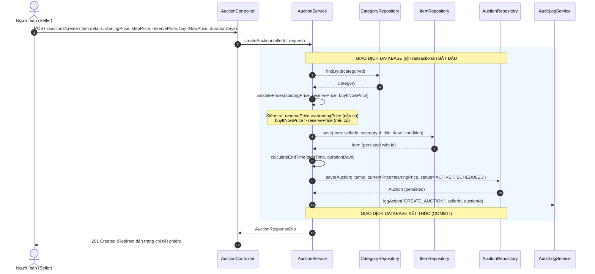
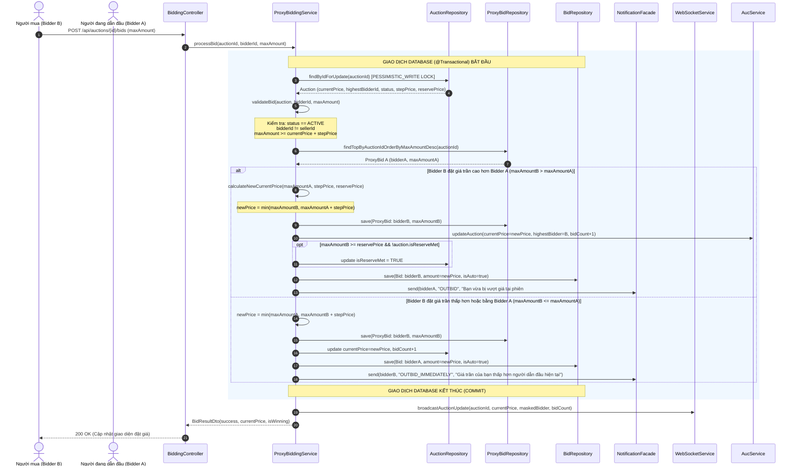
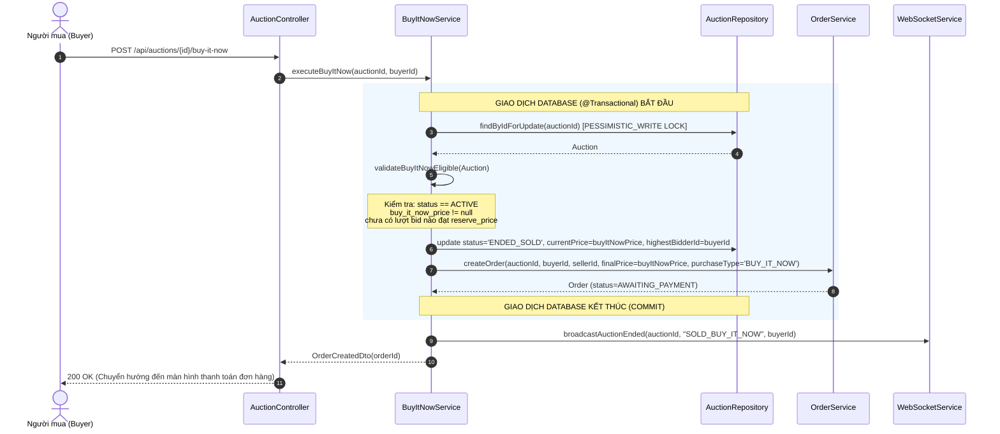
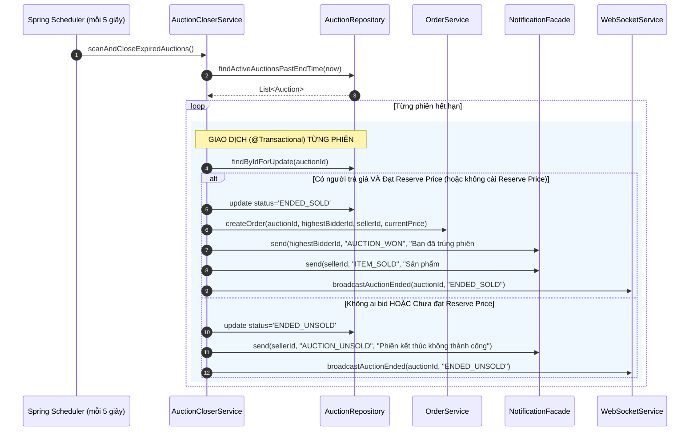
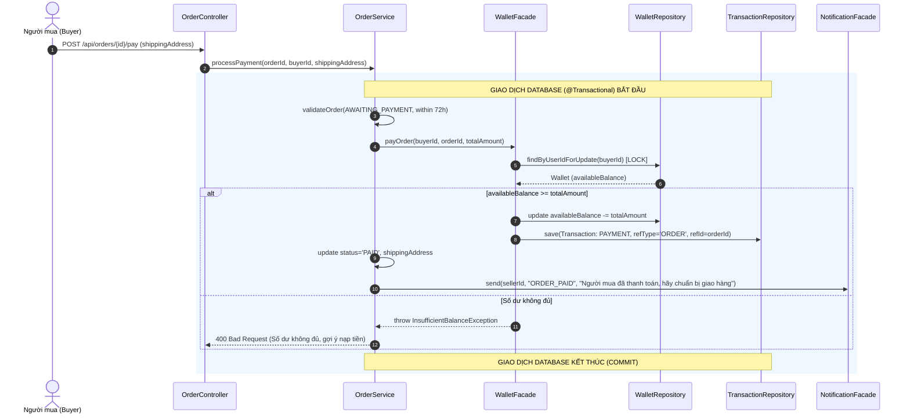
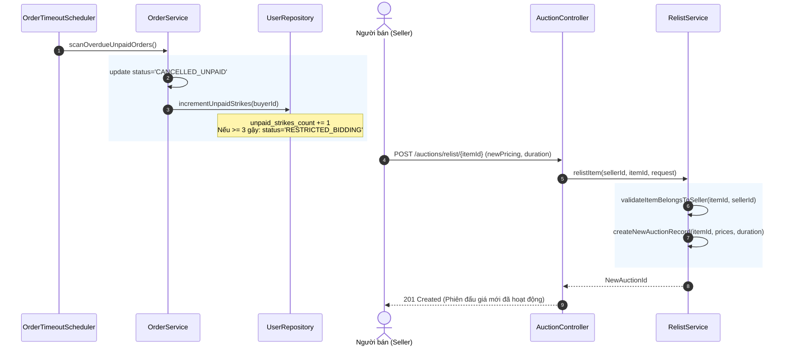

# 🔄 TÀI LIỆU SƠ ĐỒ TUẦN TỰ HỆ THỐNG (SEQUENCE DIAGRAMS)

> **Dự án:** Hệ Thống Đấu Giá Trực Tuyến (Cơ chế Đấu giá Tự động)  
> **Căn cứ:** `docs/SRS.md`, `docs/PLAN.md` (Ngày 3, 4), `docs/ERD.md`  
> **Quy tắc vàng:** Thể hiện rõ ranh giới giao dịch DB (`@Transactional`), điểm khóa dòng Concurrency (`SELECT ... FOR UPDATE`), sự kiện miền (Domain Events) và thông báo thời gian thực (WebSocket STOMP).

---

## 1. UC-01: ĐĂNG MÓN HÀNG VÀ THIẾT LẬP PHIÊN ĐẤU GIÁ (LISTING)

---

## 2. UC-02: ĐẤU GIÁ TỰ ĐỘNG (PROXY BIDDING ENGINE)

---

## 3. UC-03: MUA NGAY (BUY IT NOW)

---

## 4. UC-04: ĐÓNG PHIÊN TỰ ĐỘNG & CHỐT NGƯỜI THẮNG (AUCTION CLOSER)

---

## 5. UC-05: THANH TOÁN ĐƠN HÀNG QUA VÍ (CHECKOUT & ESCROW PAYMENT)

---

## 6. UC-06: XỬ LÝ BÙNG HÀNG (UNPAID ITEM) & ĐĂNG LẠI PHIÊN (RELIST)

