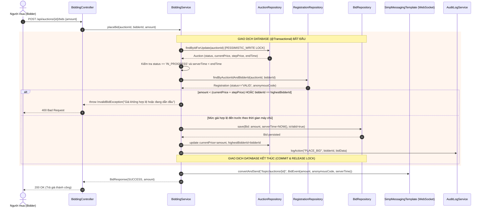
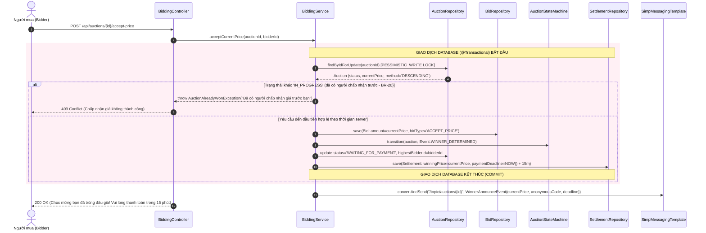
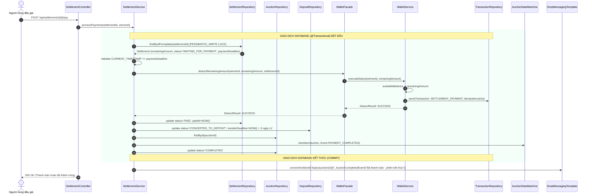
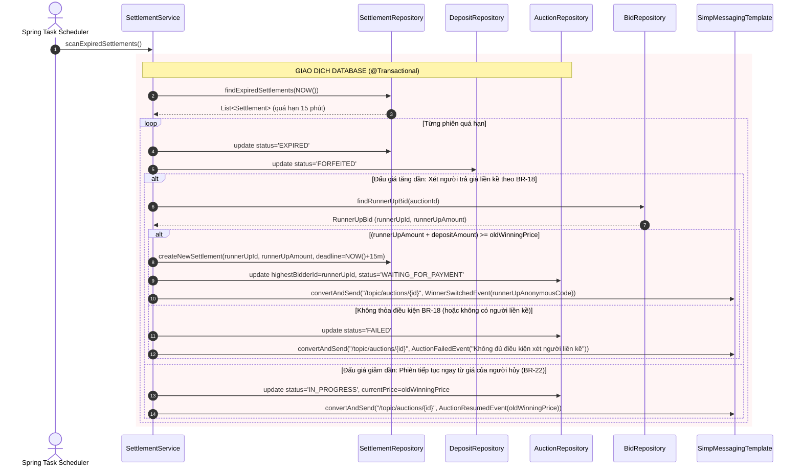

# 🔄 TÀI LIỆU SƠ ĐỒ TUẦN TỰ HỆ THỐNG (SEQUENCE DIAGRAMS - PHẦN 1)

> **Dự án:** Hệ Thống Đấu Giá Trực Tuyến (Online Auction System)  
> **Căn cứ:** docs/SRS.md (Mục 6: UC-01 đến UC-04, NFR-03), docs/STATE_MACHINES.md, docs/ERD.md, docs/PLAN.md (Ngày 3)  
> **Quy tắc vàng:** Chỉ gọi qua Facade; phân định rõ ranh giới giao dịch DB (`@Transactional`), điểm khóa dòng Concurrency (`Pessimistic Lock`), điểm ghi sổ cái ví tiền và phát sự kiện thời gian thực qua WebSocket STOMP.

---

## 1. UC-01: ĐĂNG KÝ THAM GIA PHIÊN VÀ NỘP TIỀN ĐẶT TRƯỚC

### 1.1. Luồng chính (Đăng ký thành công & Phong tỏa tiền ký quỹ)

```mermaid
sequenceDiagram
    autonumber
    actor Bidder as Người mua (Bidder)
    participant RegCtrl as RegistrationController
    participant RegService as RegistrationService
    participant RegRepo as RegistrationRepository
    participant DepRepo as DepositRepository
    participant WalletFacade as WalletFacade
    participant WallService as WalletService
    participant WallRepo as WalletRepository
    participant TxRepo as TransactionRepository
    participant AuditService as AuditLogService

    Bidder->>RegCtrl: POST /api/auctions/{id}/registrations (cam kết quy chế)
    RegCtrl->>RegService: registerAuction(auctionId, bidderId)
    
    rect rgb(240, 248, 255)
        note over RegService, TxRepo: GIAO DỊCH DATABASE (@Transactional) BẮT ĐẦU
        RegService->>RegRepo: findByAuctionIdAndBidderId(auctionId, bidderId)
        RegRepo-->>RegService: null (chưa đăng ký)
        
        RegService->>RegService: Kiểm tra hạn nộp (trước start_time 2 ngày LV - BR-09)
        RegService->>RegService: Kiểm tra tư cách pháp lý (không phải Seller - BR-06, BR-04)

        %% Gọi qua WalletFacade để phong tỏa tiền ký quỹ
        RegService->>WalletFacade: freezeDeposit(bidderId, depositAmount, auctionId)
        WalletFacade->>WallService: executeFreeze(bidderId, depositAmount, refId)
        
        %% Khóa dòng ví người dùng để kiểm tra và trừ tiền an toàn
        WallService->>WallRepo: findByUserIdForUpdate(bidderId) [PESSIMISTIC_WRITE LOCK]
        WallRepo-->>WallService: Wallet (availableBalance, frozenBalance)
        
        alt Số dư khả dụng availableBalance >= depositAmount
            WallService->>WallService: availableBalance -= depositAmount; frozenBalance += depositAmount
            WallService->>WallRepo: save(Wallet)
            
            %% Ghi nhật ký biến động ví bất biến (Append-only)
            WallService->>TxRepo: save(Transaction: FREEZE_ESCROW, idempotencyKey)
            TxRepo-->>WallService: Transaction persisted
            WallService-->>WalletFacade: FreezeResult: SUCCESS
            WalletFacade-->>RegService: FreezeResult: SUCCESS
        else Số dư không đủ (Luồng thay thế 4a)
            WallService-->>WalletFacade: throw InsufficientBalanceException
            WalletFacade-->>RegService: throw InsufficientBalanceException
            RegService-->>RegCtrl: Lỗi: Số dư khả dụng không đủ để nộp cọc
            RegCtrl-->>Bidder: 400 Bad Request (Gợi ý nạp thêm tiền)
        end

        %% Cấp mã ẩn danh ngẫu nhiên duy nhất trong phiên
        RegService->>RegService: generateUniqueAnonymousCode(auctionId)
        RegService->>RegRepo: save(Registration: status=PENDING_REVIEW, anonymousCode)
        RegRepo-->>RegService: Registration saved

        RegService->>DepRepo: save(Deposit: status=SUBMITTED, amount=depositAmount)
        DepRepo-->>RegService: Deposit saved

        RegService->>AuditService: logAction("REGISTER_AUCTION", bidderId, regData)
        note over RegService, TxRepo: GIAO DỊCH DATABASE KẾT THÚC (COMMIT)
    end

    RegService-->>RegCtrl: RegistrationResponse(anonymousCode, status=PENDING_REVIEW)
    RegCtrl-->>Bidder: 201 Created (Đã nộp cọc & cấp mã ẩn danh)
```

### 1.2. Luồng thẩm định hồ sơ của Admin (BR-05)

```mermaid
sequenceDiagram
    autonumber
    actor Admin as Quản trị viên (Admin)
    participant AdminCtrl as AdminRegistrationController
    participant RegService as RegistrationService
    participant RegRepo as RegistrationRepository
    participant NotifService as NotificationService
    participant WalletFacade as WalletFacade

    Admin->>AdminCtrl: PUT /api/admin/registrations/{id}/review (APPROVED / REJECTED)
    AdminCtrl->>RegService: reviewRegistration(regId, adminDecision, rejectReason)

    rect rgb(240, 248, 255)
        note over RegService, RegRepo: GIAO DỊCH DATABASE (@Transactional)
        RegService->>RegRepo: findById(regId)
        RegRepo-->>RegService: Registration
        
        alt Hồ sơ hợp lệ (Admin duyệt)
            RegService->>RegRepo: update status = 'VALID'
            RegService->>NotifService: send(bidderId, "Hồ sơ tham gia phiên đã được duyệt")
        else Hồ sơ không hợp lệ (Luồng thay thế 6a)
            RegService->>RegRepo: update status = 'REJECTED', rejectionReason
            %% Tự động hoàn tiền cọc vào ví theo BR-12
            RegService->>WalletFacade: unfreezeDeposit(bidderId, depositAmount, auctionId)
            RegService->>NotifService: send(bidderId, "Hồ sơ bị từ chối; tiền cọc đã hoàn về ví")
        end
    end
    RegService-->>AdminCtrl: ReviewCompleted
    AdminCtrl-->>Admin: 200 OK
```

---

## 2. UC-02: TRẢ GIÁ TRONG ĐẤU GIÁ TĂNG DẦN (ASCENDING AUCTION)

### 2.1. Luồng chính (Trả giá hợp lệ và phát tán real-time qua WebSocket)



### 2.2. Luồng người trả giá cao nhất rút lại giá trước khi công bố (BR-17)

```mermaid
sequenceDiagram
    autonumber
    actor WinnerBidder as Người dẫn đầu rút giá
    participant BidCtrl as BiddingController
    participant BidService as BiddingService
    participant AucRepo as AuctionRepository
    participant BidRepo as BidRepository
    participant RegRepo as RegistrationRepository
    participant DepRepo as DepositRepository
    participant WsTemplate as SimpMessagingTemplate

    WinnerBidder->>BidCtrl: POST /api/auctions/{id}/withdraw-bid
    BidCtrl->>BidService: withdrawHighestBid(auctionId, bidderId)

    rect rgb(255, 245, 238)
        note over BidService, DepRepo: GIAO DỊCH DATABASE (@Transactional)
        BidService->>AucRepo: findByIdForUpdate(auctionId) [PESSIMISTIC_WRITE LOCK]
        
        %% Kiểm tra người rút bắt buộc phải là người đang dẫn đầu (DECISION-7)
        BidService->>BidService: Verify bidderId == auction.highestBidderId
        
        %% Truất quyền người rút và phạt mất cọc (BR-14, BR-17, DECISION-17)
        BidService->>RegRepo: update status = 'DISQUALIFIED'
        BidService->>DepRepo: update status = 'FORFEITED' (tiền phạt cọc thuộc về Seller)
        
        %% Tìm lượt trả giá hợp lệ liền kề trước đó
        BidService->>BidRepo: findPreviousValidHighestBid(auctionId)
        BidRepo-->>BidService: PreviousBid (runnerUpBidderId, runnerUpAmount)
        
        %% Lùi giá hiện hành về giá của người liền kề
        BidService->>AucRepo: update currentPrice = runnerUpAmount, highestBidderId = runnerUpBidderId
    end

    %% Thông báo cập nhật lùi giá phòng đấu giá qua WebSocket
    BidService->>WsTemplate: convertAndSend("/topic/auctions/{id}", RollbackEvent(runnerUpAmount, runnerUpAnonymousCode))
    BidCtrl-->>WinnerBidder: 200 OK (Đã xử lý rút giá; mất tiền cọc và bị truất quyền)
```

---

## 3. UC-03: CHẤP NHẬN GIÁ TRONG ĐẤU GIÁ GIẢM DẦN (DUTCH AUCTION)



---

## 4. UC-04: THANH TOÁN SAU KHI TRÚNG ĐẤU GIÁ

### 4.1. Luồng chính (Thanh toán thành công trong hạn 15 phút)



### 4.2. Luồng người trúng hủy / quá hạn thanh toán $\rightarrow$ Xét người liền kề (BR-18, BR-27)



---

## 5. RANH GIỚI GIAO DỊCH DATABASE (DATABASE TRANSACTION BOUNDARIES)

Nhằm đảm bảo tính bất khả phân chia (**ACID**), dưới đây là 4 thao tác nhạy cảm nhất hệ thống được chốt ranh giới giao dịch:

| Thao tác nghiệp vụ | Các bước thực thi trong cùng 1 Giao dịch DB (`@Transactional`) | Cơ chế khóa (Concurrency Control) |
| :--- | :--- | :--- |
| **1. Trả giá tăng dần (`placeBid`)** | 1. Khóa đọc phiên đấu giá.<br>2. Kiểm tra hạn giờ & bước giá $P_{\text{mới}} \ge P_{\text{cũ}} + \Delta P$.<br>3. Kiểm tra người trả giá không phải người đang dẫn đầu.<br>4. Lưu bản ghi `bids` (Append-only).<br>5. Cập nhật `current_price` và `highest_bidder_id` trong `auctions`.<br>6. Ghi nhật ký vào `audit_logs`. | `SELECT ... FOR UPDATE` trên bảng `auctions` (Pessimistic Lock). |
| **2. Chấp nhận giá giảm dần (`acceptPrice`)** | 1. Khóa đọc phiên đấu giá.<br>2. Kiểm tra `status == 'IN_PROGRESS'`.<br>3. Lưu bản ghi `bids` loại `ACCEPT_PRICE`.<br>4. Chuyển `auctions.status` sang `WAITING_FOR_PAYMENT`.<br>5. Tạo bản ghi `settlements` với hạn thanh toán 15 phút.<br>6. Ghi nhật ký `audit_logs`. | `SELECT ... FOR UPDATE` trên bảng `auctions`. Người đến sau bị chặn ngay. |
| **3. Công bố người trúng (`determineWinner`)** | 1. Khóa đọc phiên đấu giá khi scheduler phát hiện hết giờ.<br>2. Kiểm tra xem có ít nhất 1 lượt trả giá hợp lệ không.<br>3. Nếu có: Chuyển `auctions.status` $\rightarrow$ `WAITING_FOR_PAYMENT` và tạo `settlements`.<br>4. Nếu không: Chuyển `auctions.status` $\rightarrow$ `FAILED`. | `SELECT ... FOR UPDATE` kết hợp câu lệnh update có điều kiện trạng thái nguồn. |
| **4. Thanh toán kết quả (`settlePayment`)** | 1. Khóa đọc bản ghi `settlements`.<br>2. Kiểm tra hạn `payment_deadline`.<br>3. Khóa ví người trúng, trừ số dư khả dụng phần tiền còn lại.<br>4. Ghi bản ghi sổ cái `transactions` (chống trùng bằng `idempotency_key`).<br>5. Cập nhật `settlements.status = 'PAID'`.<br>6. Đổi `deposits.status = 'CONVERTED_TO_DEPOSIT'`.<br>7. Đổi `auctions.status = 'COMPLETED'`. | Khóa kép: Khóa dòng `settlements` và khóa dòng `wallets` của người trúng. |

---

## 6. DỮ LIỆU KIỂM THỬ SỐ HỌC CHO QUY TẮC BR-18 (NGƯỜI TRẢ GIÁ LIỀN KỀ)

Quy tắc **Điều 51 khoản 1 Luật Đấu giá tài sản (BR-18)** quy định:
$$\text{Giá của người liền kề} + \text{Tiền đặt trước của người từ chối} \ge \text{Giá của người từ chối trúng}$$

Dưới đây là 2 bộ dữ liệu số chuẩn hóa dùng làm Test Case kiểm thử tự động (Unit Test / Integration Test):

### 6.1. Ví dụ số 1: HỢP LỆ (Thỏa mãn điều kiện BR-18)

- **Thông số ban đầu:**
  - Tài sản: Xe ô tô Camry 2.5Q.
  - Giá khởi điểm: $100.000.000$ VNĐ.
  - Mức đặt trước ($10\%$): $10.000.000$ VNĐ.
- **Diễn biến trả giá:**
  - Người A (Mã ẩn danh 001): Trả giá cao nhất $150.000.000$ VNĐ $\rightarrow$ Trúng đấu giá.
  - Người B (Mã ẩn danh 002): Trả giá liền kề $142.000.000$ VNĐ.
- **Biến cố:**
  - Hết 15 phút, Người A hủy thanh toán $\rightarrow$ Người A bị phạt mất cọc $10.000.000$ VNĐ (chuyển cho Người bán theo BR-14).
- **Kiểm tra công thức BR-18:**
  $$\text{Vế trái} = 142.000.000 + 10.000.000 = 152.000.000 \text{ VNĐ}$$
  $$\text{Vế phải (Giá người A trúng)} = 150.000.000 \text{ VNĐ}$$
  $$\Rightarrow 152.000.000 \ge 150.000.000 \quad \text{\textbf{(THỎA MÃN ĐIỀU KIỆN BR-18!)}}$$
- **Kết quả:** Hệ thống kích hoạt quyền mua cho Người B. Khi Người B thanh toán đủ $142.000.000$ VNĐ (sau khi trừ cọc của mình), Người B chính thức là người trúng đấu giá.

---

### 6.2. Ví dụ số 2: KHÔNG HỢP LỆ (Không thỏa mãn điều kiện BR-18)

- **Thông số ban đầu:**
  - Tài sản: Đồng hồ Rolex Submariner.
  - Giá khởi điểm: $100.000.000$ VNĐ.
  - Mức đặt trước ($10\%$): $10.000.000$ VNĐ.
- **Diễn biến trả giá:**
  - Người A (Mã ẩn danh 001): Trả giá cao nhất $160.000.000$ VNĐ $\rightarrow$ Trúng đấu giá.
  - Người B (Mã ẩn danh 002): Trả giá liền kề $145.000.000$ VNĐ.
- **Biến cố:**
  - Người A chủ động bấm từ chối kết quả $\rightarrow$ Người A bị mất cọc $10.000.000$ VNĐ.
- **Kiểm tra công thức BR-18:**
  $$\text{Vế trái} = 145.000.000 + 10.000.000 = 155.000.000 \text{ VNĐ}$$
  $$\text{Vế phải (Giá người A trúng)} = 160.000.000 \text{ VNĐ}$$
  $$\Rightarrow 155.000.000 < 160.000.000 \quad \text{\textbf{(KHÔNG THỎA MÃN ĐIỀU KIỆN!) } }$$
- **Kết quả:** Hệ thống **tuyệt đối không được bán** cho Người B để bảo vệ quyền lợi của Người bán (tránh bị thất thoát giá trị tài sản). Phiên đấu giá lập tức chuyển sang trạng thái `FAILED` (Không thành theo BR-24).
