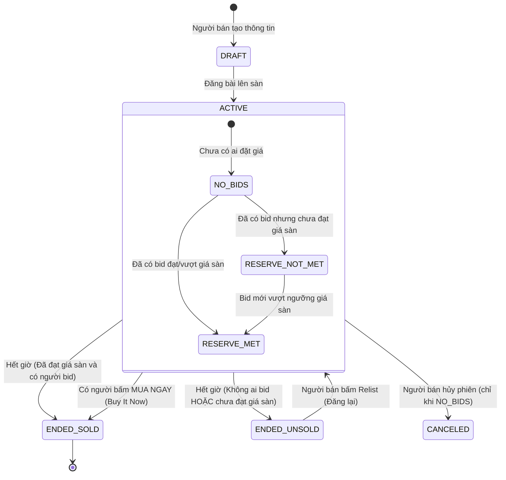
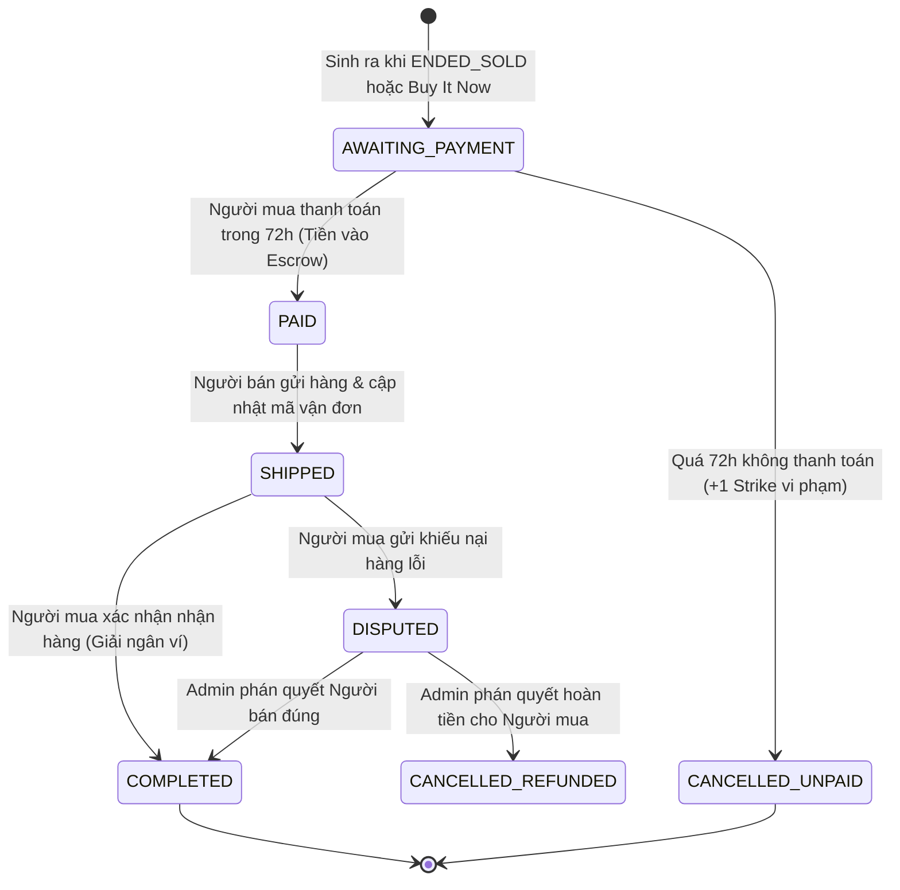

# TÀI LIỆU ĐẶC TẢ YÊU CẦU PHẦN MỀM (SRS)

*(Software Requirements Specification — SRS)*

## HỆ THỐNG ĐẤU GIÁ TRỰC TUYẾN (CƠ CHẾ ĐẤU GIÁ TỰ ĐỘNG)

| Thông tin | Chi tiết |
| :--- | :--- |
| **Dự án** | Hệ Thống Đấu Giá Trực Tuyến (Online Auction System) |
| **Phiên bản** | 2.0 (Chuẩn hóa cơ chế Đấu giá Tự động) |
| **Công nghệ** | Java 17, Spring Boot 3, MySQL, Flyway, Thymeleaf + Bootstrap, WebSocket |
| **Định hướng** | Tập trung vào cơ chế đấu giá cốt lõi: Đăng bán hàng hóa, Trả giá tự động (Proxy Bidding), Giá sàn ẩn (Reserve Price), Mua đứt (Buy It Now), Đăng lại (Relist) và Đơn hàng (Order). |

---

## MỤC LỤC
1. [Giới thiệu](#1-giới-thiệu)
2. [Tổng quan hệ thống](#2-tổng-quan-hệ-thống)
3. [Yêu cầu chức năng theo vai trò](#3-yêu-cầu-chức-năng-theo-vai-trò)
4. [Quy tắc nghiệp vụ (Business Rules)](#4-quy-tắc-nghiệp-vụ-business-rules)
5. [Vòng đời phiên đấu giá và đơn hàng](#5-vòng-đời-phiên-đấu-giá-và-đơn-hàng)
6. [Đặc tả Use Case chính](#6-đặc-tả-use-case-chính)
7. [Thực thể dữ liệu chính (14 Bảng)](#7-thực-thể-dữ-liệu-chính-14-bảng)
8. [Yêu cầu phi chức năng (NFR)](#8-yêu-cầu-phi-chức-năng-nfr)
9. [Các quyết định thiết kế đã chốt](#9-các-quyết-định-thiết-kế-đã-chốt)

---

## 1. GIỚI THIỆU

### 1.1. Mục tiêu
Cung cấp sàn thương mại điện tử chuyên biệt về đấu giá trực tuyến công bằng, minh bạch, có tính cạnh tranh thời gian thực. Hệ thống sử dụng phương thức **Đấu giá tăng dần kết hợp Đấu giá tự động (Proxy Bidding)** giúp người tham gia không cần canh màn hình liên tục mà vẫn bảo đảm cơ hội chiến thắng với mức giá tối ưu nhất.

### 1.2. Phạm vi
* **Trong phạm vi:**
  - Người bán (Seller) quản lý món hàng (`items`), phân loại theo danh mục (`categories`), thiết lập thông số đấu giá (giá khởi điểm, bước giá, giá sàn ẩn, giá mua ngay).
  - Người mua (Bidder) tham gia trả giá tức thì (**Instant Bidding**) không cần nộp hồ sơ xét duyệt trước, cài đặt mức giá trần bí mật (Max Bid).
  - Hệ thống tự động so khớp giá trần và sinh ra các bước giá công khai hiển thị theo thời gian thực.
  - Tự động đóng phiên theo đồng hồ cứng (**Hard-close**), kiểm tra giá sàn, chốt người thắng và tạo Đơn hàng (`orders`).
  - Thanh toán đơn hàng qua Ví nội bộ bảo chứng (Escrow), xử lý bùng hàng (**Unpaid Item Strike**), hỗ trợ đăng lại (**Relist**) hoặc gửi lời chào mua cho người về nhì (**Second Chance Offer**).
  - Đánh giá uy tín 2 chiều và tiếp nhận giải quyết khiếu nại.
* **Ngoài phạm vi:**
  - Không áp dụng các thủ tục hành chính/tư pháp phức tạp (không thu tiền đặt cọc trước 5%–20%, không lập biên bản đấu giá nhà nước, không xét duyệt cọc 2 ngày trước phiên).
  - Tích hợp cổng thanh toán thực tế (hệ thống mô phỏng qua ví điện tử nội bộ).

### 1.3. Thuật ngữ cốt lõi
| Thuật ngữ | Giải thích |
| :--- | :--- |
| **Phiên đấu giá (Auction)** | Một phiên giao dịch niêm yết một món hàng cụ thể với thời gian mở và đóng định trước. |
| **Proxy Bidding (Tự động nâng giá)** | Cơ chế người mua đặt trước mức giá tối đa bí mật (Max Bid); hệ thống tự động trả giá thay họ theo bước giá tối thiểu để luôn dẫn đầu. |
| **Max Bid (Giá trần bí mật)** | Con số cao nhất mà người mua sẵn sàng chi trả cho phiên, được giữ bí mật 100% ở server. |
| **Reserve Price (Giá sàn ẩn)** | Mức giá tối thiểu bí mật mà Seller chấp nhận bán. Nếu kết thúc phiên mà giá cao nhất chưa đạt mức này, phiên không thành và Seller không phải giao hàng. |
| **Buy It Now (Mua ngay)** | Mức giá cố định cho phép người mua mua đứt sản phẩm và kết thúc phiên đấu giá ngay lập tức. |
| **Relist (Đăng lại)** | Tính năng cho phép người bán tạo phiên đấu giá mới từ chính món hàng cũ khi phiên trước bị hủy hoặc không ai mua. |
| **Second Chance Offer** | Lời đề nghị bán hàng gửi riêng cho người về nhì với mức giá người đó từng trả khi người thắng cuộc bùng hàng. |
| **Unpaid Item Strike** | Gậy phạt ghi nhận người thắng cuộc không thanh toán tiền hàng đúng hạn (72 giờ). |

---

## 2. TỔNG QUAN HỆ THỐNG

### 2.1. Các vai trò người dùng
1. **Khách vãng lai (Guest):** Xem danh sách phiên đấu giá, xem chi tiết sản phẩm, xem lịch sử trả giá công khai, xem đồng hồ đếm ngược.
2. **Người mua (Bidder / User):** Cài đặt giá trần tự động (Max Bid), sử dụng tính năng Mua ngay (Buy It Now), theo dõi trạng thái dẫn đầu/bị vượt giá, thanh toán đơn hàng sau khi trúng, đánh giá người bán.
3. **Người bán (Seller / User):** Đăng món hàng, chọn danh mục, tải ảnh, thiết lập giá khởi điểm, giá sàn ẩn, giá mua ngay, theo dõi tiến độ đấu giá, xác nhận giao hàng, Relist món hàng.
4. **Quản trị viên (Admin):** Giám sát toàn bộ hệ thống, quản lý danh mục sản phẩm, cấu hình bước giá và phí dịch vụ, xử lý khiếu nại, khóa tài khoản vi phạm nhiều gậy bùng hàng.

---

## 3. YÊU CẦU CHỨC NĂNG THEO VAI TRÒ

### 3.1. Nhóm Khách & Người dùng chung (FR-GU / FR-US)
* **FR-GU-01 (Tìm kiếm & Khám phá):** Xem danh sách phiên đấu giá đang mở, lọc theo danh mục, lọc theo mức giá, sắp xếp theo thời gian sắp kết thúc hoặc lượt bid nhiều nhất.
* **FR-GU-02 (Xem chi tiết phiên):** Xem ảnh sản phẩm, tình trạng (`NEW`, `USED`), thông số phiên, giá hiện tại, nhãn giá sàn (*"Chưa đạt giá sàn"* / *"Đã đạt giá sàn"*), đồng hồ đếm ngược thời gian thực.
* **FR-US-01 (Xác thực tài khoản):** Đăng ký tài khoản, đăng nhập, bảo vệ phiên bằng mật khẩu mã hóa BCrypt.
* **FR-US-02 (Quản lý hồ sơ):** Cập nhật họ tên, số điện thoại, địa chỉ nhận hàng mặc định.
* **FR-US-03 (Quản lý Ví tiền):** Xem số dư khả dụng, nạp tiền vào ví, rút tiền, xem nhật ký biến động số dư.
* **FR-US-04 (Hệ thống thông báo):** Nhận thông báo tức thì khi bị vượt giá (Outbid), phiên sắp kết thúc trong 15 phút, báo thắng cuộc / bán thành công.

### 3.2. Nhóm Người mua (FR-BI)
* **FR-BI-01 (Đặt giá trần - Proxy Bid):** Nhập số tiền Max Bid $\ge$ Giá bid tối thiểu tiếp theo (`current_price + step_price`).
* **FR-BI-02 (Phản hồi tức thì):** Nhận phản hồi ngay trên giao diện nếu mức Max Bid vừa nhập thấp hơn Max Bid bí mật của người đang dẫn đầu.
* **FR-BI-03 (Mua đứt ngay - Buy It Now):** Nhấn mua ngay với mức giá `buy_it_now_price` định sẵn để chốt đơn ngay lập tức.
* **FR-BI-04 (Rút lại giá - Retraction):** Gửi yêu cầu hủy lượt giá khi nhập nhầm số tiền lớn bất thường trước khi phiên kết thúc 12 giờ.
* **FR-BI-05 (Thanh toán đơn hàng - Checkout):** Nhập địa chỉ nhận hàng và thanh toán số tiền trúng đấu giá + phí vận chuyển từ số dư ví trong vòng 72 giờ.
* **FR-BI-06 (Đánh giá uy tín & Khiếu nại):** Chấm điểm đánh giá 1–5 sao cho người bán; gửi khiếu nại nếu hàng không đúng mô tả.

### 3.3. Nhóm Người bán (FR-SE)
* **FR-SE-01 (Quản lý món hàng):** Tạo món hàng (`items`), chọn danh mục, mô tả chi tiết, phân loại tình trạng hàng, tải album ảnh sản phẩm.
* **FR-SE-02 (Tạo phiên đấu giá - Listing):** Chọn món hàng sở hữu, thiết lập Starting Price, Step Price, Reserve Price, Buy It Now Price và thời lượng phiên (3, 5, 7 ngày).
* **FR-SE-03 (Sửa / Hủy Listing):** Sửa mô tả hoặc hủy phiên trước thời hạn khi chưa có lượt bid nào.
* **FR-SE-04 (Đăng lại - Relist):** Tạo phiên đấu giá mới với món hàng cũ khi phiên trước kết thúc không có người mua hoặc người thắng bùng tiền.
* **FR-SE-05 (Chào giá người về nhì - Second Chance Offer):** Gửi lời mời mua cho người bid cao thứ nhì khi người thắng cuộc quá hạn thanh toán.
* **FR-SE-06 (Nhận tiền giải ngân):** Nhận tiền hàng vào ví sau khi người mua xác nhận đã nhận hàng thành công (khấu trừ 5% phí sàn).

### 3.4. Nhóm Quản trị hệ thống (FR-AD)
* **FR-AD-01 (Quản lý Danh mục):** Thêm, sửa, sắp xếp cây danh mục hàng hóa đa tầng.
* **FR-AD-02 (Cấu hình hệ thống):** Cấu hình bảng bước giá chuẩn, % phí dịch vụ sàn, thời hạn thanh toán đơn hàng.
* **FR-AD-03 (Giám sát phiên & Nhật ký):** Tra cứu toàn bộ các phiên đấu giá, xem nhật ký kiểm toán hệ thống (`audit_logs`).
* **FR-AD-04 (Xử lý khiếu nại):** Đối chất bằng chứng giữa người mua và người bán để đưa ra phán quyết hoàn tiền hoặc giải ngân.
* **FR-AD-05 (Quản lý vi phạm):** Khóa/mở khóa tài khoản tích lũy đủ 3 gậy bùng hàng (**Unpaid Item Strike**).

---

## 4. QUY TẮC NGHIỆP VỤ (BUSINESS RULES)

### 4.1. Niêm yết và Tham gia đấu giá
| Mã | Nội dung quy tắc | Căn cứ thiết kế |
| :--- | :--- | :--- |
| **BR-01** | **Phương thức đấu giá:** Mọi phiên đều áp dụng phương thức đấu giá tăng dần có hỗ trợ cơ chế trả giá tự động (Proxy Bidding). | Thiết kế cốt lõi |
| **BR-02** | **Tham gia tức thì (Instant Bidding):** Mọi người dùng đã kích hoạt tài khoản đều có thể vào đặt giá ngay lập tức, không cần nộp đơn đăng ký trước hay ký quỹ đặt cọc trước. | Tối ưu chuyển đổi |
| **BR-03** | **Chống tự nâng giá (Self-bidding):** Người bán tuyệt đối không được tham gia đặt giá hoặc mua ngay trên phiên đấu giá do chính mình tạo ra. | Chống gian lận |
| **BR-04** | **Đồng hồ đếm ngược 24/7:** Phiên đấu giá tính theo thời lượng thực (3, 5, 7 ngày) chạy liên tục 24/7, không loại trừ ngày thứ Bảy, Chủ Nhật hay ngày lễ. | Thị trường thương mại |
| **BR-05** | **Sửa và hủy Listing:** Người bán chỉ được phép sửa đổi mô tả hàng hóa hoặc hủy phiên đấu giá khi phiên **chưa có bất kỳ lượt đặt giá nào**. Khi đã có lượt bid đầu tiên, thông số phiên bị khóa cứng. | Bảo vệ người mua |

### 4.2. Cơ chế Đấu giá tự động (Proxy Bidding) & Bước giá
| Mã | Nội dung quy tắc | Căn cứ thiết kế |
| :--- | :--- | :--- |
| **BR-06** | **Bảo mật giá trần (Max Bid):** Mức giá trần tối đa người mua gửi lên hệ thống (`max_amount`) được lưu trong bảng `proxy_bids` và giữ bí mật tuyệt đối ở server, không lộ cho bất kỳ ai. | Bảo mật đấu giá |
| **BR-07** | **Tự động nâng giá:** Hệ thống tự động so khớp các mức Max Bid và chỉ hiển thị giá công khai (`current_price`) ở mức thấp nhất đủ để người có Max Bid cao hơn dẫn đầu cộng thêm một bước giá tối thiểu (`step_price`). | Tự động hóa |
| **BR-08** | **Cơ chế so khớp bước giá:** • Nếu Max Bid mới $\le$ Max Bid của người dẫn đầu: Hệ thống tự nâng giá người cũ lên bằng $\text{Max Bid mới} + \text{Bước giá}$, người cũ tiếp tục dẫn đầu. • Nếu Max Bid mới > Max Bid của người dẫn đầu: Người mới trở thành người dẫn đầu với mức giá hiển thị bằng $\text{Max Bid của người cũ} + \text{Bước giá}$. | Thuật toán Proxy |
| **BR-09** | **Hai mức giá trần bằng nhau:** Nếu hai người cùng đặt mức Max Bid bằng nhau, người gửi lệnh trước (theo thời gian server mili-giây `DATETIME(3)`) sẽ là người dẫn đầu. | Công bằng thời gian |
| **BR-10** | **Bảng bước giá tối thiểu:** Bước giá tự động điều chỉnh theo các bậc giá hiện tại: dưới 100k bước giá 5k; 100k–1tr bước giá 20k; 1tr–10tr bước giá 100k; trên 10tr bước giá 500k. | Tính thanh khoản |
| **BR-11** | **Rút lại giá (Bid Retraction):** Người mua chỉ được yêu cầu hủy lượt bid nếu nhập nhầm số tiền lớn bất thường và phải gửi yêu cầu trước khi hết giờ ít nhất 12 tiếng. | Kỷ luật đấu giá |

### 4.3. Giá sàn bảo lưu (Reserve Price) & Mua đứt (Buy It Now)
| Mã | Nội dung quy tắc | Căn cứ thiết kế |
| :--- | :--- | :--- |
| **BR-12** | **Bảo mật Giá sàn ẩn (Reserve Price):** Người mua chỉ thấy nhãn trạng thái *"Chưa đạt giá sàn"* hoặc *"Đã đạt giá sàn"*. Giá trị chính xác của `reserve_price` được ẩn hoàn toàn cho đến khi kết thúc phiên. | Bảo vệ kỳ vọng Seller |
| **BR-13** | **Kết thúc không đạt giá sàn:** Khi hết giờ, nếu giá cao nhất vẫn thấp hơn `reserve_price` (`is_reserve_met == FALSE`), phiên kết thúc với trạng thái `ENDED_UNSOLD`. Người bán không bắt buộc phải bán món hàng. | Bảo vệ tài sản |
| **BR-14** | **Mua đứt tức thì (Buy It Now):** Người mua chấp nhận mức giá `buy_it_now_price` sẽ mua đứt món hàng ngay lập tức; phiên đấu giá kết thúc ngay và chuyển sang giai đoạn Đơn hàng. | Rút ngắn thời gian |
| **BR-15** | **Thời điểm nút Buy It Now biến mất:** Nút Mua ngay sẽ tự động bị ẩn/hủy bỏ ngay khi có lượt đặt giá hợp lệ đầu tiên đạt hoặc vượt ngưỡng giá sàn. | Công bằng đấu giá |

### 4.4. Đơn hàng, Thanh toán & Xử lý bùng hàng
| Mã | Nội dung quy tắc | Căn cứ thiết kế |
| :--- | :--- | :--- |
| **BR-16** | **Đóng phiên chuẩn xác (Hard-close):** Phiên kết thúc đúng chính xác tại thời điểm `end_time` đã định trước, không gia hạn thêm thời gian. Tranh chấp mili-giây cuối được giải quyết bằng Khóa bi quan Database. | Tránh tranh chấp |
| **BR-17** | **Xác định người chiến thắng:** Người có mức trả giá cao nhất tại thời điểm đóng phiên (với điều kiện đã đạt giá sàn) được hệ thống công nhận là Người trúng đấu giá (`highest_bidder_id`). | Minh bạch kết quả |
| **BR-18** | **Khởi tạo Đơn hàng:** Ngay khi có người trúng hoặc mua ngay, hệ thống tự động tạo bản ghi trong bảng `orders` ở trạng thái Chờ thanh toán (`AWAITING_PAYMENT`). | Chuyển đổi giao dịch |
| **BR-19** | **Thời hạn thanh toán đơn hàng:** Người thắng cuộc có tối đa **72 giờ (3 ngày)** kể từ khi kết thúc phiên để tiến hành thanh toán tiền hàng và phí vận chuyển. | Thời hạn thanh toán |
| **BR-20** | **Xử phạt bùng hàng (Non-paying Bidder):** Nếu quá 72 giờ không thanh toán, đơn hàng tự động chuyển sang `CANCELLED_UNPAID`. Người mua bị ghi nhận **1 gậy vi phạm (`unpaid_strikes_count`)**. Đạt 3 gậy sẽ bị cấm tham gia đấu giá trong 30 ngày. | Răn đe bùng hàng |
| **BR-21** | **Quyền của Người bán khi bị bùng hàng:** Người bán có quyền lựa chọn: (1) Bấm Đăng lại (**Relist**) món hàng thành phiên mới; hoặc (2) Gửi lời mời mua (**Second Chance Offer**) cho người trả giá cao thứ nhì. | Quyền lợi Seller |
| **BR-22** | **Tính năng Đăng lại (Relist):** Một món hàng (`Item`) có quan hệ 1-N với `Auctions`, cho phép tái sử dụng toàn bộ thông tin và album ảnh để tạo phiên đấu giá tiếp theo mà không cần nhập lại. | Tái sử dụng dữ liệu |

### 4.5. Tài chính, Giải ngân & Khiếu nại
| Mã | Nội dung quy tắc | Căn cứ thiết kế |
| :--- | :--- | :--- |
| **BR-23** | **Ví điện tử nội bộ:** Mỗi tài khoản có 1 ví tiền (`available_balance >= 0`). Mọi giao dịch phát sinh đều ghi vết bất biến vào `transactions` kèm `idempotency_key` chống trừ tiền 2 lần. | An toàn tài chính |
| **BR-24** | **Cơ chế tiền bảo chứng (Escrow):** Tiền thanh toán của người mua được hệ thống tạm giữ an toàn, chưa chuyển ngay cho người bán cho tới khi việc giao nhận hoàn tất. | Bảo vệ người mua |
| **BR-25** | **Giải ngân và Phí sàn:** Khi người mua bấm *"Đã nhận hàng"* (hoặc sau 7 ngày giao hàng không phát sinh khiếu nại), hệ thống tự động trích 5% phí dịch vụ vào ví `SYSTEM_REVENUE` và giải ngân 95% số tiền còn lại vào ví của Người bán. | Mô hình doanh thu |
| **BR-26** | **Đánh giá uy tín 2 chiều:** Sau khi hoàn thành đơn hàng, người mua và người bán có quyền đánh giá điểm sao (1–5 sao) và để lại nhận xét công khai về đối phương. | Hệ thống tín nhiệm |
| **BR-27** | **Thời hạn và Xử lý khiếu nại:** Người mua có quyền khiếu nại trong vòng 7 ngày kể từ lúc nhận hàng nếu hàng hóa không đúng mô tả. Tiền giải ngân bị tạm khóa cho đến khi Admin đối chất và xử lý hoàn tất. | Bảo đảm chất lượng |
| **BR-28** | **Nhật ký kiểm toán (Audit Trail):** Mọi hành động nhạy cảm (đặt giá, hủy phiên, sửa thông tin, thanh toán) đều được lưu trữ vĩnh viễn trong `audit_logs` phục vụ tra soát. | Tính kiểm toán |

---

## 5. VÒNG ĐỜI PHIÊN ĐẤU GIÁ VÀ ĐƠN HÀNG

### 5.1. Vòng đời Phiên đấu giá (`auctions`)

### 5.2. Vòng đời Đơn hàng trúng đấu giá (`orders`)

---

## 6. ĐẶC TẢ USE CASE CHÍNH

### 6.1. Use Case UC-01: Đặt giá trần tự động (Proxy Bidding)
* **Tác nhân:** Người mua (Bidder).
* **Tiền điều kiện:** Đã đăng nhập, phiên đấu giá đang ở trạng thái `ACTIVE`.
* **Luồng chính:**
  1. Người mua mở trang chi tiết phiên đấu giá, xem giá hiện tại (`current_price`) và bước giá tối thiểu (`step_price`).
  2. Người mua nhập số tiền giá trần (`max_amount`) mong muốn (hệ thống kiểm tra $\ge$ Giá bid tối thiểu tiếp theo).
  3. Người mua nhấn nút "Đặt giá".
  4. Hệ thống khóa dòng phiên đấu giá (`SELECT ... FOR UPDATE`), lưu hoặc cập nhật bản ghi vào `proxy_bids`.
  5. Hệ thống so khớp Max Bid mới với Max Bid của người đang dẫn đầu:
     - Tính toán lại `current_price` theo công thức bước giá.
     - Xác định người dẫn đầu mới (`highest_bidder_id`).
     - Ghi nhận một bước giá hiển thị công khai vào bảng `bids` (`is_auto_bid = TRUE`).
  6. Hệ thống bắn dữ liệu giá mới qua WebSocket đến toàn bộ người xem phòng đấu giá.
  7. Nếu người dẫn đầu cũ bị vượt giá, hệ thống gửi thông báo `OUTBID` ngay lập tức.
* **Luồng thay thế (Vượt giá ngay lập tức):**
  - Nếu `max_amount` người dùng nhập vào vẫn thấp hơn `max_amount` bí mật của người đang dẫn đầu hiện tại $\rightarrow$ Hệ thống tự động nâng giá của người dẫn đầu lên mức bằng $\text{Max Bid mới} + \text{Bước giá}$ và hiển thị cảnh báo: *"Mức giá của bạn đã bị vượt ngay lập tức bởi giá trần của người khác!"*.

### 6.2. Use Case UC-02: Mua ngay (Buy It Now)
* **Tác nhân:** Người mua (Bidder).
* **Tiền điều kiện:** Phiên có cấu hình `buy_it_now_price`, nút Mua ngay chưa bị vô hiệu hóa.
* **Luồng chính:**
  1. Người mua nhấn nút "Mua ngay".
  2. Hệ thống hiển thị modal xác nhận mức giá mua đứt cố định.
  3. Người mua xác nhận mua.
  4. Hệ thống đóng phiên lập tức sang `ENDED_SOLD` với giá chốt bằng `buy_it_now_price`.
  5. Hệ thống tạo đơn hàng `orders` ở trạng thái `AWAITING_PAYMENT` và chuyển người mua sang màn hình thanh toán.

---

## 7. THỰC THỂ DỮ LIỆU CHÍNH (14 BẢNG)

Hệ thống được thiết kế chuẩn hóa gồm **14 bảng** phục vụ toàn diện cơ chế đấu giá:

1. **`users`:** Thông tin định danh tài khoản, mật khẩu, địa chỉ giao hàng, số gậy vi phạm bùng hàng (`unpaid_strikes_count`).
2. **`categories`:** Cây danh mục hàng hóa đa tầng (`parent_id`, `name`, `slug`).
3. **`items`:** Món hàng của người bán, mô tả, tình trạng hàng (`item_condition` gồm `NEW`, `LIKE_NEW`, `USED`), ảnh chính.
4. **`item_images`:** Album ảnh chi tiết của món hàng.
5. **`auctions`:** Thông số phiên đấu giá, giá khởi điểm, bước giá, giá sàn ẩn (`reserve_price`), giá mua ngay (`buy_it_now_price`), cờ `is_reserve_met`, giá hiện tại, người dẫn đầu.
6. **`proxy_bids`:** Bảng lưu giá trần tối đa bí mật (`max_amount`) của từng bidder cho từng phiên (`UNIQUE(auction_id, bidder_id)`).
7. **`bids`:** Bảng bất biến lưu lịch sử các bước giá nhảy công khai (`is_auto_bid`).
8. **`orders`:** Đơn hàng sinh ra khi thắng đấu giá hoặc mua ngay, lưu hạn thanh toán 72h và thông tin giao nhận.
9. **`wallets`:** Ví tiền nội bộ quản lý số dư khả dụng (`available_balance >= 0`).
10. **`transactions`:** Sổ cái ghi nhận dòng tiền bất biến kèm `idempotency_key` chống trừ tiền 2 lần.
11. **`reviews`:** Đánh giá điểm sao (1–5 sao) và nhận xét 2 chiều giữa Người mua và Người bán.
12. **`notifications`:** Bắn thông báo báo bị vượt giá, phiên sắp kết thúc, báo thắng cuộc.
13. **`complaints`:** Quản lý khiếu nại đơn hàng và đối chất giải quyết tranh chấp.
14. **`system_configs`:** Lưu bảng bước giá chuẩn, % phí sàn (5%), thời hạn thanh toán (72 giờ).

---

## 8. YÊU CẦU PHI CHỨC NĂNG (NFR)

* **NFR-01 (Thời gian phản hồi):** Thao tác đặt giá trần và so khớp tự động phản hồi trong dưới 200ms.
* **NFR-02 (Thời gian thực WebSocket):** Thông tin bước giá mới được đẩy tới phòng đấu giá trong vòng dưới 1 giây qua WebSocket STOMP.
* **NFR-03 (Toàn vẹn & Chống xung đột giây cuối):** Sử dụng khóa dòng bi quan Database (`SELECT ... FOR UPDATE`) bảo đảm tính đúng đắn khi nhiều bidder cùng đặt giá trong những giây cuối cùng.
* **NFR-04 (Bảo mật tài chính):** Ràng buộc số dư không bao giờ âm ở tầng Database; cơ chế Idempotency chống lặp giao dịch.
* **NFR-05 (Bảo mật thông tin):** Mức giá trần `max_amount` và con số `reserve_price` tuyệt đối không được trả về qua API công khai cho client.

---

## 9. CÁC QUYẾT ĐỊNH THIẾT KẾ ĐÃ CHỐT

1. **Bỏ hoàn toàn việc nộp cọc và xét duyệt trước:** Thay thế bằng cơ chế tính điểm uy tín và phạt bùng hàng (**Unpaid Item Strike**).
2. **Hard-close thay vì gia hạn thời gian:** Phiên kết thúc đúng giây định sẵn, giải quyết cạnh tranh giây cuối bằng kỹ thuật đồng thời Database.
3. **Mỗi món hàng có thể Relist nhiều lần:** 1 `Item` có quan hệ 1-N với `Auctions`.
4. **Phí hoa hồng sàn 5%:** Chỉ thu khi người mua xác nhận đã nhận hàng thành công và giải ngân vào ví người bán.
