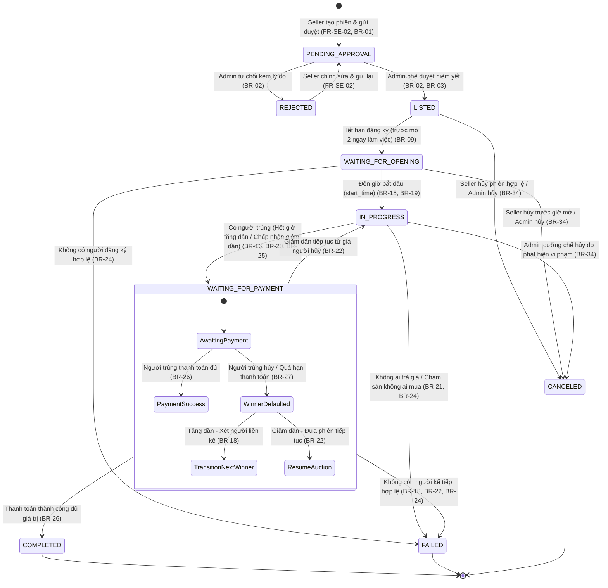
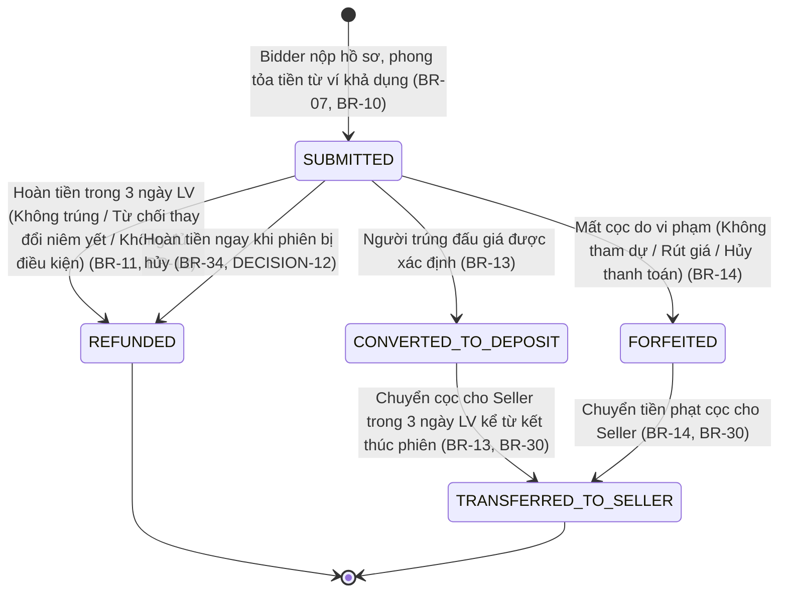
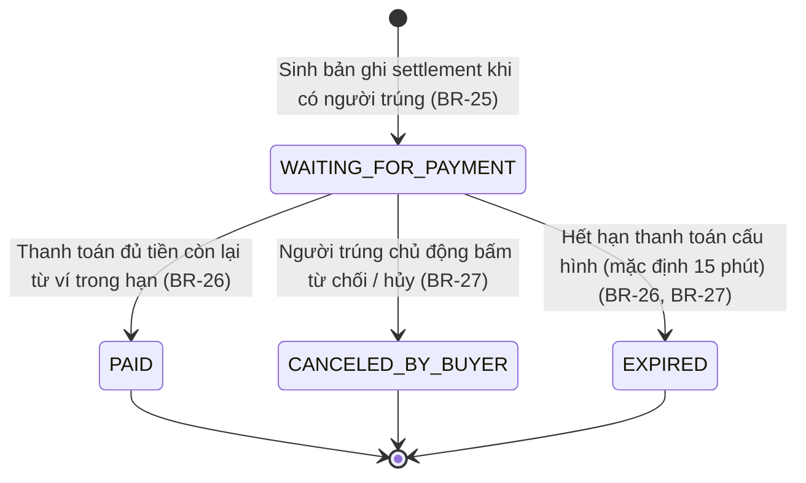
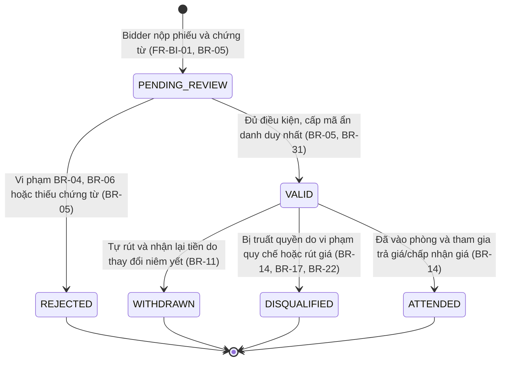
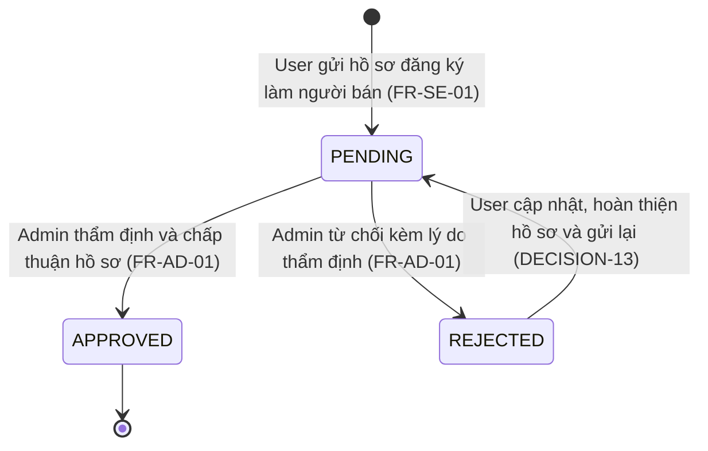
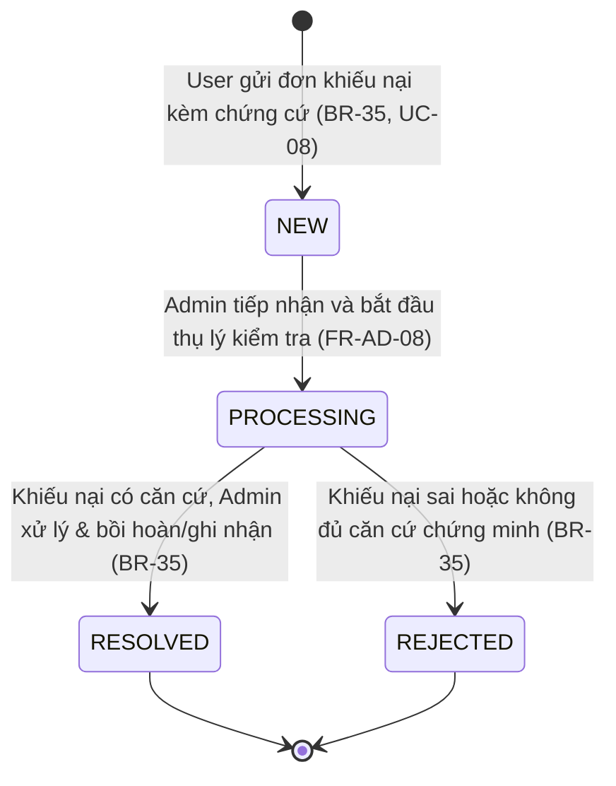

# 🔄 TÀI LIỆU SƠ ĐỒ CHUYỂN TRẠNG THÁI (STATE MACHINES)

> **Dự án:** Hệ Thống Đấu Giá Trực Tuyến (Online Auction System)  
> **Căn cứ:** docs/SRS.md (Mục 4, 5, 8), docs/ERD.md, docs/PLAN.md (Ngày 2)  
> **Nguyên tắc bất biến:** Duy nhất `AuctionStateMachine` được quyền chuyển trạng thái phiên đấu giá; mọi chuyển đổi trạng thái phải được ghi nhận vào `audit_logs`.

---

## 1. MÁY TRẠNG THÁI PHIÊN ĐẤU GIÁ (`AuctionStateMachine`)

Phiên đấu giá tuân thủ nghiêm ngặt 9 trạng thái định nghĩa tại SRS Mục 5.1 và ma trận chuyển trạng thái tại Mục 5.2.

### 1.1. Sơ đồ trạng thái Mermaid

### 1.2. Bảng định nghĩa Enum & Ma trận chuyển trạng thái phiên

| Enum (`VARCHAR(30)`) | Nhãn tiếng Việt | Trạng thái tiếp theo có thể | Sự kiện kích hoạt (Event) | Tác nhân (Trigger Actor) | Mã BR / SRS |
| :--- | :--- | :--- | :--- | :--- | :--- |
| `PENDING_APPROVAL` | Chờ duyệt | `LISTED`, `REJECTED` | Gửi duyệt thông số phiên | Seller | FR-SE-02, BR-01 |
| `REJECTED` | Bị từ chối | `PENDING_APPROVAL` | Admin từ chối phê duyệt | Admin | BR-02 |
| `LISTED` | Đã niêm yết | `WAITING_FOR_OPENING`, `CANCELED` | Admin duyệt niêm yết công khai | Admin | BR-02, BR-03 |
| `WAITING_FOR_OPENING` | Chờ mở phiên | `IN_PROGRESS`, `FAILED`, `CANCELED` | Đóng nhận đăng ký (trước mở 2 ngày LV) | **Scheduler** | BR-09, BR-24 |
| `IN_PROGRESS` | Đang diễn ra | `WAITING_FOR_PAYMENT`, `FAILED`, `CANCELED` | Đến giờ mở phiên (`start_time`) | **Scheduler** | BR-15, BR-19 |
| `WAITING_FOR_PAYMENT` | Chờ thanh toán | `COMPLETED`, `IN_PROGRESS`, `FAILED` | Xác định người trúng (hết giờ / chốt giá) | **Scheduler** / Bidder | BR-20, BR-25 |
| `COMPLETED` | Hoàn tất | *(Trạng thái kết thúc)* | Người trúng thanh toán đủ số tiền | Bidder | BR-26, BR-28 |
| `FAILED` | Không thành | *(Trạng thái kết thúc)* | Không đủ người / Không trả giá / Hết quyền | **Scheduler** | BR-18, BR-21, BR-24 |
| `CANCELED` | Đã hủy | *(Trạng thái kết thúc)* | Seller hủy trước giờ mở / Admin hủy | Seller / Admin | BR-34 |

---

## 2. MÁY TRẠNG THÁI TIỀN ĐẶT TRƯỚC (`DepositStateMachine`)

Quản lý tiền ký quỹ từ lúc phong tỏa trong ví người dùng đến khi hoàn trả hoặc chuyển thành tiền cọc cho người bán (SRS Mục 5.3).

### 2.1. Sơ đồ trạng thái Mermaid

### 2.2. Bảng định nghĩa Enum & Ma trận chuyển trạng thái tiền đặt trước

| Enum (`VARCHAR(30)`) | Nhãn tiếng Việt | Trạng thái tiếp theo có thể | Sự kiện kích hoạt | Tác nhân (Trigger) | Mã BR liên quan |
| :--- | :--- | :--- | :--- | :--- | :--- |
| `SUBMITTED` | Đã nộp (Phong tỏa) | `REFUNDED`, `CONVERTED_TO_DEPOSIT`, `FORFEITED` | Nộp hồ sơ đăng ký tham gia | Bidder | BR-07, BR-10 |
| `REFUNDED` | Đã hoàn trả | *(Trạng thái cuối)* | Hoàn trả tiền vào ví khả dụng | **Scheduler** / Admin | BR-11, BR-12, BR-34 |
| `CONVERTED_TO_DEPOSIT` | Chuyển thành cọc | `TRANSFERRED_TO_SELLER` | Xác định trúng đấu giá chính thức | Hệ thống / Scheduler | BR-13, BR-25 |
| `FORFEITED` | Bị giữ (Mất cọc) | `TRANSFERRED_TO_SELLER` | Vi phạm quy chế / Hủy thanh toán | Hệ thống / Admin | BR-14, BR-17, BR-27 |
| `TRANSFERRED_TO_SELLER` | Đã chuyển cho Seller | *(Trạng thái cuối)* | Chuyển tiền từ ví ký quỹ sang ví Seller | **Scheduler** / Admin | BR-13, BR-14, BR-30 |

---

## 3. MÁY TRẠNG THÁI THANH TOÁN KẾT QUẢ TRÚNG (`SettlementStateMachine`)

Quản lý chu trình thanh toán nghĩa vụ tài chính của người trúng đấu giá (SRS BR-25, BR-26, BR-27).

### 3.1. Sơ đồ trạng thái Mermaid

### 3.2. Bảng định nghĩa Enum & Ma trận Settlement

| Enum (`VARCHAR(30)`) | Nhãn tiếng Việt | Trạng thái tiếp theo | Sự kiện kích hoạt | Tác nhân | Mã BR |
| :--- | :--- | :--- | :--- | :--- | :--- |
| `WAITING_FOR_PAYMENT` | Chờ thanh toán | `PAID`, `CANCELED_BY_BUYER`, `EXPIRED` | Xác định người trúng đấu giá | Hệ thống | BR-25, BR-26 |
| `PAID` | Đã thanh toán | *(Trạng thái cuối)* | Trừ tiền thành công từ ví người trúng | Bidder | BR-26 |
| `CANCELED_BY_BUYER` | Người trúng hủy | *(Trạng thái cuối)* | Người trúng chủ động từ chối kết quả | Bidder | BR-27, BR-14 |
| `EXPIRED` | Quá hạn thanh toán | *(Trạng thái cuối)* | Đồng hồ đếm ngược thanh toán về 0 | **Scheduler** | BR-26, BR-27 |

---

## 4. MÁY TRẠNG THÁI HỒ SƠ ĐĂNG KÝ THAM GIA (`RegistrationStateMachine`)

Quản lý hồ sơ thẩm định tư cách người tham gia đấu giá của từng phiên (SRS BR-04, BR-05, BR-06).

### 4.1. Sơ đồ trạng thái Mermaid

### 4.2. Bảng định nghĩa Enum & Ma trận Registration

| Enum (`VARCHAR(30)`) | Nhãn tiếng Việt | Trạng thái tiếp theo | Sự kiện kích hoạt | Tác nhân | Mã BR |
| :--- | :--- | :--- | :--- | :--- | :--- |
| `PENDING_REVIEW` | Chờ xét duyệt | `VALID`, `REJECTED` | Nộp hồ sơ và phong tỏa tiền cọc | Bidder | FR-BI-01, BR-05 |
| `VALID` | Hợp lệ (Đã duyệt) | `WITHDRAWN`, `DISQUALIFIED`, `ATTENDED` | Admin duyệt hồ sơ trước mở phiên 1 ngày | Admin / Hệ thống | BR-05, BR-31 |
| `REJECTED` | Bị từ chối | *(Trạng thái cuối)* | Không đáp ứng điều kiện pháp lý | Admin | BR-04, BR-05 |
| `WITHDRAWN` | Đã rút đăng ký | *(Trạng thái cuối)* | Từ chối tiếp tục khi có thay đổi niêm yết | Bidder | BR-11 |
| `DISQUALIFIED` | Bị truất quyền | *(Trạng thái cuối)* | Rút lại giá, thông đồng, gian lận | Hệ thống / Admin | BR-14, BR-17, BR-22 |
| `ATTENDED` | Đã tham dự phiên | *(Trạng thái cuối)* | Điểm danh / gửi lệnh hợp lệ trong phiên | Hệ thống | BR-14 |

---

## 5. MÁY TRẠNG THÁI HỒ SƠ NGƯỜI BÁN (`SellerProfileStateMachine`)

Quản lý quy trình đăng ký và xét duyệt nâng cấp tài khoản Seller (FR-SE-01, FR-AD-01).

### 5.1. Sơ đồ trạng thái Mermaid

### 5.2. Bảng định nghĩa Enum & Ma trận SellerProfile

| Enum (`VARCHAR(30)`) | Nhãn tiếng Việt | Trạng thái tiếp theo | Sự kiện kích hoạt | Tác nhân | Mã SRS |
| :--- | :--- | :--- | :--- | :--- | :--- |
| `PENDING` | Chờ xét duyệt | `APPROVED`, `REJECTED` | Gửi đơn đăng ký đối tác người bán | User | FR-SE-01 |
| `APPROVED` | Đã phê duyệt | *(Có quyền đăng tài sản)* | Admin xác nhận hồ sơ đầy đủ pháp lý | Admin | FR-AD-01 |
| `REJECTED` | Bị từ chối | `PENDING` | Admin từ chối do thiếu giấy tờ/năng lực | Admin | FR-AD-01, DECISION-13 |

---

## 6. MÁY TRẠNG THÁI TIẾP NHẬN & XỬ LÝ KHIẾU NẠI (`ComplaintStateMachine`)

Quản lý khiếu nại của người tham gia đấu giá (SRS BR-35, UC-08).

### 6.1. Sơ đồ trạng thái Mermaid

### 6.2. Bảng định nghĩa Enum & Ma trận Complaint

| Enum (`VARCHAR(30)`) | Nhãn tiếng Việt | Trạng thái tiếp theo | Sự kiện kích hoạt | Tác nhân | Mã SRS / BR |
| :--- | :--- | :--- | :--- | :--- | :--- |
| `NEW` | Mới tiếp nhận | `PROCESSING` | Người dùng gửi đơn khiếu nại | User | BR-35, UC-08 |
| `PROCESSING` | Đang xử lý | `RESOLVED`, `REJECTED` | Admin mở hồ sơ khiếu nại kiểm tra | Admin | FR-AD-08 |
| `RESOLVED` | Đã xử lý | *(Trạng thái cuối)* | Admin giải quyết thỏa đáng, phản hồi | Admin | BR-35 |
| `REJECTED` | Bị từ chối | *(Trạng thái cuối)* | Bác bỏ khiếu nại kèm lý do | Admin | BR-35 |

---

## 7. ĐIỂM CẦN LƯU Ý KHI HIỆN THỰC HÓA CODE

1. **Khóa logic trạng thái (Thread-safe & Concurrency):**
   - Sự kiện chuyển từ `IN_PROGRESS` $\rightarrow$ `WAITING_FOR_PAYMENT` hoặc `FAILED` phải sử dụng cơ chế Khóa bi quan (`Pessimistic Write Lock`) hoặc Khóa lạc quan (`@Version`) trên thực thể `auctions` để tránh xung đột giữa bộ đếm thời gian của Scheduler và lệnh chấp nhận giá thời gian thực từ Bidder.
2. **Nguyên tắc phân định quyền hạn:**
   - Client Web tuyệt đối không bao giờ được gửi chuỗi trạng thái (`status`) lên Backend. Mọi API chỉ nhận sự kiện nghiệp vụ (ví dụ: `POST /api/auctions/{id}/bids`, `POST /api/settlements/{id}/pay`). Backend Service kiểm tra điều kiện hiện tại, thực thi và chuyển trạng thái nội bộ.
