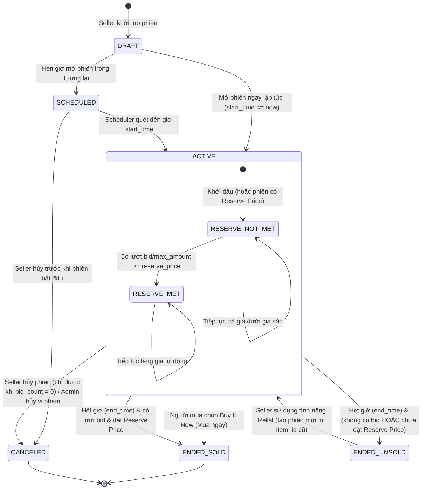
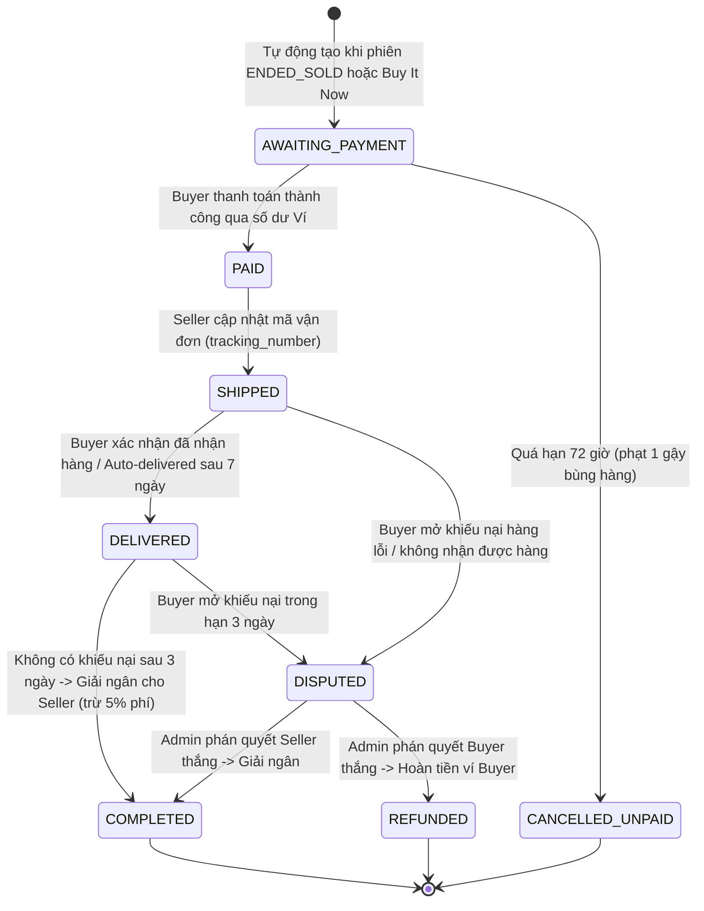
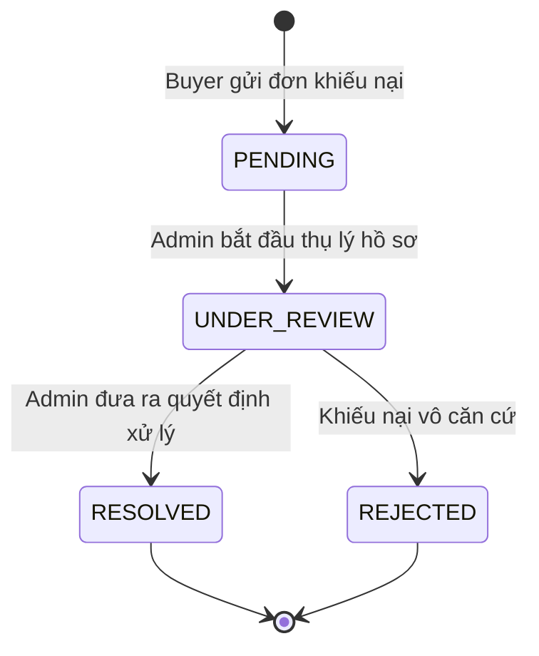
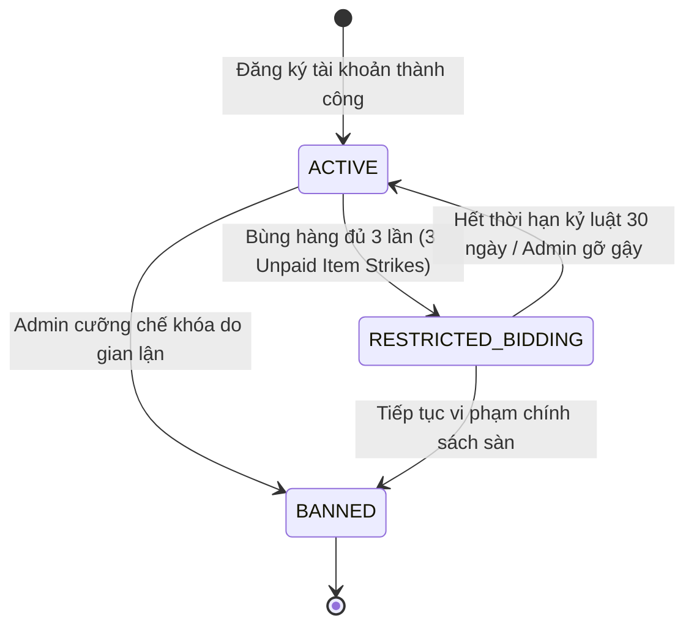

# 🔄 TÀI LIỆU SƠ ĐỒ CHUYỂN TRẠNG THÁI (STATE MACHINES)

> **Dự án:** Hệ Thống Đấu Giá Trực Tuyến (Cơ chế Đấu giá Tự động)  
> **Căn cứ:** `docs/SRS.md`, `docs/ERD.md`, `docs/PLAN.md` (Ngày 2)  
> **Nguyên tắc cốt lõi:** Duy nhất các State Machine và Service chuyên biệt được chuyển đổi trạng thái thực thể; mọi biến động phải tuân theo luồng hợp lệ.

---

## 1. MÁY TRẠNG THÁI PHIÊN ĐẤU GIÁ (`AuctionStateMachine`)

Vòng đời của một phiên đấu giá trong bảng `auctions` gồm các trạng thái:
- `DRAFT`: Bản nháp chưa công bố.
- `SCHEDULED`: Đã lên lịch, chờ đến giờ `start_time`.
- `ACTIVE`: Đang mở cho người dùng trả giá (phân nhánh logic `is_reserve_met = false/true`).
- `ENDED_SOLD`: Kết thúc thành công (đã có người thắng thỏa mãn điều kiện giá).
- `ENDED_UNSOLD`: Kết thúc không thành công (không có ai bid hoặc không đạt giá sàn).
- `CANCELED`: Phiên bị người bán hủy (khi chưa có lượt bid nào) hoặc bị Admin cưỡng chế hủy.

### 1.1. Sơ đồ Mermaid `AuctionStateMachine`

---

## 2. MÁY TRẠNG THÁI ĐƠN HÀNG (`OrderStateMachine`)

Vòng đời đơn hàng trong bảng `orders` sau khi chốt người thắng phiên đấu giá hoặc Buy It Now:
- `AWAITING_PAYMENT`: Chờ người mua thanh toán tiền hàng (hạn 72 giờ).
- `PAID`: Đã thanh toán tiền hàng qua Ví (tiền được tạm giữ an toàn trong ví Escrow).
- `SHIPPED`: Người bán đã bàn giao hàng cho đơn vị vận chuyển và cập nhật mã vận đơn (`tracking_number`).
- `DELIVERED`: Người mua đã nhận được hàng hoặc hệ thống tự động xác nhận sau 7 ngày.
- `COMPLETED`: Đơn hàng hoàn tất, giải ngân tiền cho Seller (trừ phí sàn 5%).
- `CANCELLED_UNPAID`: Quá hạn 72 giờ không thanh toán, người mua bị phạt 1 gậy (Unpaid Item Strike).
- `DISPUTED`: Đơn hàng bị khiếu nại (Item not received / Item not as described).
- `REFUNDED`: Giải quyết khiếu nại chấp thuận hoàn tiền cho Buyer.

### 2.1. Sơ đồ Mermaid `OrderStateMachine`

---

## 3. MÁY TRẠNG THÁI GIAO DỊCH VÍ (`WalletTransactionStateMachine`)

Bảng `transactions` là nhật ký bất biến (Append-only) ghi nhận biến động số dư ví:
- `TOPUP`: Nạp tiền vào ví người dùng (tăng `available_balance`).
- `WITHDRAW`: Rút tiền từ ví về tài khoản ngân hàng (giảm `available_balance`).
- `PAYMENT`: Thanh toán tiền đơn hàng trúng đấu giá (giảm ví Buyer, chuyển tiền vào ví bảo chứng).
- `PAYOUT`: Giải ngân tiền bán hàng (cộng vào ví Seller sau khi trừ phí).
- `SERVICE_FEE`: Thu phí hoa hồng sàn 5% (cộng vào ví `SYSTEM_REVENUE`).
- `REFUND`: Hoàn tiền đơn hàng bị hủy hoặc khiếu nại (cộng lại ví Buyer).

---

## 4. MÁY TRẠNG THÁI KHIẾU NẠI (`ComplaintStateMachine`)

Vòng đời khiếu nại trong bảng `complaints`:
- `PENDING`: Người mua gửi khiếu nại kèm chứng cứ hình ảnh.
- `UNDER_REVIEW`: Admin đang tiếp nhận và đối chất 2 bên.
- `RESOLVED`: Khiếu nại được giải quyết (hoàn tiền hoặc giải ngân).
- `REJECTED`: Admin bác bỏ khiếu nại do không đủ chứng cứ.

---

## 5. MÁY TRẠNG THÁI NGƯỜI DÙNG (`UserStatusStateMachine`)

Vòng đời trạng thái người dùng trong bảng `users`:
- `ACTIVE`: Tài khoản hoạt động bình thường, được quyền mua và bán.
- `RESTRICTED_BIDDING`: Tích lũy 3 gậy bùng hàng (`unpaid_strikes_count >= 3`), bị cấm tham gia đặt giá trong 30 ngày.
- `BANNED`: Vi phạm nghiêm trọng gian lận hoặc lừa đảo, bị Admin khóa vĩnh viễn.

